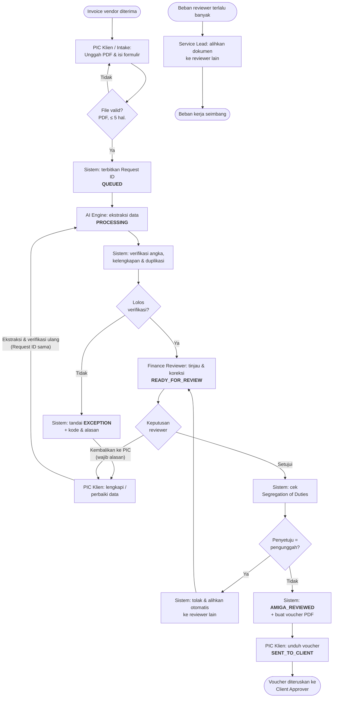

# AMIGA Robot Admin — Intelligent Vendor Invoice-to-Voucher Processing

Proof of Concept untuk **MAIN Hackathon 2026** oleh **Kelompok 11 (TEAM 11 MAIN)**.

AMIGA Robot Admin mengubah invoice vendor (PDF) menjadi voucher pembayaran resmi dalam hitungan detik. **AI hanya membaca invoice.** Sistem yang memverifikasi angka, kelengkapan, dan duplikasi, lalu **Finance Reviewer** menyetujui sebelum voucher diserahkan ke klien.

> **Dokumen acuan** (folder [`readme/`](readme/)):
> - [BRD AMIGA Robot Admin v1.1](readme/BRD_AMIGA_Robot_Admin_v1.1.docx)
> - [PRD AMIGA Robot Admin v2](<readme/PRD — AMIGA Robot Admin(v2).pdf>) (versi PRD 1.1)
> - [BPMN Invoice-to-Voucher (revisi)](readme/AMIGA_Robot_Admin_Invoice_to_Voucher.bpmn)
> - [SOP-AMIGA-FIN-001 v1.1](docs/sop.md)
>
> Bila README ini berbeda dengan dokumen acuan, **dokumen acuan yang berlaku**. Bagian [Keputusan desain](#keputusan-desain) mencatat hal yang belum diatur dokumen acuan.

---

## Daftar isi

1. [Masalah dan tujuan](#masalah-dan-tujuan)
2. [Alur dokumen (BPMN)](#alur-dokumen-bpmn)
3. [Peran dan hak akses](#peran-dan-hak-akses)
4. [Fitur dan status pengerjaan](#fitur-dan-status-pengerjaan)
5. [Skenario uji penerimaan (UAT)](#skenario-uji-penerimaan-uat)
6. [Arsitektur](#arsitektur)
7. [Menjalankan project](#menjalankan-project)
8. [Endpoint API](#endpoint-api)
9. [Keputusan desain](#keputusan-desain)
10. [Pertanyaan terbuka](#pertanyaan-terbuka)
11. [Di luar cakupan PoC](#di-luar-cakupan-poc)

---

## Masalah dan tujuan

| Masalah saat ini | Tujuan produk |
| --- | --- |
| Input ulang manual 5–10 menit per invoice, penyusunan voucher 5–15 menit | Data invoice terisi otomatis oleh AI |
| Salah ketik nominal atau nomor rekening, salah hitung total, risiko pembayaran ganda | Kesalahan tertangkap sebelum pembayaran: cek hitungan, kelengkapan, dan duplikasi |
| Riwayat perubahan dan persetujuan tidak tercatat | Pengunggah tidak bisa menyetujui dokumennya sendiri, dan semua perubahan tercatat permanen |

### Target metrik PoC

| Metrik | Target |
| --- | --- |
| Waktu ekstraksi per invoice (≤ 5 halaman) | ≤ 15 detik |
| Waktu muat antrean dan layar review | ≤ 2 detik |
| Waktu pembuatan voucher | ≤ 3 detik |
| Line items terbaca dan total benar | 100% di skenario uji |
| Duplikat yang lolos tanpa tanda | 0 |
| Pelanggaran SoD dan akses lintas klien | 0 |
| Perubahan data tercatat di jejak audit | 100% |

---

## Alur dokumen (BPMN)

Setiap invoice melewati **6 status** dengan **3 titik keputusan**: verifikasi sistem, keputusan reviewer, dan cek Segregation of Duties.



Catatan alur:

- **AI Engine hanya mengekstrak.** Verifikasi, cek SoD, dan pembuatan voucher dilakukan **Sistem**.
- EXCEPTION bisa datang dari verifikasi sistem atau dari reviewer yang mengembalikan dokumen. Setelah PIC memperbaiki, dokumen kembali ke ekstraksi dengan **Request ID yang sama**.
- Pengalihan oleh **Service Lead** terpisah dari alur SoD. Pengalihan ini hanya untuk pemerataan beban, dan status dokumen tidak berubah.
- Persetujuan dan pembayaran oleh **Client Approver** terjadi di luar sistem.
- Setiap aktivitas, perubahan data (nilai awal → nilai baru), penolakan, dan pengalihan dicatat permanen di **jejak audit**.

### Aturan verifikasi (dijalankan sistem)

| Aturan | Kode | Kapan muncul | Akibat |
| --- | --- | --- | --- |
| Kelengkapan | `MISSING_EVIDENCE` | Data wajib tidak ditemukan, misalnya nomor rekening | EXCEPTION |
| Angka / perhitungan | `CALCULATION_DISCREPANCY` | Jumlah subtotal line items ≠ total invoice | EXCEPTION |
| Duplikasi | `POSSIBLE_DUPLICATE` | Ada invoice lain dengan nomor invoice dan vendor yang sama | EXCEPTION |
| Dikembalikan reviewer | `RETURNED_BY_REVIEWER` | Finance Reviewer memilih "Kembalikan ke PIC" | EXCEPTION |
| Bukan invoice | `NOT_AN_INVOICE` | AI (berperan sebagai Invoice Verification Officer) menilai PDF bukan invoice/tagihan, mis. surat, PO, atau bukti transfer. Kendala data lain tidak ditampilkan | EXCEPTION |
| Vendor/rekening berbeda | `VENDOR_MISMATCH` | Beberapa invoice dalam satu pengajuan punya vendor atau rekening tujuan berbeda | EXCEPTION |

Nomor invoice dan nama vendor **dinormalisasi** sebelum dibandingkan (huruf kecil, tanpa spasi dan tanda baca), sehingga `INV-001` dan `inv 001` tetap terdeteksi sebagai duplikat.

---

## Peran dan hak akses

Ada 6 peran internal, ditambah **Sistem** dan **AI Engine** sebagai pelaku otomatis. **Setiap aksi diperiksa di server**, bukan hanya disembunyikan di tampilan.

| Aksi | PIC Klien | Intake Support | Finance Reviewer | Service Lead | System Admin |
| --- | --- | --- | --- | --- | --- |
| Unggah invoice dan isi formulir | Ya | Ya (klien yang didelegasikan) | Tidak | Tidak | Tidak |
| Lihat status, kode, dan alasan EXCEPTION | Ya (klien sendiri) | Ya (klien ditugaskan) | Ya | Ya | Tidak |
| Lengkapi / perbaiki data invoice | Ya | Ya (klien ditugaskan) | Tidak | Tidak | Tidak |
| Koreksi data hasil ekstraksi | Tidak | Tidak | Ya | Tidak | Tidak |
| Setujui atau kembalikan ke PIC | Tidak | Tidak | Ya, kecuali unggahan sendiri | Tidak | Tidak |
| Unduh voucher PDF | Ya | Ya | Ya | Tidak | Tidak |
| Alihkan dokumen ke reviewer lain (atur beban) | Tidak | Tidak | Tidak | Ya | Tidak |
| Kelola akun, peran, penugasan klien | Tidak | Tidak | Tidak | Tidak | Ya |
| Lihat riwayat dan jejak audit | Ya (klien sendiri) | Ya (klien ditugaskan) | Ya | Ya | Ya |
| Asisten AI di dashboard | Tidak | Tidak | Ya | Ya | Ya (SOP saja) |

**Peran ganda.** Satu pengguna boleh memiliki lebih dari satu peran internal, misalnya Intake Support sekaligus Finance Reviewer. Kombinasi yang **dilarang**: PIC Klien dengan peran internal mana pun, dan System Admin dengan Finance Reviewer. System Admin tidak boleh memberi peran kepada dirinya sendiri.

**Segregation of Duties.** Pengguna tidak boleh menyetujui dokumen yang ia unggah sendiri, termasuk dokumen yang diunggah atas namanya. Sistem menolak persetujuan dan **otomatis mengalihkan** dokumen ke reviewer lain dengan antrean tertunda paling sedikit.

**Isolasi klien.** Pengguna hanya bisa membuka dokumen klien yang ditugaskan kepadanya. Akses ke dokumen klien lain ditolak dan dicatat.

---

## Fitur dan status pengerjaan

Keterangan: ✅ selesai · 🔄 sebagian · ⏳ belum dikerjakan

| Fitur (PRD §4) | Prioritas | Status | Keterangan |
| --- | --- | --- | --- |
| F1. Unggah invoice dan antrean | P0 | ✅ | `POST /documents`: PDF ≤ 5 halaman, field wajib termasuk saluran, Request ID, QUEUED, unggah atas nama PIC oleh Intake Support |
| F2. Ekstraksi AI | P0 | ✅ | Nova Lite membaca PDF langsung (2–4 detik per invoice dummy). Gagal baca → dokumen tetap tersimpan, Finance Reviewer bisa proses ulang. Ekstraksi ulang memakai Request ID sama |
| F3. Verifikasi otomatis oleh sistem | P0 | ✅ | Kelengkapan, angka, duplikasi (dinormalisasi). Kode + alasan berbahasa sederhana. Perbaikan PIC didahulukan atas hasil AI |
| F4. Peninjauan oleh Finance Reviewer | P0 | ✅ | Koreksi data + verifikasi ulang, Setujui (kendala terbuka menahan persetujuan), Kembalikan ke PIC dengan alasan, cek SoD + pengalihan otomatis, tandai bukan duplikat |
| F5. Voucher PDF dan serah terima | P0 | ✅ | Voucher PDF (fpdf2) < 1 detik dengan teks batas otorisasi tercetak; unduhan pihak klien → SENT_TO_CLIENT |
| F6. Dashboard antrean | P1 | ✅ | `GET /dashboard/summary` (per status, bermasalah, tenggat, beban reviewer), filter di `GET /documents`, pengalihan oleh Service Lead |
| F7. Hak akses dan isolasi klien | P0 | ✅ | Login JWT, peran ganda (tabel `user_roles`), cek peran di server, isolasi klien (ditolak + dicatat), API System Admin. Delegasi oleh PIC Klien dibangun bersama unggah (Tahap 4) |
| F8. Jejak audit | P0 | ✅ | `audit_logs` **append-only** (trigger database). Mencatat unggah, perubahan status, ekstraksi, perbaikan PIC, koreksi reviewer (nilai awal → baru), persetujuan, pengembalian, penolakan SoD, pengalihan, voucher, unduhan, aksi admin, akses ditolak. `GET /documents/{id}/history` |
| Asisten AI (SOP) | Tambahan | ✅ | `POST /ask`: menjawab dari SOP dengan sumber dan riwayat percakapan |
| Asisten AI Agent (memori tanya-jawab) | Tambahan | ✅ | `POST /ask-agent`: memakai tanya-jawab lama yang mirip sebagai referensi, dengan 👍/👎 |
| Asisten AI Agent (data antrean) | Tambahan | ✅ | `/ask-agent` menjawab pertanyaan antrean dari data sistem, hanya klien yang ditugaskan; System Admin SOP saja |
| Frontend (5 layar) | P0 | ✅ | React + Vite + TypeScript: login, Dashboard Antrean, Unggah & Pengajuan, Peninjauan split-screen, Voucher, Riwayat, layar System Admin, tombol chat Asisten |
| Dashboard metrik | Owner | ✅ | KPI per status, tren harian (line chart), kecepatan proses, kualitas & kendala, nilai pembayaran; dibanding periode sebelumnya (`GET /dashboard/metrics`) |
| Data referensi vendor | Owner | ✅ | PIC Klien/Intake mendaftarkan vendor (NPWP, alamat, kontak, rekening) per klien; nama dinormalisasi agar tidak dobel; dipakai sebagai dropdown di filter & formulir; dokumen tertaut otomatis |
| Penanda tangan voucher | Owner | ✅ | "Diajukan oleh" = perusahaan klien yang dipilih saat unggah; PIC Klien mendaftarkan pemberi persetujuan "Disetujui oleh" (1 kotak default, bisa ditambah hingga 5 per dokumen); dicetak sebagai kotak tanda tangan di voucher (tanpa kotak AMIGA; persetujuan reviewer tercatat di jejak audit) |
| Manajemen voucher | Owner | ✅ | Tabel voucher dengan filter perusahaan, vendor, status, tanggal; dikelompokkan dengan subtotal; unduh CSV |

### Rencana tahap berikutnya

| Tahap | Isi |
| --- | --- |
| 3 ✅ | Login, peran ganda, isolasi klien, API System Admin (aturan SoD saat menyetujui dibangun di Tahap 5) |
| 4 ✅ | F1–F3: unggah, ekstraksi AI, verifikasi (termasuk ekstraksi ulang dengan Request ID sama) |
| 5 ✅ | F4, F5, F8: layar review, setujui/kembalikan, cek SoD + pengalihan otomatis, voucher PDF, pencatatan audit |
| 6 ✅ | Asisten AI membaca data antrean (sesuai hak akses), F6 dashboard |
| 7 ✅ | Frontend 5 layar + tombol chat asisten |
| 8 🔄 | UAT 8 skenario ✅ (Cypress E2E), lalu Demo Day |

---

## Skenario uji penerimaan (UAT)

PoC dinyatakan siap demo bila **8 skenario** di bawah lulus semua dan target waktu tercapai (PRD §8).

| No | Skenario | Langkah | Hasil yang diharapkan | Status |
| --- | --- | --- | --- | --- |
| 1 | Alur normal | Unggah → ekstraksi → lolos verifikasi → disetujui | Voucher terunduh, status SENT_TO_CLIENT | ✅ lulus E2E (Cypress) |
| 2 | Multi-line item | Invoice dengan ≥ 3 jenis barang | Semua baris terbaca, total benar | ✅ lulus E2E (Cypress) |
| 3 | Missing evidence | Invoice tanpa nomor rekening | MISSING_EVIDENCE, status EXCEPTION | ✅ lulus E2E (Cypress) |
| 4 | Duplikasi | Nomor dan vendor sama dengan invoice sebelumnya | POSSIBLE_DUPLICATE | ✅ lulus E2E (Cypress) |
| 5 | Segregation of Duties | User A unggah, lalu User A coba menyetujui | Ditolak sistem, dokumen otomatis dialihkan ke reviewer lain | ✅ lulus E2E (Cypress) |
| 6 | Isolasi klien | User klien A membuka dokumen klien B | Akses ditolak | ✅ lulus E2E (Cypress) |
| 7 | Jejak audit | Reviewer mengubah nominal | Tercatat nilai awal, nilai baru, nama, waktu | ✅ lulus E2E (Cypress) |
| 8 | Perbaikan setelah EXCEPTION | PIC melengkapi nomor rekening pada dokumen MISSING_EVIDENCE | Kembali ke ekstraksi dengan Request ID sama, diverifikasi ulang, lalu READY_FOR_REVIEW | ✅ lulus E2E (Cypress) |

Aturan `CALCULATION_DISCREPANCY` tidak lagi punya skenario UAT tersendiri di PRD v2, tetapi tetap diuji dengan test otomatis.

**Invoice dummy untuk UAT** ada di [`samples/invoices/`](samples/invoices/) (semua data fiktif), dibuat ulang dengan `backend/.venv/bin/python backend/scripts/make_dummy_invoices.py`:

| File | Untuk | Hasil yang diharapkan |
| --- | --- | --- |
| `01_normal_3_baris.pdf` | UAT 1, 2 | READY_FOR_REVIEW, 3 baris terbaca |
| `02_tanpa_rekening.pdf` | UAT 3, 8 | MISSING_EVIDENCE (nomor rekening) |
| `03_duplikat_dari_01.pdf` | UAT 4 (unggah setelah 01, klien sama) | POSSIBLE_DUPLICATE |
| `04_selisih_total.pdf` | Aturan angka | CALCULATION_DISCREPANCY |
| `05_normal_jasa.pdf` | UAT 5, 7 | READY_FOR_REVIEW |

---

## Arsitektur

| Bagian | Teknologi |
| --- | --- |
| Backend | Python, FastAPI, SQLAlchemy, Alembic |
| Database | PostgreSQL |
| Frontend | React 19 + Vite 8 + TypeScript, React Router, ikon lucide-react |
| AI (menjawab, nantinya ekstraksi) | Amazon Bedrock — **Amazon Nova Lite** (`ap-southeast-1`) |
| Embedding Asisten SOP | Amazon Bedrock — **Titan Text Embeddings v2** (`us-east-1`) |
| Pencarian dokumen Asisten SOP | FAISS (index disimpan di `backend/data/`) |
| Testing | pytest (unit & API), Cypress (8 skenario UAT end-to-end) |

Semua library dan tools yang dipakai bersifat **open source**. Satu-satunya layanan berbayar adalah Amazon Bedrock.

**Kenapa Nova dan Titan di `us-east-1`?** Hasil pengujian di akun AWS kelas pada 13/10/2026:

- `amazon.titan-text-express-v1` sudah **end of life** di semua region, sehingga diganti **Nova Lite**.
- Titan Embeddings **tidak tersedia** di `ap-southeast-1`, tetapi bisa dipanggil di `us-east-1`.
- Model Claude belum diaktifkan dan Cohere embedding tidak diizinkan untuk akun siswa.

Model bisa diganti tanpa mengubah kode lewat `LLM_MODEL`, `EMBED_MODEL`, dan `EMBED_REGION` di `.env`. Setelah mengganti model embedding, jalankan `POST /reindex`.

### Struktur folder

```
.
├── README.md
├── readme/                     # Dokumen acuan: BRD v1.1, PRD v2, BPMN revisi
├── docs/
│   └── sop.md                  # SOP v1.1 — juga sumber pengetahuan Asisten SOP
├── samples/invoices/           # Invoice PDF dummy untuk UAT
├── scripts/run_e2e.sh          # Menjalankan 8 skenario UAT (Cypress) end-to-end
├── frontend/                   # React + Vite (lihat "Menjalankan frontend")
│   └── src/
│       ├── pages/              # Login, Queue (01), Upload + Lists (02), DocumentPage (03), VoucherPage (04), HistoryPage (05), Admin
│       ├── components/         # Layout + sidebar per peran, Asisten, tabel dokumen, modal, penampil PDF
│       ├── api.ts, auth.tsx    # Klien API (token di localStorage) dan konteks login
│       └── styles.css          # Token desain: navy, teal, Inter
└── backend/
    ├── app/
    │   ├── main.py             # Entry point FastAPI
    │   ├── config.py           # Pengaturan dari .env
    │   ├── db.py, models.py    # Koneksi dan model database
    │   ├── security.py         # Hash password
    │   ├── auth.py             # Token JWT, cek peran & isolasi klien (dependency FastAPI)
    │   ├── routers/            # health, auth, clients, documents, admin, ask, ask_agent, reindex, database
    │   ├── schemas/            # Model request/response
    │   └── services/           # Ekstraksi AI, verifikasi, proses dokumen, pemilihan reviewer, penyimpanan file,
    │                           # aturan akses, jejak audit, Bedrock, RAG (loader, chunker, FAISS, indexing), riwayat, memori
    ├── alembic/                # Migrasi database
    ├── scripts/                # create_db.sh, make_dummy_invoices.py, e2e_server.sh (backend E2E :8001)
    ├── seed.py                 # Data dummy: 2 klien, 8 pengguna
    ├── tests/                  # pytest
    ├── requirements.txt
    └── .env.example
```

---

## Menjalankan project

### Prasyarat

- Python 3.12+ (dikembangkan dengan 3.14)
- PostgreSQL 13+ (dikembangkan dengan 18) yang berjalan di `localhost:5432`
- Akun AWS dengan akses Amazon Bedrock (Nova Lite dan Titan Embeddings v2)

### Langkah setup

```bash
cd backend

# 1. Virtualenv dan dependensi
python3 -m venv .venv
.venv/bin/pip install -r requirements.txt

# 2. Konfigurasi: salin lalu isi nilainya (kredensial AWS milik masing-masing)
cp .env.example .env

# 3. Buat role & database PostgreSQL sesuai DATABASE_URL di .env (meminta password sudo)
bash scripts/create_db.sh

# 4. Buat tabel dan isi data dummy
.venv/bin/alembic upgrade head
.venv/bin/python seed.py

# 5. Jalankan server
.venv/bin/uvicorn app.main:app --reload --port 8000
```

Buka <http://localhost:8000/docs> untuk mencoba endpoint dari browser. Saat pertama dijalankan, server membangun index Asisten SOP dari `docs/sop.md` (sekitar 10 detik).

> ⚠️ **Jangan commit atau membagikan `.env`.** File ini sudah ada di `.gitignore`. Jangan membuka `.env` saat berbagi layar.

### Akun dummy (hasil `seed.py`)

Semua akun memakai password dari `SEED_DEFAULT_PASSWORD` di `.env`.

| Email | Peran | Klien |
| --- | --- | --- |
| `pic.alpha@amiga.test` | PIC Klien | PT Klien Alpha |
| `pic.beta@amiga.test` | PIC Klien | PT Klien Beta |
| `intake@amiga.test` | Intake Support (delegasi PIC Alpha) | PT Klien Alpha |
| `reviewer1@amiga.test` | Finance Reviewer | Alpha, Beta |
| `reviewer2@amiga.test` | Finance Reviewer | Alpha, Beta |
| `multi@amiga.test` | Intake Support + Finance Reviewer (peran ganda, untuk UAT 5) | PT Klien Alpha |
| `lead@amiga.test` | Service Lead | Alpha, Beta |
| `admin@amiga.test` | System Admin | — |

### Menjalankan frontend

Butuh Node.js 20.19+ atau 22.12+. Backend harus berjalan di port 8000.

```bash
cd frontend
npm install
npm run dev
```

Buka <http://localhost:5173> dan login dengan akun dummy di atas. Request ke `/api/*` diteruskan Vite ke `http://localhost:8000` (ubah lewat `VITE_API_TARGET`). Cek tipe dan build produksi: `npm run build`.

### Menjalankan test

```bash
cd backend
.venv/bin/python -m pytest -m "not integration"   # cepat, tanpa AWS
.venv/bin/python -m pytest                        # termasuk integration test ke Bedrock (ekstraksi Nova)
```

### Test end-to-end (8 skenario UAT)

Cypress menjalankan 8 skenario UAT lewat UI dengan **ekstraksi Nova sungguhan**, plus target waktu (ekstraksi ≤ 15 detik, voucher ≤ 3 detik, antrean & layar review ≤ 2 detik). E2E memakai database **terpisah** `amiga_robot_admin_test` yang dikosongkan setiap kali dijalankan, sehingga data dev/demo tidak tersentuh.

```bash
# Sekali saja: buat database test (meminta password sudo)
cd backend && bash scripts/create_db.sh amiga_robot_admin_test && cd ..

# Jalankan E2E (backend :8001 + frontend :5180 dinyalakan dan dimatikan otomatis, sekitar 30 detik)
bash scripts/run_e2e.sh
# Mode interaktif Cypress
bash scripts/run_e2e.sh --open
```

Log server E2E ada di `frontend/cypress/logs/`.

**Mengosongkan data transaksi** (mis. sebelum Demo Day): `.venv/bin/python scripts/reset_transactions.py --yes` dari folder `backend/`. Menghapus dokumen, ekstraksi, kendala, voucher, jejak audit, dan file PDF di `storage/`; akun, klien, vendor, dan penanda tangan tetap ada. Trigger jejak audit hanya dinonaktifkan di dalam transaksi skrip itu.

pytest berjalan di database **`amiga_robot_admin_test`** (dibuat sekali dengan `bash scripts/create_db.sh amiga_robot_admin_test`), bukan database dev; migrasi dan seed dijalankan otomatis di awal test. Mengubah akun atau data di aplikasi tidak memengaruhi test.

Test dokumen berjalan di dalam satu transaksi database yang di-rollback, sehingga database dev tidak terisi dokumen test (jejak audit yang append-only membuat dokumen yang sudah di-commit tidak bisa dihapus).

File PDF yang diunggah disimpan di folder `storage/` (di root repo) atau di bucket S3 bila `STORAGE_BACKEND=s3`.

---

## Endpoint API

Semua endpoint selain `/health`, `/auth/login`, dan `/reindex` butuh header `Authorization: Bearer <token>`. Di <http://localhost:8000/docs>, klik **Authorize** lalu isi email (kolom `username`) dan password.

| Method | Endpoint | Fungsi |
| --- | --- | --- |
| GET | `/health` | Status server, database, dan index Asisten SOP |
| POST | `/auth/login` | Login (form: `username` = email, `password`). Mengembalikan token dan profil |
| GET | `/auth/me` | Profil, peran, dan klien yang ditugaskan |
| PATCH | `/auth/me` | Ubah nama tampilan/email sendiri (ganti email wajib password saat ini) |
| POST | `/auth/me/password` | Ganti password sendiri; semua sesi lain keluar, respons berisi token baru |
| GET | `/clients` | Klien yang ditugaskan kepada pengguna |
| GET | `/clients/{id}` | Detail klien. Klien yang tidak ditugaskan ditolak (403) dan dicatat di jejak audit |
| GET/POST | `/admin/users` | System Admin: daftar dan buat akun (peran + klien) |
| PUT | `/admin/users/{id}/roles` | System Admin: ubah peran (kombinasi terlarang ditolak, tidak bisa untuk diri sendiri) |
| PUT | `/admin/users/{id}/clients` | System Admin: ubah penugasan klien |
| PATCH | `/admin/users/{id}/active` | System Admin: aktifkan/nonaktifkan akun |
| POST | `/admin/users/{id}/password` | System Admin: reset password pengguna lain (sesi pengguna itu keluar) |
| GET/POST | `/admin/clients` | System Admin: daftar dan tambah klien |
| POST | `/documents` | PIC Klien / Intake Support: unggah invoice PDF (form: `client_id`, `request_type`, `channel` = Email/WhatsApp/Lainnya, `submitted_date`, `due_date` opsional, `files` = 1–10 PDF untuk satu voucher, `signatory_ids` opsional = pemberi persetujuan berurutan). Mengembalikan satu Request ID dan status QUEUED; AI membaca tiap invoice lalu hasilnya digabung |
| GET | `/documents` | Dokumen milik klien yang ditugaskan. Filter: `status`, `client_id`, `reviewer_id`, `problem=true`, `due_within_days`, `q` (Request ID/vendor), `sort=terbaru` atau `tenggat` |
| GET | `/documents/{id}` | Status, kode & alasan kendala, data hasil ekstraksi, isian PIC |
| GET | `/documents/{id}/file` | PDF asli |
| POST | `/documents/{id}/fix` | PIC Klien / Intake Support: kirim perbaikan saat EXCEPTION. Body: `{"fields": {"account_no": "..."}, "note": "..."}` |
| POST | `/documents/{id}/reprocess` | Finance Reviewer: proses ulang dokumen yang gagal dibaca AI |
| PUT | `/documents/{id}/extraction` | Finance Reviewer: **Simpan & verifikasi ulang**. Body: `{"fields": {"total": "950000"}, "line_items": [...]}` (`line_items` opsional, menggantikan seluruh rincian) |
| POST | `/documents/{id}/approve` | Finance Reviewer: **Setujui**. Pengunggah ditolak (403) dan dokumen dialihkan otomatis; bila lolos → AMIGA_REVIEWED + voucher |
| POST | `/documents/{id}/return` | Finance Reviewer: **Kembalikan ke PIC**. Body: `{"reason": "..."}` (wajib) |
| POST | `/documents/{id}/dismiss-duplicate` | Finance Reviewer: tandai bukan duplikat (alasan wajib) → READY_FOR_REVIEW |
| GET | `/documents/{id}/voucher` | Pratinjau voucher PDF. `?download=true` = unduh; oleh PIC Klien (atau Intake Support pengunggah) → SENT_TO_CLIENT |
| GET | `/dashboard/summary` | Service Lead / Finance Reviewer: jumlah per status, bermasalah, tenggat dekat & lewat, beban per reviewer |
| POST | `/documents/{id}/reassign` | Service Lead: alihkan ke reviewer lain (status tetap). Body: `{"reviewer_id": "...", "reason": "..."}` |
| GET | `/dashboard/metrics` | Metrik dashboard (`days`=7–365, `client_id`) untuk Service Lead, Finance Reviewer, PIC Klien, Intake |
| GET | `/vouchers` | Daftar voucher; filter `client_id`, `vendor_id`, `vendor`, `status`, `date_from`, `date_to`, `q` |
| GET/POST | `/vendors` | Data referensi vendor (POST oleh PIC Klien/Intake; 409 bila nama sudah terdaftar) |
| GET | `/vendors/check` | Cek nama vendor sudah terdaftar (`client_id`, `name`) |
| PUT / PATCH | `/vendors/{id}`, `/vendors/{id}/active` | Ubah / nonaktifkan vendor |
| GET/POST | `/signatories` | Pemberi persetujuan ("Disetujui oleh") per klien (POST/PUT/PATCH hanya PIC Klien) |
| PUT | `/documents/{id}/signers` | Ganti penanda tangan dokumen sebelum voucher terbit. Body: `{"signatory_ids": [...]}` |
| GET | `/documents/{id}/history` | Riwayat & jejak audit dokumen (System Admin boleh tanpa penugasan klien) |
| POST | `/ask` | Tanya Asisten SOP. Body: `{"question": "...", "session_id": "..."}` |
| POST | `/ask-agent` | Seperti `/ask`, ditambah **memori tanya-jawab lintas sesi** (arahan mentor): pertanyaan lama yang mirip ikut dipakai sebagai referensi. Pertanyaan tentang antrean dijawab dari data sistem sesuai hak akses (`used_queue_data`). Respons menambahkan `answer_id` dan `memory_refs` |
| POST | `/ask-agent/feedback` | Beri 👍/👎 pada jawaban `/ask-agent`. Body: `{"answer_id": 17, "helpful": true}` |
| POST | `/reindex` | Bangun ulang index Asisten SOP setelah SOP/dokumen berubah. Butuh header `X-API-Key` (`REINDEX_API_KEY`) |
| GET | `/db/summary` | Jumlah baris di setiap tabel database |
| GET | `/db/qa-memory` | Isi memori `/ask-agent` (`active` = bisa dipakai sebagai referensi) |
| GET | `/db/conversations` | Daftar sesi chat beserta jumlah pesan |
| GET | `/db/conversations/{session_id}` | Seluruh pesan dalam satu sesi |
| GET | `/db/users` | Daftar pengguna, peran, dan klien (tanpa password) |

Endpoint `/db/*` hanya untuk **melihat** isi database selama pengembangan dan hanya bisa dibuka **System Admin**. Hash password dan vektor embedding tidak pernah ditampilkan.

`/ask` dan `/ask-agent` hanya untuk Finance Reviewer, Service Lead, dan System Admin.

`session_id` mengelompokkan riwayat percakapan. Gunakan nilai unik per orang/percakapan.

Setelah unggah, ekstraksi dan verifikasi berjalan di background: cek `GET /documents/{id}` beberapa detik kemudian. Endpoint dashboard antrean dibangun di Tahap 6.

---

## Keputusan desain

Hal-hal berikut belum diatur rinci di dokumen acuan dan **sudah disepakati tim** (13/10/2026):

| Topik | Keputusan | Alasan |
| --- | --- | --- |
| Data saat ekstraksi ulang | Field yang diisi/diperbaiki PIC **didahulukan** atas hasil AI | Mencegah putaran tanpa akhir: PDF tanpa nomor rekening akan selalu kosong bila AI menimpa isian PIC (UAT #8) |
| Pengalihan otomatis SoD | Ke reviewer lain (bukan pengunggah) dengan **antrean tertunda paling sedikit** | Sekaligus membantu pemerataan beban |
| Peran ganda | Diizinkan dengan kombinasi terlarang (lihat [Peran dan hak akses](#peran-dan-hak-akses)) | Tanpa ini, UAT #5 tidak mungkin terjadi karena Finance Reviewer tidak boleh mengunggah |
| Isi token login | Token hanya berisi ID pengguna; peran dan status aktif dibaca ulang dari database di setiap request | Perubahan peran atau penonaktifan akun oleh System Admin langsung berlaku tanpa menunggu token kedaluwarsa |
| Akses lintas klien | Ditolak dengan **403 "Akses ditolak"** dan dicatat sebagai `ACCESS_DENIED` di jejak audit | Sesuai UAT 6, dan percobaan akses bisa ditelusuri |
| System Admin dan akunnya sendiri | Tidak bisa mengubah peran, penugasan klien, atau status akunnya sendiri | Perluasan aturan "admin tidak boleh memberi peran ke diri sendiri" |
| Penugasan reviewer | Saat lolos verifikasi, dokumen ditugaskan ke Finance Reviewer klien itu dengan antrean READY_FOR_REVIEW paling sedikit, **bukan** pengunggah atau PIC yang diwakili | Mencegah SoD sejak awal; cek SoD saat menyetujui tetap dijalankan (Tahap 5) |
| Cakupan cek duplikat | Hanya di antara invoice **klien yang sama** | Risiko bayar ganda ada per klien; pesan duplikat menyebut Request ID lain sehingga tidak boleh lintas klien |
| AI gagal membaca | Status **EXCEPTION** dengan kode `EXTRACTION_FAILED`; Finance Reviewer bisa memproses ulang | Hanya ada 6 status di PRD; dokumen tetap tersimpan (FR-2.5) |
| Pilihan saluran | Email, WhatsApp, Lainnya | PRD menyebut "mis. Email/WhatsApp" |
| Format Request ID | `REQ-YYYYMMDD-XXXXXX` (6 karakter heksadesimal acak) | Mudah dibaca dan dicatat PIC |
| Persetujuan dan kendala | **Setujui** ditolak (409) selama masih ada kendala terbuka, termasuk kendala baru dari koreksi reviewer | Voucher tidak boleh terbit dari data yang gagal verifikasi |
| Duplikat yang ternyata bukan duplikat | Finance Reviewer (bukan pengunggah) bisa **menandai bukan duplikat** dengan alasan wajib → READY_FOR_REVIEW | Tanpa ini dokumen tertahan di EXCEPTION selamanya; PRD belum mengatur (pertanyaan terbuka 2) |
| Serah terima voucher | Status jadi SENT_TO_CLIENT hanya bila diunduh **PIC Klien** atau **Intake Support yang mengunggah dokumen itu**. Pratinjau dan unduhan reviewer tidak mengubah status | Pengguna peran ganda yang mengunduh sebagai reviewer tidak boleh dianggap menyerahkan ke klien |
| Nomor voucher | `VCH/YYYY/MM/NNNN`, urut per bulan (WIB). Teks batas otorisasi bisa diganti lewat `VOUCHER_AUTHORIZATION_TEXT` di `.env` | **Sementara**, menunggu format resmi dari tim Keuangan (pertanyaan terbuka 4) |
| Beban berlebih | Reviewer dengan **> 5** dokumen READY_FOR_REVIEW ditandai berlebih; tenggat "dekat" = ≤ 2 hari. Bisa diubah lewat `REVIEWER_OVERLOAD_THRESHOLD` dan `DUE_SOON_DAYS` | **Sementara**, menunggu batas resmi (pertanyaan terbuka 3) |
| Pengalihan oleh Service Lead | Hanya dokumen READY_FOR_REVIEW, ke Finance Reviewer aktif klien itu yang bukan pengunggah | Pengalihan tidak boleh membuka celah SoD |
| Asisten dan data antrean | `/ask-agent` memakai data antrean hanya bila pertanyaannya tentang antrean (mis. "dokumen apa yang tenggatnya dekat?"). Data dibangun di server dari klien yang ditugaskan; jawaban seperti ini **tidak disimpan** ke memori | Data cepat berubah, jadi tidak boleh menjadi referensi jawaban lain; hak akses sama dengan layar biasa |
| Penanda tangan voucher | Nama + kotak tanda tangan basah (tanpa gambar atau e-sign). Disalin ke dokumen saat dipilih, sehingga voucher lama tidak berubah bila daftar diedit. "Diajukan oleh" = perusahaan klien (tanda tangan & cap); "Disetujui oleh" 1 kotak default, maks. 5 | Keputusan owner 14 & 15 Okt 2026 |
| Beberapa invoice per voucher | 1–10 PDF per pengajuan, masing-masing maks. 5 halaman dan 10 MB. Nomor invoice digabung, total dijumlahkan, rincian diberi awalan nomor invoice. Satu voucher hanya untuk satu vendor dan satu rekening (`VENDOR_MISMATCH`); duplikasi dicek per nomor invoice. PIC meninjau di halaman Preview sebelum mengirim | Koreksi owner 15 Okt 2026 |
| Vendor per klien | Data vendor milik masing-masing klien (tidak dibagi lintas klien) | Data rekening vendor termasuk data sensitif dan mengikuti aturan isolasi klien |
| Halaman awal | Dashboard metrik untuk semua peran selain System Admin | Permintaan owner: metrik utama terlihat pertama |
| `POSSIBLE_DUPLICATE` | Membuat status **EXCEPTION** | Sesuai PRD v2 dan target "0 duplikat lolos" |
| Kembalikan ke PIC | Kode kendala `RETURNED_BY_REVIEWER` + alasan wajib | PRD v2 tidak memberi nama kode |
| Jejak audit permanen | Ditegakkan dengan **trigger database**, bukan hanya di aplikasi | Bahkan akses langsung ke database tidak bisa mengubah atau menghapus catatan |
| Sumber pengetahuan Asisten | `docs/sop.md` di repo adalah sumber kebenaran; file di S3 dengan nama sama dilewati | Mencegah salinan SOP lama ikut menjawab |
| Asisten AI | Satu fitur di dalam aplikasi (tombol chat di semua layar), hanya untuk peran internal | Data yang dijawab dibatasi hak akses pengguna, sama seperti layar biasa |
| Memori tanya-jawab `/ask-agent` | Dipakai **sebagai referensi** (SOP tetap acuan utama); kemiripan minimal **0,70**; jawaban 👎 tidak dipakai, 👍 didahulukan; memori dari index SOP lama diabaikan setelah `/reindex`; pertanyaan lanjutan dan jawaban "tidak ada di dokumen" tidak disimpan | Diukur dengan Titan Embed v2: pertanyaan berbeda maksud bisa mencapai ~0,36 (mis. target waktu *ekstraksi* vs *voucher*), parafrase berkata mirip ~0,80. Batas 0,70 mencegah jawaban yang salah topik ikut menjadi referensi |

---

## Pertanyaan terbuka

Perlu dijawab klien / tim Keuangan AMIGA (PRD v2 §8):

1. Apakah kode `CALCULATION_DISCREPANCY` disetujui dan ditambahkan ke glosarium BRD?
2. Apakah `POSSIBLE_DUPLICATE` membuat status EXCEPTION (seperti PRD v2) atau hanya peringatan bagi reviewer? (Sementara: EXCEPTION, dan reviewer bisa menandai bukan duplikat dengan alasan.)
3. Batas "beban terlalu banyak" bagi Service Lead, misalnya lebih dari N dokumen tertunda per reviewer. (Sementara: > 5.)
4. Format nomor voucher dan teks batas otorisasi. (Sementara: `VCH/YYYY/MM/NNNN` dan teks di `app/config.py`.)
5. Layanan AI/OCR yang dipakai dan kebijakan datanya (no-training).
6. Tanggal Demo Day.

---

## Di luar cakupan PoC

- Persetujuan dan pembayaran oleh klien, serta portal untuk Client Approver.
- Integrasi ke ERP, akuntansi, internet banking, atau payment gateway.
- Penarikan invoice otomatis dari WhatsApp/Email (saluran hanya dicatat sebagai metadata).
- Format selain PDF dan invoice lebih dari 5 halaman.
- Validasi Faktur Pajak ke sistem DJP.
