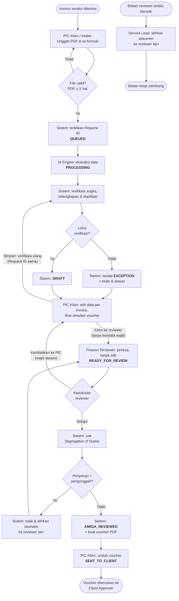

# AMIGA Robot Admin — Intelligent Vendor Invoice-to-Voucher Processing

Proof of Concept untuk **MAIN Hackathon 2026** oleh **Kelompok 11 (TEAM 11 MAIN)**.

AMIGA Robot Admin mengubah invoice vendor (PDF) menjadi voucher pembayaran resmi dalam hitungan detik. **AI hanya membaca invoice.** Sistem yang memverifikasi angka, kelengkapan, dan duplikasi, lalu **Finance Reviewer** menyetujui sebelum voucher diserahkan ke klien.

## Coba aplikasi

| | |
| --- | --- |
| Login aplikasi | http://13.212.201.121/login (ketik lengkap dengan `http://`) |
| Bot Telegram | [@amiga_online_ro_bot](https://t.me/amiga_online_ro_bot) |
| Buku panduan (PDF) | [User Guide Book v4.0](readme/User_Guide_Book_AMIGA_Robot_Admin_v4.0.pdf): persyaratan sistem, instalasi, menjalankan, fitur |
| Galeri screenshot | [Galeri Dokumentasi](readme/Galeri_Dokumentasi_AMIGA_Robot_Admin.pdf) |

**Fitur utama:** AI (Amazon Bedrock Nova Lite) membaca invoice PDF/foto, termasuk satu PDF berisi banyak invoice; sistem
memverifikasi angka, kelengkapan, dan duplikat; saran PPN dan potongan PPh otomatis (DPP PPh 23 dari imbalan jasa yang
dicocokkan dengan PPN tercetak); simulasi dan voucher resmi PDF; peninjauan Finance Reviewer dengan pemisahan tugas;
Asisten AI (RAG atas SOP); bot Telegram; tutorial di dalam aplikasi; jejak audit permanen.

**Mulai cepat (lokal):**

```bash
git clone https://github.com/halvrenvaire/AMIGA-ADMIN-ROBOT-TIM11-.git && cd AMIGA-ADMIN-ROBOT-TIM11-
cd backend && python3 -m venv .venv && .venv/bin/pip install -r requirements.txt
cp .env.example .env            # isi DATABASE_URL, JWT_SECRET, SEED_DEFAULT_PASSWORD, kredensial AWS
bash scripts/create_db.sh && .venv/bin/alembic upgrade head && .venv/bin/python seed.py
.venv/bin/uvicorn app.main:app --reload --port 8000      # terminal 1
cd ../frontend && npm install && npm run dev              # terminal 2, buka http://localhost:5173
```

Detail lengkap ada di [Menjalankan project](#menjalankan-project). Semua contoh invoice di `samples/` adalah data fiktif;
contoh kasus DSS dibuat oleh `backend/scripts/make_dss_sample.py`.

> **Dokumen acuan** (folder [`readme/`](readme/)):
> - [**User Guide Book v4.0**](readme/User_Guide_Book_AMIGA_Robot_Admin_v4.0.pdf): persyaratan sistem, instalasi, menjalankan aplikasi, dan panduan fitur (dibuat ulang dengan `backend/.venv/bin/python docs/user-guide/build_user_guide.py`)
> - [BRD AMIGA Robot Admin v1.1](readme/BRD_AMIGA_Robot_Admin_v1.1.docx)
> - [PRD AMIGA Robot Admin v2](<readme/PRD — AMIGA Robot Admin(v2).pdf>) (versi PRD 1.1)
> - [BPMN Invoice-to-Voucher (revisi)](readme/AMIGA_Robot_Admin_Invoice_to_Voucher.bpmn)
> - [Tracking tugas feedback owner](docs/TASKS.md)
> - [SOP-AMIGA-FIN-001 v1.3](docs/sop.md)
>
> Bila README ini berbeda dengan dokumen acuan, **dokumen acuan yang berlaku**. Bagian [Keputusan desain](#keputusan-desain) mencatat hal yang belum diatur dokumen acuan.

---

## Daftar isi

1. [Masalah dan tujuan](#masalah-dan-tujuan)
2. [Alur dokumen (BPMN)](#alur-dokumen-bpmn)
3. [Peran dan hak akses](#peran-dan-hak-akses)
4. [Fitur dan status pengerjaan](#fitur-dan-status-pengerjaan)
5. [Skenario uji penerimaan (UAT)](#skenario-uji-penerimaan-uat)
6. [Arsitektur](#arsitektur)
7. [Menjalankan project](#menjalankan-project)
   - [Deploy publik (Neon + FastAPI Cloud + Vercel)](#deploy-publik-neon--fastapi-cloud--vercel)
   - [Deploy ke EC2](#deploy-ke-ec2)
8. [Endpoint API](#endpoint-api)
9. [Keputusan desain](#keputusan-desain)
10. [Pertanyaan terbuka](#pertanyaan-terbuka)
11. [Di luar cakupan PoC](#di-luar-cakupan-poc)

---

## Masalah dan tujuan

| Masalah saat ini | Tujuan produk |
| --- | --- |
| Input ulang manual 5–10 menit per invoice, penyusunan voucher 5–15 menit | Data invoice terisi otomatis oleh AI |
| Salah ketik nominal atau nomor rekening, salah hitung total, risiko pembayaran ganda | Kesalahan tertangkap sebelum pembayaran: cek hitungan, kelengkapan, dan duplikasi |
| Riwayat perubahan dan persetujuan tidak tercatat | Pengunggah tidak bisa menyetujui dokumennya sendiri, dan semua perubahan tercatat permanen |

### Target metrik PoC

| Metrik | Target |
| --- | --- |
| Waktu ekstraksi per invoice (AI membaca maks. 5 halaman pertama) | ≤ 15 detik |
| Waktu muat antrean dan layar review | ≤ 2 detik |
| Waktu pembuatan voucher | ≤ 3 detik |
| Line items terbaca dan total benar | 100% di skenario uji |
| Duplikat yang lolos tanpa tanda | 0 |
| Pelanggaran SoD dan akses lintas klien | 0 |
| Perubahan data tercatat di jejak audit | 100% |

---

## Alur dokumen (BPMN)

Setiap invoice melewati **7 status** dengan **3 titik keputusan**: verifikasi sistem, keputusan reviewer, dan cek Segregation of Duties. Hasil bacaan AI berhenti di **Draf** (`DRAFT`): PIC memeriksa dan mengedit data **per invoice**, melihat **simulasi voucher**, lalu mengirimnya ke Finance Reviewer. Reviewer **tidak mengedit**; hanya Setujui atau Kembalikan ke PIC (feedback owner, Tahap 3). Selama voucher belum terbit, pengaju bisa **membatalkan** pengajuan (status `CANCELLED`, alasan wajib); datanya tetap tersimpan dan invoice yang sama boleh diajukan ulang.



Catatan alur:

- **AI Engine hanya mengekstrak.** Verifikasi, cek SoD, dan pembuatan voucher dilakukan **Sistem**.
- EXCEPTION bisa datang dari verifikasi sistem atau dari reviewer yang mengembalikan dokumen. PIC memperbaiki di editor yang sama; setiap simpan memverifikasi ulang dengan **Request ID yang sama** (tanpa kendala wajib → kembali Draf).
- **Kendala wajib** (harus dibereskan PIC sebelum dikirim): `MISSING_EVIDENCE`, `CALCULATION_DISCREPANCY`, `NOT_AN_INVOICE`, `EXTRACTION_FAILED`, `ACCOUNT_MISMATCH`. **Peringatan yang dikonfirmasi PIC**: `VENDOR_MISMATCH` (beberapa vendor/rekening dalam satu voucher) tidak membuat dokumen "Ada kendala", tetapi draf baru bisa dikirim setelah PIC mengonfirmasinya dengan alasan. Kendala lain (`POSSIBLE_DUPLICATE`, `RECEIPT_NOT_INVOICE`, `NEEDS_MANUAL_REVIEW`) ikut terkirim dan diputuskan reviewer.
- **Bila AI bermasalah** (kredensial dicabut, layanan gangguan) atau dimatikan dengan `AI_EXTRACTION_ENABLED=false`, bukti yang tidak terbaca menjadi **draf isi manual**: dokumen tetap Draf dengan pesan "Isi data invoice secara manual", saran pajak dari aturan tetap ada, dan PIC bisa mencoba "Coba baca ulang dengan AI" untuk bukti yang gagal saja. Hanya file yang hilang dari penyimpanan yang menjadi `EXTRACTION_FAILED`.
- **Subtotal baris** dihitung sistem (qty × harga satuan, 2 desimal) bila keduanya terisi; tanpa qty atau harga, subtotal diisi manual (harga borongan).
- Pengalihan oleh **Service Lead** terpisah dari alur SoD. Pengalihan ini hanya untuk pemerataan beban, dan status dokumen tidak berubah.
- Persetujuan dan pembayaran oleh **Client Approver** terjadi di luar sistem.
- Setiap aktivitas, perubahan data (nilai awal → nilai baru), penolakan, dan pengalihan dicatat permanen di **jejak audit**.

### Aturan verifikasi (dijalankan sistem)

| Aturan | Kode | Kapan muncul | Akibat |
| --- | --- | --- | --- |
| Kelengkapan | `MISSING_EVIDENCE` | Data wajib tidak ditemukan (vendor, nomor, tanggal, total). Rekening tujuan opsional | EXCEPTION |
| Angka / perhitungan | `CALCULATION_DISCREPANCY` | Jumlah subtotal line items ≠ total invoice | EXCEPTION |
| Duplikasi | `POSSIBLE_DUPLICATE` | Ada invoice lain dengan nomor invoice dan vendor yang sama | EXCEPTION |
| Dikembalikan reviewer | `RETURNED_BY_REVIEWER` | Finance Reviewer memilih "Kembalikan ke PIC" | EXCEPTION |
| Bukan invoice | `NOT_AN_INVOICE` | AI (berperan sebagai Invoice Verification Officer) menilai PDF bukan invoice/tagihan, mis. surat, PO, atau bukti transfer. Kendala data lain tidak ditampilkan | EXCEPTION |
| Vendor/rekening berbeda | `VENDOR_MISMATCH` | Beberapa invoice dalam satu pengajuan punya vendor atau rekening tujuan berbeda | Peringatan: tetap Draf, PIC mengonfirmasi dengan alasan sebelum kirim; konfirmasi gugur bila daftar vendor/rekening berubah |
| Rekening tidak cocok | `ACCOUNT_MISMATCH` | Rekening suatu invoice berbeda dengan rekening terverifikasi vendornya (dicek per invoice) | EXCEPTION |

> **Voucher Pengeluaran Reimburse** (bon tol, parkir, dll.): struk/nota adalah bukti sah, boleh banyak vendor, data wajib hanya tanggal dan total, dan rekening vendor tidak dicek karena uang dibayarkan ke karyawan.

Nomor invoice dan nama vendor **dinormalisasi** sebelum dibandingkan (huruf kecil, tanpa spasi dan tanda baca), sehingga `INV-001` dan `inv 001` tetap terdeteksi sebagai duplikat.

---

## Peran dan hak akses

Ada 6 peran internal, ditambah **Sistem** dan **AI Engine** sebagai pelaku otomatis. **Setiap aksi diperiksa di server**, bukan hanya disembunyikan di tampilan.

| Aksi | PIC Klien | Intake Support | Finance Reviewer | Service Lead | System Admin |
| --- | --- | --- | --- | --- | --- |
| Unggah invoice dan isi formulir | Ya | Ya (klien yang didelegasikan) | Tidak | Tidak | Tidak |
| Lihat status, kode, dan alasan EXCEPTION | Ya (klien sendiri) | Ya (klien ditugaskan) | Ya | Ya | Tidak |
| Lengkapi / perbaiki data invoice | Ya | Ya (klien ditugaskan) | Tidak | Tidak | Tidak |
| Koreksi data hasil ekstraksi | Tidak | Tidak | Ya | Tidak | Tidak |
| Setujui atau kembalikan ke PIC | Tidak | Tidak | Ya, kecuali unggahan sendiri | Tidak | Tidak |
| Unduh voucher PDF | Ya | Ya | Ya | Tidak | Tidak |
| Alihkan dokumen ke reviewer lain (atur beban) | Tidak | Tidak | Tidak | Ya | Tidak |
| Kelola akun, peran, penugasan klien | Tidak | Tidak | Tidak | Tidak | Ya |
| Lihat riwayat dan jejak audit | Ya (klien sendiri) | Ya (klien ditugaskan) | Ya | Ya | Ya |
| Asisten AI di dashboard | Tidak | Tidak | Ya | Ya | Ya (SOP saja) |

**Peran ganda.** Satu pengguna boleh memiliki lebih dari satu peran internal, misalnya Intake Support sekaligus Finance Reviewer. Kombinasi yang **dilarang**: PIC Klien dengan peran internal mana pun, dan System Admin dengan Finance Reviewer. System Admin tidak boleh memberi peran kepada dirinya sendiri.

**Segregation of Duties.** Pihak pengaju sebuah dokumen tidak boleh meninjau, menandai bukan duplikat, atau menyetujuinya. Pihak pengaju adalah pengunggah, PIC yang diwakili, dan siapa pun yang memperbaiki data, memberi catatan PIC, atau mengubah penanda tangan dokumen itu, termasuk pengguna peran ganda Intake Support + Finance Reviewer. Sistem tidak pernah menugaskan dokumen kepada pihak pengajunya; bila tetap dicoba, persetujuan ditolak dan dokumen **otomatis dialihkan** ke reviewer lain.

**Isolasi klien.** PIC Klien dan Intake Support hanya bisa membuka dokumen perusahaan yang ditugaskan System Admin, dan hanya bisa mengajukan untuk perusahaan itu. Finance Reviewer (meninjau) dan Service Lead (mengawasi) menangani **semua perusahaan** tanpa penugasan. Akses di luar hak ditolak dan dicatat.

---

## Fitur dan status pengerjaan

Keterangan: ✅ selesai · 🔄 sebagian · ⏳ belum dikerjakan

| Fitur (PRD §4) | Prioritas | Status | Keterangan |
| --- | --- | --- | --- |
| F1. Unggah invoice dan antrean | P0 | ✅ | `POST /documents`: PDF tanpa batas halaman (AI membaca 5 halaman pertama), field wajib termasuk saluran, Request ID, QUEUED, unggah atas nama PIC oleh Intake Support |
| F2. Ekstraksi AI | P0 | ✅ | Nova Lite membaca PDF langsung (2–4 detik per invoice dummy). Gagal baca → dokumen tetap tersimpan, Finance Reviewer bisa proses ulang. Ekstraksi ulang memakai Request ID sama |
| F3. Verifikasi otomatis oleh sistem | P0 | ✅ | Kelengkapan, angka, duplikasi (dinormalisasi). Kode + alasan berbahasa sederhana. Perbaikan PIC didahulukan atas hasil AI |
| F4. Peninjauan oleh Finance Reviewer | P0 | ✅ | Koreksi data + verifikasi ulang, Setujui (kendala terbuka menahan persetujuan), Kembalikan ke PIC dengan alasan, cek SoD + pengalihan otomatis, tandai bukan duplikat |
| F5. Voucher PDF dan serah terima | P0 | ✅ | Voucher PDF (fpdf2) < 1 detik; unduhan pihak klien → SENT_TO_CLIENT. Kop memakai **logo klien** (diunggah PIC Klien di Penanda tangan, atau System Admin di Klien; tanpa logo: nama klien). Klien, Request ID, vendor, No./Tgl. invoice, rekening, catatan tanda tangan elektronik, dan teks batas otorisasi **tidak dicetak** (feedback owner 19 Okt 2026; FR-5.2 dicabut owner) |
| F6. Dashboard antrean | P1 | ✅ | `GET /dashboard/summary` (per status, bermasalah, tenggat, beban reviewer), filter di `GET /documents`, pengalihan oleh Service Lead |
| F7. Hak akses dan isolasi klien | P0 | ✅ | Login JWT, peran ganda (tabel `user_roles`), cek peran di server, isolasi klien (ditolak + dicatat), API System Admin. Delegasi oleh PIC Klien dibangun bersama unggah (Tahap 4) |
| F8. Jejak audit | P0 | ✅ | `audit_logs` **append-only** (trigger database). Mencatat unggah, perubahan status, ekstraksi, perbaikan PIC, koreksi reviewer (nilai awal → baru), persetujuan, pengembalian, penolakan SoD, pengalihan, voucher, unduhan, aksi admin, akses ditolak. `GET /documents/{id}/history` |
| Asisten AI (SOP) | Tambahan | ✅ | `POST /ask`: menjawab dari SOP dengan sumber dan riwayat percakapan |
| Asisten AI Agent (memori tanya-jawab) | Tambahan | ✅ | `POST /ask-agent`: memakai tanya-jawab lama yang mirip sebagai referensi, dengan 👍/👎 |
| Asisten AI Agent (data antrean) | Tambahan | ✅ | `/ask-agent` menjawab pertanyaan antrean dari data sistem, hanya klien yang ditugaskan; System Admin SOP saja |
| Frontend (5 layar) | P0 | ✅ | React + Vite + TypeScript: login, Dashboard Antrean, Unggah & Pengajuan, Peninjauan split-screen, Voucher, Riwayat, layar System Admin, tombol chat Asisten |
| Dashboard metrik | Owner | ✅ | KPI per status, tren harian (line chart), kecepatan proses, kualitas & kendala, nilai pembayaran; dibanding periode sebelumnya (`GET /dashboard/metrics`) |
| Data referensi vendor | Owner | ✅ | PIC Klien/Intake mendaftarkan vendor (NPWP, alamat, kontak, rekening) per klien; nama dinormalisasi agar tidak dobel; dipakai sebagai dropdown di filter & formulir; dokumen tertaut otomatis |
| Penanda tangan voucher | Owner | ✅ | "Diajukan oleh" = PIC Klien yang mengajukan (nama + perusahaan); PIC Klien mendaftarkan pemberi persetujuan "Disetujui oleh" (1 kotak default, bisa ditambah hingga 5 per dokumen); dicetak sebagai kotak tanda tangan di voucher (tanpa kotak AMIGA; persetujuan reviewer tercatat di jejak audit) |
| Manajemen voucher | Owner | ✅ | Tabel voucher dengan filter perusahaan, vendor, status, tanggal; dikelompokkan dengan subtotal; unduh CSV |
| Potongan pajak per invoice | Owner (Tahap 4) | ✅ | PIC memilih PPh 21 (non final), PPh 23, PPh 4 ayat 2, PPh 26, atau Tanpa potongan per invoice. Tarif mengikuti NPWP vendor dari data referensi (bisa diubah per invoice); DPP otomatis dari rincian tanpa baris PPN. AI (Nova) hanya **menyarankan** (cadangan: aturan kata kunci); PIC **wajib memilih sendiri** pajak setiap bukti, termasuk "Tanpa potongan", sebelum draf bisa dikirim. Di Telegram: tombol "Pakai saran pajak & kirim" atau "Tanpa potongan & kirim". Voucher mencetak jumlah tagihan, potongan, dan **total dibayarkan (bersih)**. Tabel tarif di Data Referensi / Tarif pajak |
| Unggah foto invoice | Tambahan | ✅ | JPG, PNG, WEBP diterima di dashboard dan bot Telegram; dikenali dari isi file, diputar sesuai EXIF, diperkecil, lalu diubah menjadi PDF satu halaman. Foto asli disimpan (`GET /documents/{id}/files/{posisi}/original`, tombol "Lihat foto asli") |
| Bot Telegram `@amiga_ro_bot` | Tambahan | ✅ | **Unggah invoice PDF** (saluran Telegram, diproses AI lalu hasilnya dikabarkan), cek progres (`/terakhir`, `/kendala`, `/status`), dan tanya Asisten AI dari Telegram. Akun dihubungkan dengan kode sekali pakai dari Pengaturan akun; hak akses sama dengan dashboard. Lihat [Bot Telegram](#bot-telegram) |

### Rencana tahap berikutnya

| Tahap | Isi |
| --- | --- |
| 3 ✅ | Login, peran ganda, isolasi klien, API System Admin (aturan SoD saat menyetujui dibangun di Tahap 5) |
| 4 ✅ | F1–F3: unggah, ekstraksi AI, verifikasi (termasuk ekstraksi ulang dengan Request ID sama) |
| 5 ✅ | F4, F5, F8: layar review, setujui/kembalikan, cek SoD + pengalihan otomatis, voucher PDF, pencatatan audit |
| 6 ✅ | Asisten AI membaca data antrean (sesuai hak akses), F6 dashboard |
| 7 ✅ | Frontend 5 layar + tombol chat asisten |
| 8 🔄 | UAT 8 skenario ✅ (Cypress E2E), lalu Demo Day |

---

## Skenario uji penerimaan (UAT)

PoC dinyatakan siap demo bila **8 skenario** di bawah lulus semua dan target waktu tercapai (PRD §8).

| No | Skenario | Langkah | Hasil yang diharapkan | Status |
| --- | --- | --- | --- | --- |
| 1 | Alur normal | Unggah → ekstraksi → lolos verifikasi → disetujui | Voucher terunduh, status SENT_TO_CLIENT | ✅ lulus E2E (Cypress) |
| 2 | Multi-line item | Invoice dengan ≥ 3 jenis barang | Semua baris terbaca, total benar | ✅ lulus E2E (Cypress) |
| 3 | Rekening opsional | Invoice tanpa nomor rekening | Tetap Draf, tanpa kendala (feedback 21 Okt 2026); data wajib lain yang kosong tetap MISSING_EVIDENCE | ✅ lulus E2E (Cypress) |
| 4 | Duplikasi | Nomor dan vendor sama dengan invoice sebelumnya | POSSIBLE_DUPLICATE | ✅ lulus E2E (Cypress) |
| 5 | Segregation of Duties | User A unggah, lalu User A coba menyetujui | Ditolak sistem, dokumen otomatis dialihkan ke reviewer lain | ✅ lulus E2E (Cypress) |
| 6 | Isolasi klien | User klien A membuka dokumen klien B | Akses ditolak | ✅ lulus E2E (Cypress) |
| 7 | Jejak audit | Reviewer tidak bisa mengedit dan mengembalikan ke PIC; PIC mengubah nominal | Tercatat nilai awal, nilai baru, nama, waktu | ✅ lulus E2E (Cypress) |
| 8 | Perbaikan PIC di draf | PIC mengisi nomor rekening di editor draf, menyimpan (tombol Simpan menyala saat ada perubahan) | Diverifikasi ulang dengan Request ID sama → Draf, lalu dikirim → READY_FOR_REVIEW | ✅ lulus E2E (Cypress) |

Aturan `CALCULATION_DISCREPANCY` tidak lagi punya skenario UAT tersendiri di PRD v2, tetapi tetap diuji dengan test otomatis.

**Invoice dummy untuk UAT** ada di [`samples/invoices/`](samples/invoices/) (semua data fiktif), dibuat ulang dengan `backend/.venv/bin/python backend/scripts/make_dummy_invoices.py`:

| File | Untuk | Hasil yang diharapkan |
| --- | --- | --- |
| `01_normal_3_baris.pdf` | UAT 1, 2 | READY_FOR_REVIEW, 3 baris terbaca |
| `02_tanpa_rekening.pdf` | UAT 3, 8 | Draf tanpa kendala (rekening opsional) |
| `03_duplikat_dari_01.pdf` | UAT 4 (unggah setelah 01, klien sama) | POSSIBLE_DUPLICATE |
| `04_selisih_total.pdf` | Aturan angka | CALCULATION_DISCREPANCY |
| `05_normal_jasa.pdf` | UAT 5, 7 | READY_FOR_REVIEW |

**Invoice dummy untuk pajak** (PPN dan PPh per baris, Tahap 9) ada di [`samples/pajak/`](samples/pajak/), dibuat ulang dengan `backend/.venv/bin/python backend/scripts/make_tax_invoices.py`. Langkah dan hasil yang diharapkan per file ada di [`samples/pajak/README.md`](samples/pajak/README.md).

---

## Arsitektur

| Bagian | Teknologi |
| --- | --- |
| Backend | Python, FastAPI, SQLAlchemy, Alembic |
| Database | PostgreSQL |
| Frontend | React 19 + Vite 8 + TypeScript, React Router, ikon lucide-react |
| AI (menjawab, nantinya ekstraksi) | Amazon Bedrock — **Amazon Nova Lite** (`ap-southeast-1`) |
| Embedding Asisten SOP | Amazon Bedrock — **Titan Text Embeddings v2** (`us-east-1`) |
| Pencarian dokumen Asisten SOP | FAISS (index disimpan di `backend/data/`) |
| Testing | pytest (unit & API), Cypress (8 skenario UAT end-to-end) |

Semua library dan tools yang dipakai bersifat **open source**. Satu-satunya layanan berbayar adalah Amazon Bedrock.

**Kenapa Nova dan Titan di `us-east-1`?** Hasil pengujian di akun AWS kelas pada 13/10/2026:

- `amazon.titan-text-express-v1` sudah **end of life** di semua region, sehingga diganti **Nova Lite**.
- Titan Embeddings **tidak tersedia** di `ap-southeast-1`, tetapi bisa dipanggil di `us-east-1`.
- Model Claude belum diaktifkan dan Cohere embedding tidak diizinkan untuk akun siswa.

Model bisa diganti tanpa mengubah kode lewat `LLM_MODEL`, `EMBED_MODEL`, dan `EMBED_REGION` di `.env`. Setelah mengganti model embedding, jalankan `POST /reindex`.

Tanpa akses AI, aplikasi tetap bisa dipakai: isi `AI_EXTRACTION_ENABLED=false` di `.env` supaya setiap unggahan langsung menjadi draf isi manual (AI tidak dipanggil). Bila AI menyala tetapi gagal, dokumen juga jatuh ke isi manual dengan pesan yang jelas.

### Struktur folder

```
.
├── README.md
├── readme/                     # Dokumen acuan: BRD v1.1, PRD v2, BPMN revisi
├── docs/
│   └── sop.md                  # SOP v1.1 — juga sumber pengetahuan Asisten SOP
├── samples/invoices/           # Invoice PDF dummy untuk UAT
├── samples/pajak/              # Invoice PDF dummy untuk PPN dan PPh per baris
├── scripts/run_e2e.sh          # Menjalankan 8 skenario UAT (Cypress) end-to-end
├── frontend/                   # React + Vite (lihat "Menjalankan frontend")
│   └── src/
│       ├── pages/              # Login, Queue (01), Upload + Lists (02), DocumentPage (03), VoucherPage (04), HistoryPage (05), Admin
│       ├── components/         # Layout + sidebar per peran, Asisten, tabel dokumen, modal, penampil PDF
│       ├── api.ts, auth.tsx    # Klien API (token di localStorage) dan konteks login
│       └── styles.css          # Token desain: navy, teal, Inter
└── backend/
    ├── app/
    │   ├── main.py             # Entry point FastAPI
    │   ├── config.py           # Pengaturan dari .env
    │   ├── db.py, models.py    # Koneksi dan model database
    │   ├── security.py         # Hash password
    │   ├── auth.py             # Token JWT, cek peran & isolasi klien (dependency FastAPI)
    │   ├── routers/            # health, auth, clients, documents, admin, ask, ask_agent, reindex, database
    │   ├── schemas/            # Model request/response
    │   └── services/           # Ekstraksi AI, verifikasi, proses dokumen, pemilihan reviewer, penyimpanan file,
    │                           # aturan akses, jejak audit, Bedrock, RAG (loader, chunker, FAISS, indexing), riwayat, memori
    ├── alembic/                # Migrasi database
    ├── bot/telegram_bot.py     # Bot Telegram @amiga_ro_bot (program terpisah)
    ├── scripts/                # create_db.sh, make_dummy_invoices.py, make_tax_invoices.py, e2e_server.sh (backend E2E :8001)
    ├── seed.py                 # Data dummy: 2 klien, 8 pengguna
    ├── tests/                  # pytest
    ├── requirements.txt
    └── .env.example
```

---

## Menjalankan project

### Prasyarat

- Python 3.12+ (dikembangkan dengan 3.14)
- PostgreSQL 13+ (dikembangkan dengan 18) yang berjalan di `localhost:5432`
- Akun AWS dengan akses Amazon Bedrock (Nova Lite dan Titan Embeddings v2)

### Langkah setup

```bash
cd backend

# 1. Virtualenv dan dependensi
python3 -m venv .venv
.venv/bin/pip install -r requirements.txt

# 2. Konfigurasi: salin lalu isi nilainya (kredensial AWS milik masing-masing)
cp .env.example .env

# 3. Buat role & database PostgreSQL sesuai DATABASE_URL di .env (meminta password sudo)
bash scripts/create_db.sh

# 4. Buat tabel dan isi data dummy
.venv/bin/alembic upgrade head
.venv/bin/python seed.py

# 5. Jalankan server
.venv/bin/uvicorn app.main:app --reload --port 8000
```

Buka <http://localhost:8000/docs> untuk mencoba endpoint dari browser. Saat pertama dijalankan, server membangun index Asisten SOP dari `docs/sop.md` (sekitar 10 detik).

> ⚠️ **Jangan commit atau membagikan `.env`.** File ini sudah ada di `.gitignore`. Jangan membuka `.env` saat berbagi layar.

### Akun dummy (hasil `seed.py`)

Semua akun memakai password dari `SEED_DEFAULT_PASSWORD` di `.env`.

| Email | Peran | Klien |
| --- | --- | --- |
| `pic.alpha@amiga.test` | PIC Klien | PT Klien Alpha |
| `pic.beta@amiga.test` | PIC Klien | PT Klien Beta |
| `intake@amiga.test` | Intake Support (delegasi PIC Alpha) | PT Klien Alpha |
| `reviewer1@amiga.test` | Finance Reviewer | Alpha, Beta |
| `reviewer2@amiga.test` | Finance Reviewer | Alpha, Beta |
| `multi@amiga.test` | Intake Support + Finance Reviewer (peran ganda, untuk UAT 5) | PT Klien Alpha |
| `lead@amiga.test` | Service Lead | Alpha, Beta |
| `admin@amiga.test` | System Admin | — |

### Menjalankan frontend

Butuh Node.js 20.19+ atau 22.12+. Backend harus berjalan di port 8000.

```bash
cd frontend
npm install
npm run dev
```

Buka <http://localhost:5173> dan login dengan akun dummy di atas. Request ke `/api/*` diteruskan Vite ke `http://localhost:8000` (ubah lewat `VITE_API_TARGET`). Cek tipe dan build produksi: `npm run build`.

### Bot Telegram

Bot `@amiga_ro_bot` adalah program terpisah yang membaca pesan Telegram lalu memanggil API AMIGA **atas nama akun yang terhubung**. Hak akses, isolasi klien, dan Asisten AI-nya sama persis dengan dashboard. Bot hanya melayani **chat pribadi**, bukan grup.

1. Isi `TELEGRAM_BOT_TOKEN` (dari @BotFather) di `backend/.env`. ⚠️ Siapa pun yang memegang token bisa mengendalikan bot; jangan dibagikan.
2. Jalankan server API (port 8000), lalu di **terminal lain**:

   ```bash
   cd backend
   .venv/bin/python -m bot.telegram_bot
   ```

   Saat start, bot mendaftarkan menu perintah ke Telegram. Pesan yang menumpuk lebih dari 10 menit saat bot mati tidak dibalas.
3. Hubungkan akun: login ke dashboard → **Pengaturan akun** → **Hubungkan Telegram** → klik **Buka @amiga_ro_bot** lalu **Start** (atau kirim `/login <kode>`). Kode 6 digit berlaku 10 menit dan sekali pakai; 5 kali salah → chat diblokir 15 menit. **Password tidak pernah diketik di chat.**

| Perintah | Fungsi |
| --- | --- |
| `/login <kode>` | Hubungkan Telegram dengan akun AMIGA |
| `/logout` | Putuskan Telegram dari akun |
| `/reset` | Mulai percakapan baru dengan Asisten |
| `/terakhir` | 5 invoice terbaru (Finance Reviewer: yang ditugaskan kepadanya) |
| `/kendala` | Invoice berstatus EXCEPTION, tenggat terdekat di atas |
| `/status REQ-...` | Detail dokumen: status, vendor, total, reviewer, kendala, tautan dashboard |
| `/bantuan` | Daftar perintah dan contoh pertanyaan |
| *(kalimat biasa)* | Dijawab Asisten AI (`/ask-agent`), termasuk pertanyaan data antrean |
| *(kirim file PDF)* | Unggah invoice (PIC Klien / Intake Support), lihat di bawah |

**Unggah invoice lewat bot** (SOP 6.4 & 7.1): kirim 1–10 file **PDF** (boleh sekaligus) → pilih perusahaan dan jenis permintaan lewat tombol → **Kirim ke AMIGA**. Bot memakai endpoint `POST /documents` yang sama dengan dashboard (saluran `Telegram`, tanggal hari ini, penanda tangan default klien), jadi semua aturan berlaku: jumlah halaman tidak dibatasi, hanya perusahaan yang ditugaskan, Request ID, ekstraksi AI, verifikasi, dan jejak audit. Setelah AI selesai (dipantau hingga 2 menit), bot mengabarkan **Siap ditinjau** atau **Ada kendala** beserta alasannya. Draft yang belum dikirim tersimpan di memori bot selama 30 menit (hilang bila bot di-restart).

> ⚠️ File yang dikirim ke bot melewati server Telegram (chat bot tidak terenkripsi end-to-end). Untuk PoC memakai data dummy; untuk produksi perlu kajian UU PDP.

System Admin tetap tidak bisa melihat data invoice lewat bot. Akun yang dinonaktifkan langsung kehilangan akses bot.

### Menjalankan test

```bash
cd backend
.venv/bin/python -m pytest -m "not integration"   # cepat, tanpa AWS
.venv/bin/python -m pytest                        # termasuk integration test ke Bedrock (ekstraksi Nova)
```

### Test end-to-end (8 skenario UAT)

Cypress menjalankan 8 skenario UAT lewat UI dengan **ekstraksi Nova sungguhan**, plus target waktu (ekstraksi ≤ 15 detik, voucher ≤ 3 detik, antrean & layar review ≤ 2 detik). E2E memakai database **terpisah** `amiga_robot_admin_test` yang dikosongkan setiap kali dijalankan, sehingga data dev/demo tidak tersentuh.

```bash
# Sekali saja: buat database test (meminta password sudo)
cd backend && bash scripts/create_db.sh amiga_robot_admin_test && cd ..

# Jalankan E2E (backend :8001 + frontend :5180 dinyalakan dan dimatikan otomatis, sekitar 30 detik)
bash scripts/run_e2e.sh
# Mode interaktif Cypress
bash scripts/run_e2e.sh --open
```

Log server E2E ada di `frontend/cypress/logs/`.

**Mengosongkan data transaksi** (mis. sebelum Demo Day): `.venv/bin/python scripts/reset_transactions.py --yes` dari folder `backend/`. Menghapus dokumen, ekstraksi, kendala, voucher, jejak audit, dan file PDF di `storage/`; akun, klien, vendor, dan penanda tangan tetap ada. Trigger jejak audit hanya dinonaktifkan di dalam transaksi skrip itu.

pytest berjalan di database **`amiga_robot_admin_test`** (dibuat sekali dengan `bash scripts/create_db.sh amiga_robot_admin_test`), bukan database dev; migrasi dan seed dijalankan otomatis di awal test. Mengubah akun atau data di aplikasi tidak memengaruhi test.

Test dokumen berjalan di dalam satu transaksi database yang di-rollback, sehingga database dev tidak terisi dokumen test (jejak audit yang append-only membuat dokumen yang sudah di-commit tidak bisa dihapus).

File PDF yang diunggah disimpan di folder `storage/` (di root repo) atau di bucket S3 bila `STORAGE_BACKEND=s3`.

---

## Deploy publik (Neon + FastAPI Cloud + Vercel)

| Bagian | Layanan | Catatan |
| --- | --- | --- |
| Database | Neon PostgreSQL 18, project `amiga-robot-admin` (aws-us-east-1) | Satu region dengan FastAPI Cloud; beda region membuat tiap halaman 2–6 detik |
| Backend | FastAPI Cloud, app `amiga-robot-admin` → `https://amiga-robot-admin.fastapicloud.dev` | `backend/pyproject.toml` (entrypoint `app.main:app`), deploy dari folder induk repo dengan direktori `backend` supaya `docs/sop.md` ikut |
| File | Amazon S3 (`STORAGE_BACKEND=s3`) | Disk FastAPI Cloud tidak permanen |
| Frontend | Vercel, Root Directory `frontend` → `https://amiga-admin-robot-tim-11.vercel.app` | `frontend/vercel.json`; `VITE_API_URL` = alamat backend (frontend memanggil backend langsung, bukan lewat rewrite Vercel yang membatasi unggahan ±4,5 MB) |
| Bot Telegram | Tetap di komputer demo | `BOT_API_BASE_URL` diarahkan ke alamat backend publik |

Rahasia produksi disimpan di `backend/production.env` (diabaikan git, tidak ikut terunggah) dan di FastAPI Cloud sebagai *secret*.

```bash
# Migrasi dan seed ke Neon (nilai dari production.env, .env lokal tidak berubah)
cd backend && python3 -c "import os,subprocess;e=dict(os.environ);e.update(dict(l.split('=',1) for l in open('production.env').read().splitlines() if '=' in l and not l.startswith('#')));subprocess.run(['.venv/bin/alembic','upgrade','head'],env=e,check=True)"

# Deploy backend (dari folder induk repo; sekali saja: backend/.venv/bin/fastapi login)
backend/.venv/bin/fastapi deploy .

# Ubah variabel lingkungan (mis. CORS_ORIGINS = alamat Vercel), otomatis deploy ulang
echo -n "https://<app>.vercel.app" | backend/.venv/bin/fastapi cloud env set CORS_ORIGINS --value-stdin --path .
```

## Deploy ke EC2

Mengikuti panduan "Deploy aplikasi ke EC2" (Alkademi), dengan web app di **port 80** sesuai arahan mentor. Dashboard dan API dijalankan **satu proses** (`app.serve`: API di `/api`, dashboard di alamat lainnya) di `127.0.0.1:3000`, dan **nginx** menerimanya di port 80. Aplikasi tidak dijalankan sebagai root (port di bawah 1024 hanya boleh dibuka root). Server memakai **IAM role** untuk Bedrock, jadi **tidak ada access key AWS** di kode maupun `.env`.

1. **Launch server** dari launch template mentor (tag `Owner` = username AWS persis, tanpa key pair), tunggu *Running* + *2/2 checks passed* ±3 menit, salin **Public IPv4**.
2. **Connect** lewat *Session Manager*, lalu:

   ```bash
   sudo su - ec2-user
   cloud-init status --wait
   git clone https://github.com/halvrenvaire/AMIGA-ADMIN-ROBOT-TIM11-.git
   cd AMIGA-ADMIN-ROBOT-TIM11-
   bash scripts/deploy_ec2.sh            # port 80 (nginx). Tanpa nginx: PORT=3000 bash scripts/deploy_ec2.sh
   ```

   Repo privat: saat diminta, isi username GitHub dan **Personal Access Token** (read-only), jangan password. Token tidak disimpan di kode.

3. Buka `http://IP-PUBLIK` dari laptop (**http**, bukan https; port 80 tidak perlu ditulis). Password akun dummy dicetak di akhir skrip (acak, berbeda dengan laptop dev).

Skrip `scripts/deploy_ec2.sh` (aman dijalankan ulang) memasang swap 2 GB, Python 3.12/3.11, PostgreSQL 15 di `127.0.0.1` (port 5432 tidak dibuka), membuat `backend/.env` dengan rahasia acak, menjalankan migrasi + data dummy, mengecek akses Bedrock lewat role, mem-build frontend dengan Node 22, menjalankan aplikasi dengan `nohup` (PID di `~/app.pid`, log di `~/app.log`), lalu memasang **nginx** di port 80 (aktif otomatis setelah server restart). Di belakang nginx, IP asli pengunjung dibaca dari `X-Forwarded-For` yang ditulis ulang nginx, supaya batas percobaan login tetap per pengunjung dan tidak bisa dipalsukan. Bot Telegram ikut dijalankan bila `TELEGRAM_BOT_TOKEN` diisi di `backend/.env` server; **matikan dulu bot di laptop**, karena hanya satu bot boleh berjalan.

| Kebutuhan | Nilai di server |
| --- | --- |
| Region & model | `us-east-1`, `us.amazon.nova-lite-v1:0` (Nova **Micro** tidak bisa membaca PDF/foto invoice), `amazon.titan-embed-text-v2:0` |
| Database | PostgreSQL 15 lokal, autentikasi `scram-sha-256` (bawaan Amazon Linux `ident` diganti oleh skrip) |
| Update | `git pull && bash scripts/deploy_ec2.sh` |
| Port | Publik **80** (nginx, maks. unggahan 110 MB, timeout 180 dtk) → aplikasi `127.0.0.1:3000` |
| Log / berhenti | `tail -f ~/app.log`, `sudo tail /var/log/nginx/error.log` / `kill $(cat ~/app.pid)` |

**Keamanan untuk internet publik:** server menolak menyala bila `JWT_SECRET` lemah atau kosong; login dikunci 15 menit setelah 5 kali salah (per email dan IP); file di luar `frontend/dist` tidak bisa diakses. Gunakan **data dummy saja**. Simpan kode ke GitHub sebelum *terminate* server.

## Endpoint API

Semua endpoint selain `/health`, `/auth/login`, dan `/reindex` butuh header `Authorization: Bearer <token>`. Di <http://localhost:8000/docs>, klik **Authorize** lalu isi email (kolom `username`) dan password.

| Method | Endpoint | Fungsi |
| --- | --- | --- |
| GET | `/health` | Status server, database, dan index Asisten SOP |
| POST | `/auth/login` | Login (form: `username` = email, `password`). Mengembalikan token dan profil |
| GET | `/auth/me` | Profil, peran, dan klien yang ditugaskan |
| PATCH | `/auth/me` | Ubah nama tampilan/email sendiri (ganti email wajib password saat ini) |
| POST | `/auth/me/password` | Ganti password sendiri; semua sesi lain keluar, respons berisi token baru |
| GET | `/documents/{id}/files/{posisi}/original` | Foto asli sebelum diubah ke PDF (404 bila file diunggah sebagai PDF) |
| GET | `/auth/me/telegram` | Status hubungan akun dengan bot Telegram |
| POST | `/auth/me/telegram/link-code` | Kode sekali pakai (6 digit, 10 menit) + tautan `t.me` untuk menghubungkan bot |
| DELETE | `/auth/me/telegram` | Putuskan Telegram dari akun |
| GET | `/clients` | Klien yang ditugaskan kepada pengguna |
| GET | `/clients/{id}` | Detail klien. Klien yang tidak ditugaskan ditolak (403) dan dicatat di jejak audit |
| GET/POST | `/admin/users` | System Admin: daftar dan buat akun (peran + klien) |
| PUT | `/admin/users/{id}/roles` | System Admin: ubah peran (kombinasi terlarang ditolak, tidak bisa untuk diri sendiri) |
| PUT | `/admin/users/{id}/clients` | System Admin: ubah penugasan klien |
| PATCH | `/admin/users/{id}/active` | System Admin: aktifkan/nonaktifkan akun |
| POST | `/admin/users/{id}/password` | System Admin: reset password pengguna lain (sesi pengguna itu keluar) |
| GET/POST | `/admin/clients` | System Admin: daftar dan tambah klien |
| POST | `/documents` | PIC Klien / Intake Support: buat Voucher Pengeluaran (form: `client_id`, `request_type` = kategori `Voucher Pengeluaran Vendor` / `Voucher Pengeluaran Reimburse` / `Lainnya`, `channel` = Email/WhatsApp/Lainnya, `submitted_date`, `due_date` opsional, `files` = 1–10 file bukti untuk satu voucher (Reimburse: sampai 20), `signatory_ids` opsional = pemberi persetujuan berurutan, `submitter_name` opsional = nama di kotak "Diajukan oleh" bila bukan PIC pengaju). Mengembalikan satu Request ID dan status QUEUED; AI membaca tiap invoice, hasilnya disimpan per invoice dan digabung, lalu berhenti di DRAFT (atau EXCEPTION bila ada kendala wajib) |
| GET | `/documents` | Dokumen milik klien yang ditugaskan. Filter: `status`, `client_id`, `reviewer_id`, `problem=true`, `due_within_days`, `q` (Request ID/vendor), `request_type` (kategori), `sort=terbaru` atau `tenggat` |
| GET | `/documents/{id}` | Status, kode & alasan kendala, data hasil ekstraksi, isian PIC |
| GET | `/documents/{id}/file` | PDF asli |
| GET | `/documents/{id}/files/{position}` | PDF satu file bukti (layar edit per invoice) |
| PUT | `/documents/{id}/files/{position}/data` | PIC Klien / Intake Support: simpan data **satu invoice** saat DRAFT/EXCEPTION. Body = data lengkap invoice itu: `vendor_name`, `invoice_no`, `invoice_date`, `total`, `bank_name`, `account_no`, `account_name`, `line_items`. Data voucher disusun ulang dari semua invoice, diverifikasi ulang, perubahan dicatat `FIXED_BY_PIC` (nilai awal → baru) |
| GET | `/documents/{id}/voucher-preview` | Simulasi Voucher Pengeluaran bertanda SIMULASI (tanpa nomor dan tanda tangan elektronik), lengkap dengan lampiran |
| POST | `/documents/{id}/submit` | PIC Klien / Intake Support: kirim draf ke Finance Reviewer → READY_FOR_REVIEW. 409 bila masih ada kendala wajib atau ada bukti yang pajaknya belum dipilih. Pengirim dihitung pihak pengaju (SoD) |
| PUT | `/documents/{id}/files/{position}/tax` | PIC Klien / Intake Support: pilih pajak satu invoice saat DRAFT/EXCEPTION. Body: `{"code": "PPH23", "npwp": true, "base": null}` (`base` kosong = DPP otomatis). PPh per baris: `"mode": "line"` dengan `"lines": [{"index": 1, "pph": "PPH23"}]`. Pengaturan PPN: `"vat": {"mode": "separate"\|"included"\|"none", "rate": "11", "show": false}`; per baris `vat` (kena PPN) dan `kind` (`item`/`vat`). Tarif disalin ke data invoice; dicatat `FIXED_BY_PIC` |
| POST | `/documents/{id}/files/{position}/tax/ai-suggest` | PIC Klien / Intake Support: minta rekomendasi AI jenis PPh per baris. Hanya saran (berlaku setelah pajak diterapkan); 503 bila AI tidak tersedia, saran aturan tetap dipakai |
| GET | `/tax-rates` | Semua pengguna: jenis dan tarif pajak |
| PUT | `/tax-rates/{code}` | Service Lead / System Admin: ubah nama, tarif ber-NPWP / tanpa NPWP, keterangan, aktif, status konfirmasi. Draf dan voucher lama tidak berubah |
| GET/PUT/DELETE | `/clients/{id}/logo` | Logo klien (PNG) untuk kop voucher. PUT body `{"image": "data:image/png;base64,..."}` (PNG/JPG/WEBP ≤ 2 MB, dirapikan ke PNG); hanya PIC Klien klien itu atau System Admin |
| POST | `/documents/{id}/fix` | (lama) PIC Klien / Intake Support: kirim perbaikan saat EXCEPTION. Body: `{"fields": {"account_no": "..."}, "note": "..."}`. Dashboard kini memakai `PUT .../files/{position}/data` |
| POST | `/documents/{id}/cancel` | PIC Klien / Intake Support: batalkan pengajuan saat DRAFT, EXCEPTION, atau READY_FOR_REVIEW. Body: `{"reason": "..."}` (min. 5 karakter). Status → CANCELLED, kendala ditutup, tercatat di jejak audit; tidak dihitung sebagai duplikat |
| POST | `/documents/{id}/reprocess` | PIC Klien / Intake Support / Finance Reviewer: proses ulang dokumen yang gagal dibaca AI. Pada draf isi manual, hanya bukti yang belum terbaca AI yang dibaca ulang. 409 bila `AI_EXTRACTION_ENABLED=false` |
| POST | `/documents/{id}/acknowledge` | PIC Klien / Intake Support: konfirmasi peringatan dengan alasan saat DRAFT/EXCEPTION. Body: `{"code": "VENDOR_MISMATCH", "reason": "..."}` (min. 5 karakter). Tercatat `WARNING_ACKNOWLEDGED`, tampil untuk reviewer, tidak dicetak di voucher |
| PUT | `/documents/{id}/extraction` | **Dicabut** (403): Finance Reviewer tidak mengedit data; kembalikan ke PIC dengan alasan |
| POST | `/documents/{id}/approve` | Finance Reviewer: **Setujui**. Pengunggah ditolak (403) dan dokumen dialihkan otomatis; bila lolos → AMIGA_REVIEWED + voucher |
| POST | `/documents/{id}/return` | Finance Reviewer: **Kembalikan ke PIC**. Body: `{"reason": "..."}` (wajib) |
| POST | `/documents/{id}/dismiss-duplicate` | Finance Reviewer: tandai bukan duplikat (alasan wajib) saat READY_FOR_REVIEW; status tetap |
| GET | `/documents/{id}/voucher` | Pratinjau voucher PDF. `?download=true` = unduh; oleh PIC Klien (atau Intake Support pengunggah) → SENT_TO_CLIENT |
| GET | `/dashboard/summary` | Service Lead / Finance Reviewer: jumlah per status, bermasalah, tenggat dekat & lewat, beban per reviewer |
| POST | `/documents/{id}/reassign` | Service Lead: alihkan ke reviewer lain (status tetap). Body: `{"reviewer_id": "...", "reason": "..."}` |
| GET | `/dashboard/metrics` | Metrik dashboard (`days`=7–365, `client_id`) untuk Service Lead, Finance Reviewer, PIC Klien, Intake |
| GET | `/vouchers` | Daftar voucher; filter `client_id`, `vendor_id`, `vendor`, `status`, `request_type` (kategori), `date_from`, `date_to`, `q` |
| GET | `/vouchers/report` | Service Lead: rekap voucher PDF (`period` = 1 / 7 / 30 hari terakhir, atau `custom` + `date_from` & `date_to`, maks. 366 hari, tanggal WIB). Berisi ringkasan, rekap per perusahaan dan per reviewer, serta daftar voucher; unduhan tercatat di jejak audit |
| GET/POST | `/vendors` | Data referensi vendor (POST oleh PIC Klien/Intake; 409 bila nama sudah terdaftar) |
| GET | `/vendors/check` | Cek nama vendor sudah terdaftar (`client_id`, `name`) |
| GET / PUT / PATCH | `/vendors/{id}`, `/vendors/{id}/active` | Lihat / ubah / nonaktifkan vendor. Dari layar dokumen, PIC bisa mendaftarkan atau memperbarui rekening vendor (diisi dari invoice) |
| GET/POST | `/signatories` | Pemberi persetujuan ("Disetujui oleh") per klien (POST/PUT/PATCH hanya PIC Klien) |
| PUT | `/documents/{id}/signers` | Ganti penanda tangan dokumen sebelum voucher terbit. Body: `{"signatory_ids": [...]}` |
| GET | `/documents/{id}/history` | Riwayat & jejak audit dokumen (System Admin boleh tanpa penugasan klien) |
| POST | `/ask` | Tanya Asisten SOP. Body: `{"question": "...", "session_id": "..."}` |
| POST | `/ask-agent` | Seperti `/ask`, ditambah **memori tanya-jawab lintas sesi** (arahan mentor): pertanyaan lama yang mirip ikut dipakai sebagai referensi. Pertanyaan tentang antrean dijawab dari data sistem sesuai hak akses (`used_queue_data`). Respons menambahkan `answer_id` dan `memory_refs` |
| POST | `/ask-agent/feedback` | Beri 👍/👎 pada jawaban `/ask-agent`. Body: `{"answer_id": 17, "helpful": true}` |
| POST | `/reindex` | Bangun ulang index Asisten SOP setelah SOP/dokumen berubah. Butuh header `X-API-Key` (`REINDEX_API_KEY`) |
| GET | `/db/summary` | Jumlah baris di setiap tabel database |
| GET | `/db/qa-memory` | Isi memori `/ask-agent` (`active` = bisa dipakai sebagai referensi) |
| GET | `/db/conversations` | Daftar sesi chat beserta jumlah pesan |
| GET | `/db/conversations/{session_id}` | Seluruh pesan dalam satu sesi |
| GET | `/db/users` | Daftar pengguna, peran, dan klien (tanpa password) |

Endpoint `/db/*` hanya untuk **melihat** isi database selama pengembangan dan hanya bisa dibuka **System Admin**. Hash password dan vektor embedding tidak pernah ditampilkan.

`/ask` dan `/ask-agent` hanya untuk Finance Reviewer, Service Lead, dan System Admin.

`session_id` mengelompokkan riwayat percakapan. Gunakan nilai unik per orang/percakapan.

Setelah unggah, ekstraksi dan verifikasi berjalan di background: cek `GET /documents/{id}` beberapa detik kemudian. Endpoint dashboard antrean dibangun di Tahap 6.

---

## Keputusan desain

Hal-hal berikut belum diatur rinci di dokumen acuan dan **sudah disepakati tim** (13/10/2026):

| Topik | Keputusan | Alasan |
| --- | --- | --- |
| Data saat ekstraksi ulang | Field yang diisi/diperbaiki PIC **didahulukan** atas hasil AI | Mencegah putaran tanpa akhir: PDF tanpa nomor rekening akan selalu kosong bila AI menimpa isian PIC (UAT #8) |
| Pengalihan otomatis SoD | Ke reviewer lain (bukan pihak pengaju) dengan **jumlah kasus paling sedikit**, seri diacak | Sekaligus membantu pemerataan beban |
| Peran ganda | Diizinkan dengan kombinasi terlarang (lihat [Peran dan hak akses](#peran-dan-hak-akses)) | Tanpa ini, UAT #5 tidak mungkin terjadi karena Finance Reviewer tidak boleh mengunggah |
| Isi token login | Token hanya berisi ID pengguna; peran dan status aktif dibaca ulang dari database di setiap request | Perubahan peran atau penonaktifan akun oleh System Admin langsung berlaku tanpa menunggu token kedaluwarsa |
| Akses lintas klien | Ditolak dengan **403 "Akses ditolak"** dan dicatat sebagai `ACCESS_DENIED` di jejak audit | Sesuai UAT 6, dan percobaan akses bisa ditelusuri |
| System Admin dan akunnya sendiri | Tidak bisa mengubah peran, penugasan klien, atau status akunnya sendiri | Perluasan aturan "admin tidak boleh memberi peran ke diri sendiri" |
| Penugasan reviewer | Saat lolos verifikasi, dokumen ditugaskan ke Finance Reviewer aktif mana pun (tanpa penugasan perusahaan) dengan **jumlah kasus paling sedikit**; bila seri, dipilih **acak**. Contoh: 20 dokumen untuk 3 reviewer → 7, 7, 6. Pihak pengaju tidak pernah dipilih | Koreksi owner 16 Okt 2026; cek SoD saat menyetujui tetap dijalankan |
| Cakupan cek duplikat | Hanya di antara invoice **klien yang sama** | Risiko bayar ganda ada per klien; pesan duplikat menyebut Request ID lain sehingga tidak boleh lintas klien |
| AI gagal membaca | Status **EXCEPTION** dengan kode `EXTRACTION_FAILED`; Finance Reviewer bisa memproses ulang | Hanya ada 6 status di PRD; dokumen tetap tersimpan (FR-2.5) |
| Pilihan saluran | Email, WhatsApp, Lainnya | PRD menyebut "mis. Email/WhatsApp" |
| Format Request ID | `REQ-YYYYMMDD-XXXXXX` (6 karakter heksadesimal acak) | Mudah dibaca dan dicatat PIC |
| Persetujuan dan kendala | **Setujui** ditolak (409) selama masih ada kendala terbuka, termasuk kendala baru dari koreksi reviewer | Voucher tidak boleh terbit dari data yang gagal verifikasi |
| Duplikat yang ternyata bukan duplikat | Finance Reviewer (bukan pihak pengaju) bisa **menandai bukan duplikat** dengan alasan wajib saat meninjau | PRD belum mengatur (pertanyaan terbuka 2) |
| Serah terima voucher | Status jadi SENT_TO_CLIENT hanya bila diunduh **PIC Klien** atau **Intake Support yang mengunggah dokumen itu**. Pratinjau dan unduhan reviewer tidak mengubah status | Pengguna peran ganda yang mengunduh sebagai reviewer tidak boleh dianggap menyerahkan ke klien |
| Nomor voucher | `VCH/YYYY/MM/NNNN`, urut per bulan (WIB) | **Sementara**, menunggu format resmi dari tim Keuangan (pertanyaan terbuka 4) |
| Beban berlebih | Reviewer dengan **> 5** dokumen READY_FOR_REVIEW ditandai berlebih; tenggat "dekat" = ≤ 2 hari. Bisa diubah lewat `REVIEWER_OVERLOAD_THRESHOLD` dan `DUE_SOON_DAYS` | **Sementara**, menunggu batas resmi (pertanyaan terbuka 3) |
| Pengalihan oleh Service Lead | Hanya dokumen READY_FOR_REVIEW, ke Finance Reviewer aktif yang bukan pihak pengaju | Pengalihan tidak boleh membuka celah SoD |
| Asisten dan data antrean | `/ask-agent` memakai data antrean hanya bila pertanyaannya tentang antrean (mis. "dokumen apa yang tenggatnya dekat?"). Data dibangun di server dari klien yang ditugaskan; jawaban seperti ini **tidak disimpan** ke memori | Data cepat berubah, jadi tidak boleh menjadi referensi jawaban lain; hak akses sama dengan layar biasa |
| Penanda tangan voucher | Nama + kotak tanda tangan basah (tanpa gambar atau e-sign). Disalin ke dokumen saat dipilih, sehingga voucher lama tidak berubah bila daftar diedit. "Diajukan oleh" = PIC Klien pengaju (nama, "PIC Klien, <perusahaan>"); "Disetujui oleh" 1 kotak default, maks. 5 | Keputusan owner 14–16 Okt 2026 |
| Beberapa invoice per voucher | 1–10 PDF per pengajuan (Reimburse: sampai 20), masing-masing maks. 10 MB; **jumlah halaman tidak dibatasi** karena satu berkas bisa berisi invoice, Faktur Pajak, dan timesheet (feedback owner 20 Okt 2026). AI hanya membaca 5 halaman pertama (`AI_MAX_PAGES`), semua halaman tetap dilampirkan di voucher. Nomor invoice digabung, total dijumlahkan, rincian diberi awalan nomor invoice. Beberapa vendor/rekening dalam satu voucher harus dikonfirmasi PIC dengan alasan (`VENDOR_MISMATCH`, feedback owner 20 Okt 2026) dan tampil sebagai "Pembayaran per rekening" untuk reviewer; duplikasi dicek per nomor invoice. PIC meninjau di halaman Preview sebelum mengirim | Koreksi owner 15 Okt 2026 |
| Vendor per klien | Data vendor milik masing-masing klien (tidak dibagi lintas klien) | Data rekening vendor termasuk data sensitif dan mengikuti aturan isolasi klien |
| Halaman awal | Dashboard metrik untuk semua peran selain System Admin | Permintaan owner: metrik utama terlihat pertama |
| `POSSIBLE_DUPLICATE` | Tidak menahan draf; ikut terkirim dan **Setujui ditolak** sampai reviewer menandai bukan duplikat (atau mengembalikan ke PIC) | Alur draf (Tahap 3): keputusan duplikat ada di reviewer; target "0 duplikat lolos" tetap terjaga |
| Kembalikan ke PIC | Kode kendala `RETURNED_BY_REVIEWER` + alasan wajib | PRD v2 tidak memberi nama kode |
| Tarif pajak | NONE 0%; PPh 23 2% (tanpa NPWP 4%); PPh 21 non final 2,5% (3%); PPh 4 ayat 2 10% (sewa tanah/bangunan); PPh 26 20%. PPh 21, 23, dan 4 ayat 2 **dikonfirmasi tim** (20 Okt 2026); PPh 26 masih berlabel **perlu dikonfirmasi** | "Ppn 26 (luar negeri)" dari owner belum jelas: PPh 26 atau PPN luar negeri. Reimburse: saran Tanpa potongan, PIC tetap boleh memilih pajak lain (menunggu owner) |
| Saran pajak AI | Saran AI hanya menjadi pilihan awal di formulir dan **tidak berlaku otomatis**; kirim ke reviewer ditolak (409) sampai setiap bukti punya pilihan pajak dari PIC (keputusan tim 19 Okt 2026). Saran PPh 21 untuk vendor PT/CV dikoreksi sistem menjadi PPh 23; reimburse selalu Tanpa potongan | PPh 21 hanya untuk orang pribadi; reimburse karyawan umumnya tidak dipotong (menunggu konfirmasi owner) |
| Tabel voucher, PPN, dan potongan | Kolom **No · Uraian · Jumlah** (feedback owner 20 Okt 2026). PPN tidak dicetak sebagai baris: dilebur ke nilai barang (dibagi proporsional bila beberapa barang; sisa pembulatan ke barang terakhir), sehingga nilai barang = total invoice. Potongan PPh menjadi **baris bernomor tepat di bawah barangnya**, dihitung dari nilai sebelum PPN; jumlah semua baris = Total dibayarkan (mis. 1. Coffee 949.050 · 2. Potongan PPh 23 2% × 855.000 = (17.100) · Total 931.950). Data PPN tetap tersimpan | Hanya baris yang **diawali** PPN/VAT/PB1 dianggap PPN; barang yang menyebut "termasuk PPN" di uraiannya tetap barang |
| Jejak audit permanen | Ditegakkan dengan **trigger database**, bukan hanya di aplikasi | Bahkan akses langsung ke database tidak bisa mengubah atau menghapus catatan |
| Sumber pengetahuan Asisten | `docs/sop.md` di repo adalah sumber kebenaran; file di S3 dengan nama sama dilewati | Mencegah salinan SOP lama ikut menjawab |
| Asisten AI | Satu fitur di dalam aplikasi (tombol chat di semua layar), hanya untuk peran internal | Data yang dijawab dibatasi hak akses pengguna, sama seperti layar biasa |
| Memori tanya-jawab `/ask-agent` | Dipakai **sebagai referensi** (SOP tetap acuan utama); kemiripan minimal **0,70**; jawaban 👎 tidak dipakai, 👍 didahulukan; memori dari index SOP lama diabaikan setelah `/reindex`; pertanyaan lanjutan dan jawaban "tidak ada di dokumen" tidak disimpan | Diukur dengan Titan Embed v2: pertanyaan berbeda maksud bisa mencapai ~0,36 (mis. target waktu *ekstraksi* vs *voucher*), parafrase berkata mirip ~0,80. Batas 0,70 mencegah jawaban yang salah topik ikut menjadi referensi |
| PPN, biaya, dan potongan di bawah tabel | AI wajib mencatat PPN/PPh, ongkir, materai, dan diskon di bagian ringkasan sebagai baris rincian. Bila jumlah rincian ≠ total, AI **membaca ulang** khusus mencari baris yang terlewat; hasilnya dipakai **hanya bila membuat hitungan pas persis**. Selisih yang sama dengan 11%/12% rincian diberi petunjuk "kemungkinan PPN" | Contoh nyata: faktur PT Sukanda Djaya (855.000 + PPN 94.050 = 949.050) sempat keliru ditandai CALCULATION_DISCREPANCY. Sistem tidak pernah menghitung atau mengarang angka sendiri; pembacaan ulang menambah ~3–4 detik hanya saat ada selisih |
| Format foto invoice | Foto JPG/PNG/WEBP **dikonversi ke PDF di pintu masuk**; Word/Excel tetap ditolak (SOP 1.3) | Seluruh alur (layar peninjauan, penggabungan voucher, ekstraksi AI) tetap memakai PDF, jadi tidak ada bagian lain yang berubah. PRD FR-1.1/1.5 menyebut PDF saja dan menaruh format lain di luar cakupan: **perlu dikonfirmasi ke mentor** |
| Unggah invoice lewat Telegram | Diizinkan lewat **bot resmi** dari chat pribadi akun yang terhubung (saluran `Telegram`); kirim ke WhatsApp/Email/grup tetap tidak diproses (SOP 1.2) | Bot memakai endpoint unggah yang sama dengan dashboard, jadi validasi, hak akses, dan audit identik. Disetujui tim 16/10/2026; perlu dikonfirmasi ke mentor karena PRD menaruh penarikan otomatis dari WhatsApp/Email di luar cakupan |

---

## Pertanyaan terbuka

Perlu dijawab klien / tim Keuangan AMIGA (PRD v2 §8):

1. Apakah kode `CALCULATION_DISCREPANCY` disetujui dan ditambahkan ke glosarium BRD?
2. Apakah `POSSIBLE_DUPLICATE` membuat status EXCEPTION (seperti PRD v2) atau hanya peringatan bagi reviewer? (Sementara: EXCEPTION, dan reviewer bisa menandai bukan duplikat dengan alasan.)
3. Batas "beban terlalu banyak" bagi Service Lead, misalnya lebih dari N dokumen tertunda per reviewer. (Sementara: > 5.)
4. Format nomor voucher. (Sementara: `VCH/YYYY/MM/NNNN`. Teks batas otorisasi sudah tidak dicetak atas permintaan owner.)
5. Layanan AI/OCR yang dipakai dan kebijakan datanya (no-training).
6. Tanggal Demo Day.

---

## Di luar cakupan PoC

- Persetujuan dan pembayaran oleh klien, serta portal untuk Client Approver.
- Integrasi ke ERP, akuntansi, internet banking, atau payment gateway.
- Penarikan invoice otomatis dari WhatsApp/Email (saluran hanya dicatat sebagai metadata).
- Format selain PDF dan foto JPG/PNG/WEBP (mis. Word, Excel).
- Validasi Faktur Pajak ke sistem DJP.
