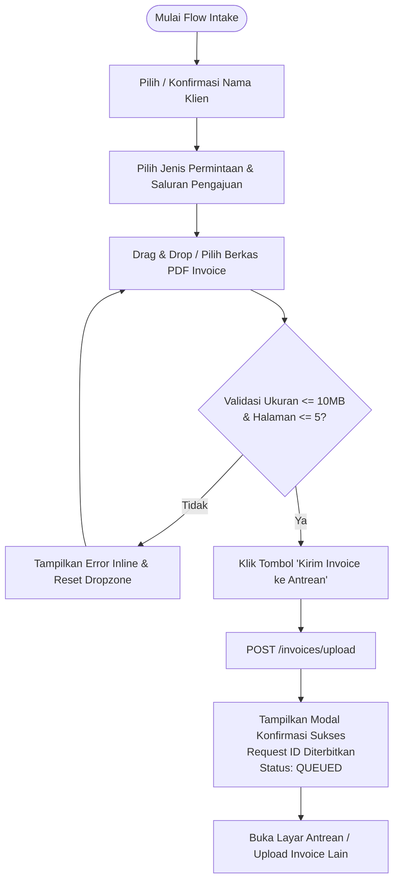
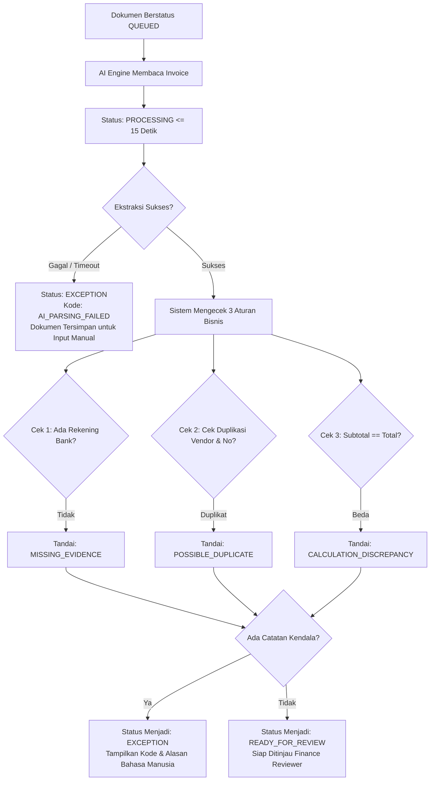
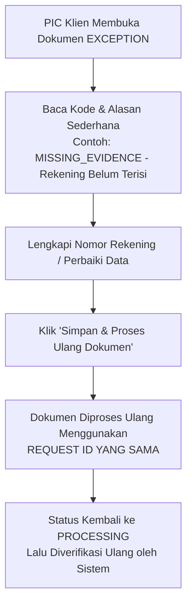

# DESIGN REQUIREMENTS DOCUMENT (DRD)

**AMIGA Robot Admin: Intelligent Vendor Invoice-to-Voucher Processing**

| Atribut Dokumen | Rincian Desain |
| :--- | :--- |
| **Versi Dokumen** | v1.0 (Desain Sistem & Spesifikasi Antarmuka Lengkap) |
| **Tanggal Efektif** | 13 Oktober 2026 |
| **Status Dokumen** | Approved for Implementation (Sprint 0 - Sprint 3) |
| **Dokumen Acuan** | BRD v1.1, PRD v1.1, SRD v1.0, DESIGN-examples.md |
| **Peran Penulis** | Lead Product Designer & Design Systems Architect (Team 11 MAIN) |
| **Arah Visual** | Navy Ink on Cool Marble (Financial Control Tower) |

---

## 1. Problem Statement & Visi Desain

### 1.1 Problem Statement Desain
Sebelum AMIGA Robot Admin dirancang, alur operasional pengelolaan tagihan vendor klien berada dalam kondisi terfragmentasi, bising, dan rentan terhadap kesalahan manusia:
1. **Fragmentasi Saluran Komunikasi**: Status pekerjaan dan berkas invoice tercecer antara chat WhatsApp, lampiran email, dan spreadsheet lokal. Pengguna tidak memiliki kepastian status (*state visibility*) tanpa bertanya manual kepada PIC.
2. **Kelelahan Kognitif & Entri Manual**: Finance Reviewer harus bolak-balik mengganti jendela aplikasi antara PDF viewer eksternal dan lembar Excel, mengetik ulang angka nominal berdigit panjang dan nomor rekening bank. Hal ini memicu keletihan mata dan risiko tinggi salah ketik.
3. **Ketiadaan Konteks Kendala**: Ketika tagihan tertahan, tidak ada bahasa visual terstandar yang menjelaskan kepada PIC Klien mengapa dokumen bermasalah dan bagian mana yang perlu diperbaiki.

### 1.2 Visi Desain (Design Vision)
Menciptakan **"A Quiet, High-Density Financial Control Tower"**: antarmuka kerja keuangan modern yang tenang, percaya diri, dan berpresisi tinggi. Desain memadukan kanvas marmer dingin (*cool marble*) dengan tipografi tinta biru dongker gelap (*ink navy*) dan aksen biru sinyal (*signal blue*) yang tegas. 

Antarmuka ini tidak dirancang seperti dashboard landing page generik yang penuh hiasan dekoratif, melainkan sebagai alat kerja profesional yang menghadirkan **Dual-Context Split Screen** yang sinkron, proteksi kesalahan sistematis (*preventive guardrails*), serta kejelasan hierarki data finansial tanpa beban kognitif yang sia-sia.

---

## 2. Prinsip-Prinsip Desain (Design Principles)

Empat nilai inti yang wajib dipatuhi di setiap layar dan komponen:

### D-1. Radical Clarity & Dual-Context (Kejelasan Ekstrem & Konteks Ganda)
Finance Reviewer tidak boleh dipaksa mengingat data dari layar sebelumnya (*no memory strain*). Dokumen asli PDF dan data ekstraksi digital yang dapat diedit harus selalu hadir berdampingan dalam satu pandangan (*split-screen*). Setiap angka hasil ekstraksi memiliki penanda visual yang jelas terhadap status validitasnya.

### D-2. Preventive Guardrails & SoD Integrity (Pagar Pengaman Preventif)
Desain aktif mencegah kesalahan sebelum transaksi dieksekusi. Batasan kewenangan pemisahan tugas (*Segregation of Duties*) disampaikan secara transparan dan manusiawi: tombol persetujuan dinonaktifkan atau diberikan penjelas yang jelas jika pengguna adalah pengunggah dokumen yang sama, lengkap dengan pesan sistem otomatis yang netral dan tanpa stigma.

### D-3. Calm Authority: Navy Ink on Cool Marble (Otoritas Tenang & Berwibawa)
Menghilangkan warna hitam pekat `#000000` yang tajam dan melelahkan mata. Seluruh teks dan elemen visual dirender menggunakan palet biru tinta gelap (*Ink Navy*) di atas permukaan kanvas putih marmer sejuk. Warna aksen biru cerah (*Signal Blue*) dikhususkan hanya untuk tindakan primer (*primary CTAs*). Tidak ada gradien warna-warni AI ungu/cyan yang membingungkan.

### D-4. Forgiving & Actionable Error States (Kendala yang Dapat Ditindaklanjuti)
Status `EXCEPTION` tidak boleh menjadi jalan buntu (*dead end*). Setiap kendala menampilkan kode resmi, alasan berbahasa Indonesia sederhana, serta tombol aksi langsung untuk memperbaiki data dengan tetap mempertahankan Request ID yang sama.

---

## 3. Style Guide, Design Tokens & Arah Visual

Arah visual mengadopsi referensi *Navy ink on cool marble* yang terkalibrasi khusus untuk aplikasi keuangan perusahaan (diadaptasi dari fondasi `DESIGN-examples.md`).

### 3.1 Palet Warna & Semantic Tokens

Sesuai permintaan kebutuhan produk, **Warna Biru menjadi warna utama sistem**.

```css
:root {
  /* === PRIMARY CORE BRAND PALETTE === */
  --color-ink-navy: #0B3558;       /* Teks primer, heading, border tegas, dark surface */
  --color-signal-blue: #006BFF;    /* Aksi utama (Primary CTA), link aktif, tab terpilih */
  --color-slate-gray: #476788;     /* Teks sekunder, label formulir, icon netral */
  --color-mist-gray: #A6BBD1;      /* Garis pembatas halus, disabled text, placeholder */

  /* === SURFACES & CANVAS === */
  --surface-canvas: #F8F9FB;       /* Latar belakang utama aplikasi (Cool Marble) */
  --surface-card: #FFFFFF;         /* Permukaan panel elevated, form card, table row */
  --surface-subtle: #F0F3F8;       /* Input fill, badge neutral background, hover wash */
  --surface-hairline: #D4E0ED;     /* Border 1px pada card, input, dan tabel */

  /* === SEMANTIC STATUS TOKENS (STATUS & VERIFIKASI) === */
  /* Exception & Error */
  --status-exception-text: #B91C1C;
  --status-exception-bg: #FEF2F2;
  --status-exception-border: #FECACA;

  /* Ready for Review & Warning */
  --status-ready-text: #B45309;
  --status-ready-bg: #FFFBEB;
  --status-ready-border: #FDE68A;

  /* Approved / Reviewed / Sent */
  --status-success-text: #047857;
  --status-success-bg: #ECFDF5;
  --status-success-border: #A7F3D0;

  /* Processing AI */
  --status-processing-text: #1D4ED8;
  --status-processing-bg: #EFF6FF;
  --status-processing-border: #BFDBFE;

  /* Queued / Neutral */
  --status-queued-text: #476788;
  --status-queued-bg: #F1F5F9;
  --status-queued-border: #CBD5E1;
}
```

#### Tabel Pemetaan Warna Status Dokumen

| Status Dokumen | Background Fill | Border Stroke | Text Color | Ikon Representatif |
| :--- | :--- | :--- | :--- | :--- |
| **QUEUED** | `#F1F5F9` | `#CBD5E1` | `#476788` | Jam Pasir / Antrean |
| **PROCESSING** | `#EFF6FF` | `#BFDBFE` | `#1D4ED8` | Putaran Proses AI |
| **READY_FOR_REVIEW** | `#FFFBEB` | `#FDE68A` | `#B45309` | Tanda Periksa Kuning |
| **EXCEPTION** | `#FEF2F2` | `#FECACA` | `#B91C1C` | Tanda Seru Merah |
| **AMIGA_REVIEWED** | `#ECFDF5` | `#A7F3D0` | `#047857` | Lencana Centang Hijau |
| **SENT_TO_CLIENT** | `#EFF6FF` | `#93C5FD` | `#006BFF` | Dokumen Terkirim Biru |

### 3.2 Tipografi (Typography Hierarchy)

- **Font Keluarga Utama**: `Manrope` (alternatif: `Gilroy` / `Inter`). Alasan: Manrope memiliki bukaan huruf lebar (*open apertures*), geometri humanis yang hangat, serta fitur angka tabular (*tabular figures*) bawaan yang memastikan kolom mata uang Rupiah dan angka kuantitas selalu rata secara vertikal.
- **Font Angka & Kode Teknis**: `JetBrains Mono` / `ui-monospace`. Digunakan khusus untuk Request ID (`REQ-20261013-00042`), Nomor Invoice, dan Nomor Rekening Bank.

```css
:root {
  /* Font Family */
  --font-family-sans: 'Manrope', -apple-system, BlinkMacSystemFont, "Segoe UI", Roboto, sans-serif;
  --font-family-mono: 'JetBrains Mono', monospace;

  /* Type Scale */
  --font-size-display: 32px;   /* Ringkasan metrik dashboard */
  --font-size-h1: 24px;        /* Judul utama halaman */
  --font-size-h2: 18px;        /* Header seksi / modal */
  --font-size-h3: 15px;        /* Sub-header / card title */
  --font-size-body: 14px;      /* Teks isi standar, label form, isi tabel */
  --font-size-body-sm: 13px;   /* Helper text, metadata pendukung */
  --font-size-caption: 11px;   /* Badge status, timestamp audit */

  /* Line Heights */
  --line-height-tight: 1.2;
  --line-height-normal: 1.5;
  --line-height-relaxed: 1.6;

  /* Font Weights */
  --weight-regular: 400;
  --weight-medium: 500;
  --weight-semibold: 600;
  --weight-bold: 700;
}
```

### 3.3 Ikonografi & Visual Motifs
- **Gaya Ikon**: Garis tipis 1.5px (*clean stroke geometric line icons*), monokromatis mengikuti warna teks induknya.
- **Aturan Penggunaan**: Ikon murni bersifat fungsional (bantu navigasi dan penanda status), bukan dekorasi estetis.
- **Apa yang Dilarang Keras (Anti-Slop Check)**:
  - Dilarang menggunakan ikon generic AI seperti kilau bintang (*sparkles*), sihir (*magic wand*), kubus bersinar, atau robot.
  - Dilarang menggunakan tombol dengan bentuk kapsul lonjong (*pill-shaped 9999px*) untuk kontrol utama tabel. Gunakan radius terkalibrasi 8px.
  - Dilarang menggunakan efek kaca blur berlebihan (*excessive glassmorphism*) pada panel tabel.
  - Dilarang menggunakan teks hitam absolut `#000000`.

### 3.4 Spasi, Radius, & Elevasi (Spacing & Elevation Tokens)

```css
:root {
  /* Spacing Grid (8px Base Unit) */
  --space-4: 4px;
  --space-8: 8px;
  --space-12: 12px;
  --space-16: 16px;
  --space-20: 20px;
  --space-24: 24px;
  --space-32: 32px;
  --space-40: 40px;

  /* Border Radii */
  --radius-xs: 4px;     /* Checkbox, tag kecil */
  --radius-sm: 6px;     /* Badge status, dropdown item */
  --radius-md: 8px;     /* Tombol aksi, input field, modal form */
  --radius-lg: 12px;    /* Container card, preview panel */
  --radius-xl: 16px;    /* Floating container besar */

  /* Elevation Shadows (Blue-Tinted Natural Depth) */
  --shadow-subtle: 0 1px 3px rgba(11, 53, 88, 0.05);
  --shadow-card: 0 4px 12px rgba(11, 53, 88, 0.06), 0 1px 2px rgba(11, 53, 88, 0.04);
  --shadow-elevated: 0 12px 24px -4px rgba(11, 53, 88, 0.08), 0 4px 6px -2px rgba(11, 53, 88, 0.03);
  --shadow-modal: 0 20px 35px -5px rgba(11, 53, 88, 0.15);
}
```

---

## 4. User Flows & User Experience (UX)

### 4.1 Flow 1: Intake & Pengunggahan Dokumen (PIC Klien & Intake Support)



### 4.2 Flow 2: Ekstraksi AI & Verifikasi Otomatis Sistem



### 4.3 Flow 3: Peninjauan Split-Screen & Cek Segregation of Duties (Finance Reviewer)

```mermaid
graph TD
    OpenDoc[Reviewer Membuka Dokumen READY_FOR_REVIEW] --> SplitScreen[Layar Split Screen Terbuka <= 2 Detik\nKiri: PDF Asli | Kanan: Form Digital]
    SplitScreen --> CheckData[Periksa Data Header, Baris Barang, & Rekening]

    CheckData --> NeedEdit{Perlu Koreksi Nilai?}
    NeedEdit -- Ya --> EditField[Koreksi Nominal / Deskripsi\nSistem Catat Old Value & New Value]
    NeedEdit -- Tidak --> Decision{Pilih Aksi Reviewer}

    EditField --> Decision

    Decision -- Kembalikan --> ReturnModal[Input Alasan Pengembalian Wajib]
    ReturnModal --> ReturnSubmit[Status Menjadi EXCEPTION\nKembali ke PIC Klien]

    Decision -- Setujui Dokumen --> SoDCheck{Cek Sistem SoD:\nApakah Reviewer == Uploader?}

    SoDCheck -- Ya: Melanggar SoD --> RejectSoD[TOLAK PERSETUJUAN SECARA OTOMATIS]
    RejectSoD --> AutoReassign[Sistem Otomatis Alihkan Dokumen\nke Reviewer Lain yang Tersedia]
    AutoReassign --> AuditSoD[Jejak Audit Mencatat Penolakan SoD]
    AuditSoD --> NotifyUser[Tampilkan Pemberitahuan Informatif]

    SoDCheck -- Tidak: Lolos SoD --> ApproveSuccess[Status: AMIGA_REVIEWED]
    ApproveSuccess --> GenPDF[Sistem Buat Voucher PDF <= 3 Detik]
    GenPDF --> HandoverReady[Voucher Siap Diserahkan ke Klien]
```

### 4.4 Flow 4: Perbaikan Dokumen EXCEPTION (PIC Klien)



---

## 5. Screen Inventory & Layouting (5 Layar Utama)

### Layar 01: Dashboard Antrean Kerja
- **Target Persona**: Service Lead, Finance Reviewer.
- **Tujuan Utama**: Memantau volume transaksi real-time, mendeteksi bottleneck per reviewer, memfilter pekerjaan berdasarkan klien dan status.
- **Hirarki Visual**:
  1. Top Bar: Profil pengguna, nama peran, delegasi aktif.
  2. Metric Cards Strip (4 kolom): Antrean Total, Membutuhkan Review, Kendala (Exceptions), Selesai Hari Ini.
  3. Filter Bar: Filter Klien dropdown, Filter Status multi-select, Toggle Dokumen Bermasalah, Search Bar.
  4. Workload Distribution Section (Khusus Service Lead): Kapasitas per reviewer, tombol alihkan tugas.
  5. Primary Table: Request ID, Klien, Vendor, Tanggal, Nominal Total, Status Badge, Reviewer Bertugas, Aksi.
- **Primary Action**: "Buka Dokumen untuk Peninjauan".
- **Layout Wireframe (ASCII)**:

```
+----------------------------------------------------------------------------------------------------+
|  AMIGA Robot Admin           [Klien: Semua Klien v]               [Finance Reviewer: Budi v] [O]  |
+----------------------------------------------------------------------------------------------------+
|  RINGKASAN ANTREAN KERJA                                                                           |
|  +--------------------+  +--------------------+  +--------------------+  +--------------------+    |
|  | TOTAL ANTREAN      |  | SIAP DITINJAU      |  | DALAM KENDALA      |  | SELESAI HARI INI   |    |
|  | 28 Dokumen         |  | 12 Dokumen         |  | 4 Dokumen          |  | 19 Dokumen         |    |
|  +--------------------+  +--------------------+  +--------------------+  +--------------------+    |
|                                                                                                    |
|  [Cari Request ID / Vendor...] [Status: Semua v] [Tenggat: Hari Ini v] [x Hanya Bermasalah]        |
|  +-----------------------------------------------------------------------------------------------+ |
|  | REQ ID          | KLIEN        | VENDOR           | NOMINAL      | STATUS       | REVIEWER | AKSI | |
|  +-----------------+--------------+------------------+--------------+--------------+----------+------+ |
|  | REQ-20261013-01 | PT Alpha     | PT Sumber Sarana | Rp15.400.000 | READY_REVIEW | Budi S   | [Buka]|
|  | REQ-20261013-02 | PT Beta Indo | CV Logistik Jaya | Rp 4.250.000 | EXCEPTION    | Sarah M  | [Buka]|
|  | REQ-20261013-03 | PT Alpha     | PT Solusi Data   | Rp38.000.000 | PROCESSING   | (AI)     | [Buka]|
|  +-----------------------------------------------------------------------------------------------+ |
|  Showing 1 - 3 of 28 documents                                         [< Previous]  [Next >]      |
+----------------------------------------------------------------------------------------------------+
```

---

### Layar 02: Pengunggahan Dokumen (Intake)
- **Target Persona**: PIC Klien, Intake Support.
- **Tujuan Utama**: Mengunggah berkas PDF faktur/invoice vendor, melengkapi metadata wajib, dan memantau penerbitan Request ID.
- **Hirarki Visual**:
  1. Header: Judul instruksi singkat, penanda hak delegasi klien.
  2. Two-Column Layout:
     - Kiri: Form Metadata Wajib (Nama Klien, Jenis Permintaan, Saluran Pengajuan, Tanggal Invoice).
     - Kanan: Drag & Drop Zone interaktif berkas PDF (Maksimal 5 halaman, indikator preview ringkas).
  3. Action Footbar: Tombol batalkan dan tombol primer "Kirim Invoice ke Antrean".
  4. Bottom Alert Banner: Keterangan waktu pemrosesan otomatis AI (SLA <= 15 detik).
- **Primary Action**: "Kirim Invoice ke Antrean".
- **Layout Wireframe (ASCII)**:

```
+----------------------------------------------------------------------------------------------------+
|  AMIGA Robot Admin           [Formulir Intake Invoice]                 [PIC Klien: PT Alpha v] [O]  |
+----------------------------------------------------------------------------------------------------+
|  UNGGAH INVOICE TAGIHAN VENDOR                                                                     |
|  Lengkapi formulir metadata dan lampirkan berkas invoice vendor resmi dalam format PDF.            |
|                                                                                                    |
|  +--------------------------------------------+  +-----------------------------------------------+ |
|  | METADATA PERMINTAAN                        |  | LAMPIRAN BERKAS INVOICE (PDF)                 | |
|  |                                            |  |                                               | |
|  | Organisasi Klien *                         |  |  + - - - - - - - - - - - - - - - - - - - - +  | |
|  | [ PT Alpha Teknologi Utama            v ]  |  |  |           [ Ikon Unggah Dokumen ]       |  | |
|  |                                            |  |  |                                         |  | |
|  | Jenis Permintaan *                         |  |  |    Tarik & Letakkan file PDF di sini    |  | |
|  | [ Pembayaran Tagihan Vendor Eksternal v ]  |  |  |             atau [Pilih Berkas]         |  | |
|  |                                            |  |  |                                         |  | |
|  | Saluran Asal Pengajuan *                   |  |  |  Format PDF digital | Maks. 5 Halaman   |  | |
|  | [ Email Kantor (finance@alpha.co.id)   v ]  |  |  |  Ukuran file maksimal: 10 Megabytes     |  | |
|  |                                            |  |  + - - - - - - - - - - - - - - - - - - - - +  | |
|  | Tanggal Pengajuan *                        |  |                                               | |
|  | [ 13 / 10 / 2026                      [#] ]|  |  File terpilih: invoice_vendor_oktober.pdf    | |
|  |                                            |  |  Ukuran: 2.4 MB | Halaman: 3 Halaman [x Hapus]| |
|  +--------------------------------------------+  +-----------------------------------------------+ |
|                                                                                                    |
|  [Batal]                                                      [ Kirim Invoice ke Antrean (P0) > ]  |
+----------------------------------------------------------------------------------------------------+
```

---

### Layar 03: Peninjauan & Verifikasi (Split-Screen)
- **Target Persona**: Finance Reviewer AMIGA.
- **Tujuan Utama**: Memeriksa akurasi ekstraksi data berdampingan dengan dokumen fisik PDF asli, mengoreksi baris barang, melihat indikator validasi sistem, dan memutuskan persetujuan dengan proteksi SoD.
- **Hirarki Visual**:
  1. Top Utility Header: Nomor Request ID, Status Saat Ini, Zoom Toolbar PDF, Indikator Segregation of Duties.
  2. Split Workspace (Rasio 50% : 50% Desktop):
     - Panel Kiri: Embedded PDF Viewer asli dengan fungsi Pan, Zoom, Page Navigator (1/3).
     - Panel Kanan: Editable Form Editor terstruktur (Data Header Vendor, Tabel Rincian Line Items, Data Pembayaran Bank, Box Catatan Kendala).
  3. Validation Issue Pill Strip: Penanda aktif `MISSING_EVIDENCE`, `CALCULATION_DISCREPANCY`, atau `POSSIBLE_DUPLICATE`.
  4. Fixed Footer Actions:
     - Kiri: Tombol "Kembalikan ke PIC (Exception)" dengan input modal alasan.
     - Kanan: Tombol "Simpan Draf Koreksi" dan Tombol Primer "Setujui Dokumen (Approve)".
- **Primary Action**: "Setujui Dokumen".
- **Layout Wireframe (ASCII)**:

```
+----------------------------------------------------------------------------------------------------+
|  REQ-20261013-00042  |  Klien: PT Alpha  |  Status: [ READY_FOR_REVIEW ]  |  SoD: Aman (Reviewer)  |
+----------------------------------------------------------------------------------------------------+
|  [PDF Asli: zoom - 100% + | Hal 1/2]          |  [Data Ekstraksi Digital (Dapat Diedit)]           |
|  +------------------------------------------+ |  +-----------------------------------------------+ |
|  | INVOICE                                  | |  | INFORMASI UTAMA VENDOR                        | |
|  | PT SUMBER BERKAH                         | |  | Nama Vendor:    [ PT Sumber Berkah        ]   | |
|  | No: INV/2026/089                         | |  | No. Invoice:    [ INV/2026/089            ]   | |
|  | Tgl: 10 Okt 2026                         | |  | Tanggal:        [ 2026-10-10              ]   | |
|  |                                          | |  +-----------------------------------------------+ |
|  | Rincian Barang:                          | |  | RINCIAN LINE ITEMS (Multi-baris)              | |
|  | 1. Cloud Server     1 unit  12.000.000   | |  | Deskripsi         | Qty | Harga Sat | Subtotal    | |
|  | 2. Maintenance Supp 1 unit   3.000.000   | |  | Cloud Server      |  1  | 12.000.000| 12.000.000  | |
|  |                                          | |  | Maintenance Supp  |  1  |  3.000.000|  3.000.000  | |
|  | Subtotal:                   15.000.000   | |  | Subtotal: Rp15.000.000 | PPN (11%): Rp1.650.000 | |
|  | PPN 11%:                     1.650.000   | |  | TOTAL AKHIR:    [ Rp 16.650.000           ]   | |
|  | TOTAL:                      16.650.000   | |  +-----------------------------------------------+ |
|  |                                          | |  | INFORMASI PEMBAYARAN REKENING                 | |
|  | Rek: BCA 8800112233                      | |  | Bank: [ BCA ]  No Rek: [ 8800112233 ]         | |
|  | a/n PT Sumber Berkah                     | |  | Nama Penerima: [ PT Sumber Berkah ]           | |
|  +------------------------------------------+ |  +-----------------------------------------------+ |
|                                                                                                    |
|  [<- Kembali ke Antrean]  [Kembalikan ke PIC...]     [Simpan Koreksi]   [ Setujui Dokumen (Voucher) ]|
+----------------------------------------------------------------------------------------------------+
```

---

### Layar 04: Pratinjau Voucher (Preview & Handover)
- **Target Persona**: Finance Reviewer, PIC Klien.
- **Tujuan Utama**: Memeriksa tampilan akhir voucher pembayaran resmi AMIGA sebelum diteruskan ke Client Approver eksternal, dan mengunduh berkas PDF resmi.
- **Hirarki Visual**:
  1. Header Status: "Dokumen Telah Ditinjau Tim Keuangan AMIGA" (Status: `AMIGA_REVIEWED`).
  2. Document Canvas: Render visual voucher pembayaran format standar AMIGA (Ukuran A4).
  3. Non-Removable Banner: Kotak peringatan teks batas legalitas otorisasi pembayaran klien.
  4. Action Toolbar: Tombol "Cetak Voucher" dan Tombol Primer "Unduh Voucher PDF Resmi".
- **Primary Action**: "Unduh Voucher PDF Resmi".
- **Layout Wireframe (ASCII)**:

```
+----------------------------------------------------------------------------------------------------+
|  AMIGA Robot Admin           [Pratinjau Voucher Pembayaran]            [PIC Klien: PT Alpha v] [O]  |
+----------------------------------------------------------------------------------------------------+
|  PRATINJAU VOUCHER RESMI                                             Status: [ AMIGA_REVIEWED ]    |
|                                                                                                    |
|  +-----------------------------------------------------------------------------------------------+ |
|  |  AMIGA OPERATING PARTNER                       PAYMENT VOUCHER                                | |
|  |  No. Voucher: VCH/202610/CLI-ALPHA/00042       Tanggal: 13 Oktober 2026                       | |
|  |                                                                                               | |
|  |  Dibayarkan Kepada : PT Sumber Berkah          Referensi Request ID : REQ-20261013-00042      | |
|  |  Bank Tujuan       : Bank Central Asia (BCA)   Nomor Invoice Vendor : INV/2026/089            | |
|  |  Nomor Rekening    : 8800112233                Tanggal Invoice      : 10 Oktober 2026         | |
|  |  Nama Rekening     : PT Sumber Berkah          Jumlah Transfer      : Rp 16.650.000,-         | |
|  |                                                                                               | |
|  |  Terbilang: Enam Belas Juta Enam Ratus Lima Puluh Ribu Rupiah                                 | |
|  |                                                                                               | |
|  |  Diverifikasi Oleh: Budi Santoso (Finance Reviewer)   Waktu Persetujuan: 13/10/2026 14:20 WIB | |
|  |                                                                                               | |
|  |  +-----------------------------------------------------------------------------------------+  | |
|  |  | BATAS OTORISASI: Voucher ini diterbitkan atas dasar verifikasi tim Keuangan AMIGA.       |  | |
|  |  | Otorisasi pembayaran akhir dan eksekusi transfer dana merupakan kewenangan mutlak     |  | |
|  |  | Client Approver di luar sistem AMIGA. Dokumen ini sah tanpa tanda tangan basah.         |  | |
|  |  +-----------------------------------------------------------------------------------------+  | |
|  +-----------------------------------------------------------------------------------------------+ |
|                                                                                                    |
|  [<- Kembali ke Antrean]                                      [ Unduh Voucher PDF Resmi (v) ]      |
+----------------------------------------------------------------------------------------------------+
```

---

### Layar 05: Riwayat & Jejak Audit (Audit Trail)
- **Target Persona**: Semua peran sesuai hak akses (Auditor, Reviewer, PIC Klien, System Admin).
- **Tujuan Utama**: Menampilkan kronologi tidak dapat diubah (*immutable timeline*) dari seluruh peristiwa yang terjadi pada dokumen.
- **Hirarki Visual**:
  1. Header Dokumen: Nomor Request ID, Klien Pemilik, Tanggal Terbit, Status Terkini.
  2. Filter Jejak: Tampilkan Semua, Perubahan Data Saja, Riwayat Persetujuan & SoD.
  3. Chronological Vertical Timeline: Tiap entri memuat Avatar Aktor, Nama & Peran, Jenis Aktivitas, Waktu Presisi, dan Delta Perubahan Data (*old value -> new value*).
- **Primary Action**: "Ekspor Catatan Audit (CSV/PDF)".
- **Layout Wireframe (ASCII)**:

```
+----------------------------------------------------------------------------------------------------+
|  JEJAK AUDIT DOKUMEN: REQ-20261013-00042                               [ Hak Akses: Terisolasi ]   |
+----------------------------------------------------------------------------------------------------+
|  Status Terkini: [ SENT_TO_CLIENT ] | Klien: PT Alpha | Tanggal: 13 Okt 2026                       |
|                                                                                                    |
|  (o) 13/10/2026 14:35 WIB - VOUCHER_DOWNLOADED                                                     |
|      Aktor: Andi Wijaya (PIC Klien) | IP: 182.253.12.44                                            |
|      Status berubah dari [ AMIGA_REVIEWED ] menjadi [ SENT_TO_CLIENT ]                             |
|      Aksi: Mengunduh berkas voucher resmi VCH/202610/CLI-ALPHA/00042.pdf                           |
|      |                                                                                             |
|  (o) 13/10/2026 14:20 WIB - REVIEW_APPROVED                                                        |
|      Aktor: Budi Santoso (Finance Reviewer) | IP: 103.11.24.9                                      |
|      Status berubah dari [ READY_FOR_REVIEW ] menjadi [ AMIGA_REVIEWED ]                           |
|      Catatan SoD: Lolos verifikasi pemisahan tugas (Uploader != Reviewer).                         |
|      |                                                                                             |
|  (o) 13/10/2026 14:15 WIB - FIELD_VALUE_MODIFIED                                                   |
|      Aktor: Budi Santoso (Finance Reviewer)                                                        |
|      Perubahan field 'total_amount': Nilai lama [ 15000000 ] -> Nilai baru [ 16650000 ]           |
|      Alasan: Penambahan komponen pajak PPN 11% yang belum terjumlah pada draf ekstraksi AI.        |
|      |                                                                                             |
|  (o) 13/10/2026 14:02 WIB - SYSTEM_VERIFICATION_PASSED                                             |
|      Aktor: AMIGA Verification Engine (Sistem Otomatis)                                            |
|      Status berubah dari [ PROCESSING ] menjadi [ READY_FOR_REVIEW ]                               |
|      Pemeriksaan: Tidak ditemukan duplikasi, nomor rekening lengkap, perhitungan seimbang.         |
|      |                                                                                             |
|  (o) 13/10/2026 14:00 WIB - INTAKE_DOCUMENT_UPLOADED                                               |
|      Aktor: Andi Wijaya (PIC Klien) atas nama PT Alpha                                             |
|      Status awal diterbitkan: [ QUEUED ]                                                           |
|      File: invoice_vendor_oktober.pdf (3 halaman, 2.4 MB)                                          |
+----------------------------------------------------------------------------------------------------+
```

---

## 6. Komponen Library (Design System Components)

Seluruh komponen dirancang modular dan reuseable dengan token warna yang telah didefinisikan.

### 6.1 Tombol (Button System)
- **Varian**:
  - `Primary`: Background `--color-signal-blue` (`#006BFF`), Teks Putih, Radius 8px, Hover `#0058D6`, Active `#0048B3`.
  - `Secondary / Dark`: Background `--color-ink-navy` (`#0B3558`), Teks Putih, Radius 8px, Hover `#07243C`.
  - `Outline`: Background Transparan, Border 1px `--surface-hairline`, Teks `--color-ink-navy`, Hover Background `--surface-subtle`.
  - `Danger`: Background `--status-exception-bg`, Border 1px `--status-exception-border`, Teks `--status-exception-text`.
  - `Ghost`: Tanpa border, Teks `--color-slate-gray`, Hover Teks `--color-ink-navy`.
- **States**: Default, Hover, Focused (Ring 2px `#006BFF`), Disabled (Opacity 50%, Not-allowed), Loading (Spinner ring spinner).
- **Aturan UX**: Tombol primer pada formulir kritis tidak menggunakan ikon panah generic `->`.

### 6.2 Status Badge (Pill Indicators)
- **Varian Berdasarkan Status**:
  - `Queued`: Background `#F1F5F9`, Border `#CBD5E1`, Teks `#476788`.
  - `Processing`: Background `#EFF6FF`, Border `#BFDBFE`, Teks `#1D4ED8`.
  - `Ready for Review`: Background `#FFFBEB`, Border `#FDE68A`, Teks `#B45309`.
  - `Exception`: Background `#FEF2F2`, Border `#FECACA`, Teks `#B91C1C`.
  - `Reviewed`: Background `#ECFDF5`, Border `#A7F3D0`, Teks `#047857`.
  - `Sent`: Background `#EFF6FF`, Border `#93C5FD`, Teks `#006BFF`.
- **States**: Static label, Interactive click filterable (pada table header).

### 6.3 Input Fields & Dropdowns
- **Tipe**: Text Input, Currency Input (Format Rupiah otomatis), Datepicker, Select Dropdown.
- **Tokens**:
  - Background: `--surface-subtle` (`#F0F3F8`).
  - Border: 1px Solid `--surface-hairline` (`#D4E0ED`).
  - Font: 14px Manrope, warna teks `--color-ink-navy`.
  - Focus State: Border 1px `--color-signal-blue`, Box Shadow `0 0 0 3px rgba(0, 107, 255, 0.15)`.
  - Error State: Border 1px `--status-exception-border`, Helper text merah dengan ikon seru.

### 6.4 Data Table Rincian (Line Items Table)
- **Fitur Utama**:
  - Header tabel dengan latar belakang `--surface-subtle` dan teks uppercase 12px `--color-slate-gray`.
  - Kolom nominal rata kanan (*right-aligned*) menggunakan font tabular figures.
  - Setiap sel yang telah diedit manual oleh reviewer memiliki penanda titik kuning kecil (*indicator dot*) sebagai indikasi revisi.

### 6.5 Modal Dialog (Persetujuan & Pengembalian Dokumen)
- **Spesifikasi**:
  - Backdrop: Overlay `rgba(11, 53, 88, 0.4)` dengan blur 2px.
  - Container: Background Putih, Radius 12px, Shadow `--shadow-modal`.
  - Aksesibilitas: Dapat ditutup menggunakan tombol keyboard `Esc`, trap focus di dalam modal.

---

## 7. State Matrix (Kondisi Layar Kunci)

Setiap layar kunci dijamin memiliki 5 kondisi tampilan yang tertangani secara utuh:

| Layar Kunci | Empty State | Loading State | Error State | Success State | Offline State |
| :--- | :--- | :--- | :--- | :--- | :--- |
| **01 Dashboard Antrean** | Ilustrasi rapi: "Belum ada antrean dokumen aktif. Invoice baru akan muncul di sini." | Shimmer skeleton cards (4 buah) dan skeleton table 5 baris. | Banner merah: "Gagal memuat antrean server. Coba muat ulang." | Tampilan daftar tabel lengkap dengan badge status real-time. | Badge kuning: "Mode Offline. Menampilkan data cache lokal terakhir." |
| **02 Intake Upload** | Area dropzone bersih dengan teks instruksi drag & drop. | Progress bar persentase upload (0 - 100%) dengan SLA timer. | Alert merah: "File ditolak: Berkas melebihi 5 halaman atau bukan PDF." | Banner hijau sukses dengan tombol langsung melihat status antrean. | Tombol submit dinonaktifkan: "Koneksi terputus. Harap sambungkan internet." |
| **03 Split Review** | Kotak peringatan: "Dokumen tidak ditemukan atau akses ditolak." | Spinner sinkron: "Memuat berkas PDF dan data ekstraksi AI..." | Banner kendala: "Gagal memuat PDF asli dari penyimpanan cloud." | Split screen interaktif penuh, field editable aktif. | Notifikasi: "Koneksi offline: Perubahan draf disimpan di browser lokal." |
| **04 Pratinjau Voucher** | "Voucher belum dapat diterbitkan sebelum review disetujui." | Shimmer template voucher A4 sedang dikompilasi (SLA <= 3s). | "Gagal menghasilkan berkas voucher. Klik untuk proses ulang." | Tampilan voucher resmi siap unduh dengan tombol aktif. | Tombol unduh membuka berkas yang telah ter-cache lokal jika tersedia. |
| **05 Jejak Audit** | "Belum ada riwayat aktivitas yang tercatat untuk dokumen ini." | Skeleton bar timeline vertikal memanjang ke bawah. | "Gagal mengambil data jejak audit dari server ledger." | Kronologi lengkap tersusun rapi dengan delta data akurat. | Menampilkan catatan histori terakhir yang berhasil dimuat. |

---

## 8. Perilaku Responsif (Responsive Behaviour)

Sistem dirancang berfokus pada efisiensi kerja di layar komputer desktop tanpa mengabaikan aksesibilitas peninjauan di tablet maupun ponsel.

### 8.1 Desktop Breakpoint (>= 1280px)
- **Tata Letak**: Standar operasional penuh.
- **Layar Review**: Mode Split-Screen murni berdampingan (Panel Kiri 50% PDF Viewer : Panel Kanan 50% Form Editor). Keduanya memiliki independent vertical scrollbar.
- **Dashboard**: Tampilan 4 kartu metrik horisontal dan tabel data multi-kolom penuh.

### 8.2 Tablet Breakpoint (768px - 1279px)
- **Tata Letak**: Layout adaptif fluid.
- **Layar Review**: Menggunakan sistem **Tab Toggle View** di bagian atas ("Lihat PDF Asli" vs "Formulir Data Ekstraksi") atau split stacked atas-bawah (atas PDF viewer, bawah tabel rincian).
- **Dashboard**: Metrik kartu menjadi grid 2x2, tabel mendukung horizontal scroll halus dengan fixed column aksi di kanan.

### 8.3 Mobile Breakpoint (<= 767px)
- **Fokus Penggunaan**: Membantu PIC Klien mengunggah dokumen darurat atau memantau status penyelesaian tagihan.
- **Layar Intake**: Formulir linier satu kolom vertikal penuh, area dropzone bertransformasi menjadi tombol "Ambil Berkas PDF dari Perangkat".
- **Layar Review**: Reviewer diarahkan menggunakan desktop untuk akurasi verifikasi, namun jika diakses via mobile, sistem menyajikan tampilan ringkasan kartu data dengan tombol unduh voucher PDF.
- **Sentuhan Mobile**: Seluruh target ketukan (*tap targets*) minimal berukuran 44px x 44px untuk menjamin kenyamanan navigasi jari.

---

## 9. Aksesibilitas & Standar Inklusif (WCAG 2.1 AA)

1. **Rasio Kontras Warna (Contrast Ratio)**:
   - Teks utama (`#0B3558`) di atas kanvas putih marmer (`#FFFFFF` / `#F8F9FB`) menghasilkan rasio kontras **10.8:1** (jauh melampaui standar WCAG AA 4.5:1).
   - Teks sekunder (`#476788`) menghasilkan rasio kontras **5.2:1** (lulus standar normal text).
   - Seluruh teks tombol primer putih di atas Signal Blue (`#006BFF`) menghasilkan rasio kontras **4.6:1** (lulus WCAG AA).
2. **Urutan Fokus & Navigasi Keyboard (Focus Order)**:
   - Tombol keyboard `Tab` dan `Shift + Tab` bergerak secara logis mengikuti urutan visual formulir (kiri ke kanan, atas ke bawah).
   - Indikator fokus aktif (*visible focus ring*) ditegakkan di seluruh kontrol interaktif: `outline: 2px solid #006BFF; outline-offset: 2px;`.
   - Menghilangkan `outline: none` tanpa pengganti dilarang keras di seluruh stylesheet.
3. **Penyandang Pembaca Layar (Screen Reader ARIA Requirements)**:
   - Tabel rincian line item dilengkapi dengan atribut `role="table"`, `aria-label="Rincian Baris Tagihan Vendor"`.
   - Alert kendala EXCEPTION menggunakan `role="alert"` dan `aria-live="polite"` agar pesan kendala langsung terbaca pengguna tunanetra tanpa memutus fokus.
   - Tombol pengalihan SoD yang dinonaktifkan dilengkapi dengan `aria-disabled="true"` dan `aria-describedby="sod-explanation-tooltip"`.

---

## 10. Keputusan Desain & Resolusi Antarmuka

Bagian ini merangkum ketetapan desain dan pengalaman pengguna (UX) yang telah disepakati:

1. **Interaksi Koreksi Line Items pada Split Screen**:
   - *Status*: Mengadopsi rekomendasi teknis. Untuk tahap PoC, peninjauan mengandalkan sinkronisasi nomor halaman dan dokumen asli berdampingan secara responsif. Penyorotan koordinat kotak otomatis (*bounding box highlight*) dicatat sebagai peningkatan lanjutan untuk menjaga stabilitas dan kecepatan implementasi demo.
2. **Konfirmasi Pengalihan Otomatis SoD**:
   - *Status*: Disetujui. Saat terjadi pelanggaran SoD (pengunggah mencoba menyetujui dokumen sendiri), sistem langsung menolak dan mengalihkan penugasan secara otomatis ke reviewer lain yang tersedia, disertai modal edukasi transparan ("Dokumen dialihkan otomatis ke [Nama Reviewer Lain] untuk memenuhi standar audit Segregation of Duties").
3. **Format Watermark pada Pratinjau Voucher**:
   - *Status*: Ditetapkan sebagai fitur tambahan (*backlog / P1*) yang akan dikerjakan pada iterasi berikutnya. Desain v1.0 berfokus pada kejelasan rincian voucher resmi dan teks batas otorisasi legal.
4. **Fleksibilitas Ambang Batas Beban Antrean (Workload Threshold)**:
   - *Status*: Desain kartu beban antrean pada dashboard Service Lead dirancang fleksibel dengan indikator visual yang menyesuaikan nilai batas konfigurasi dinamis (`WORKLOAD_MAX_THRESHOLD`).
