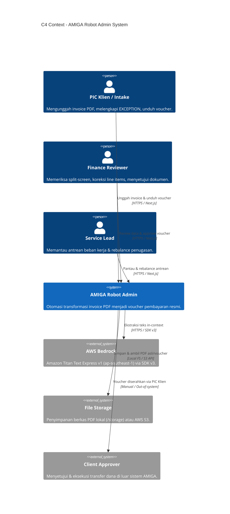
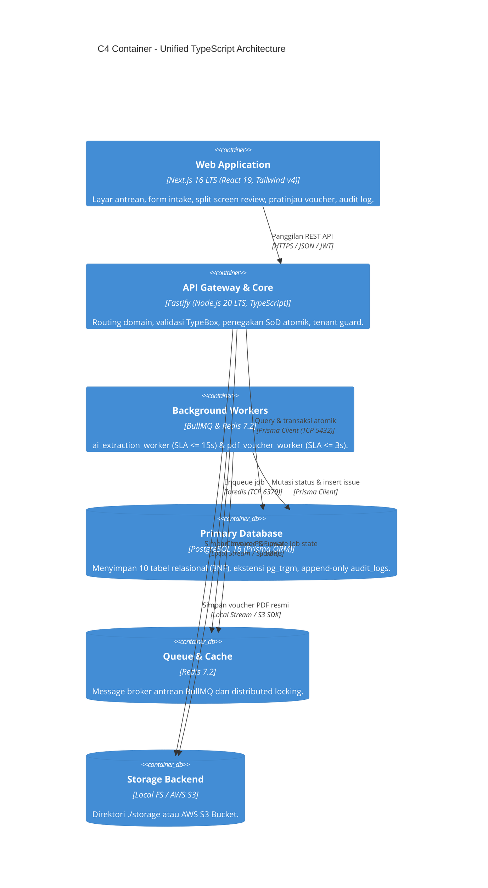
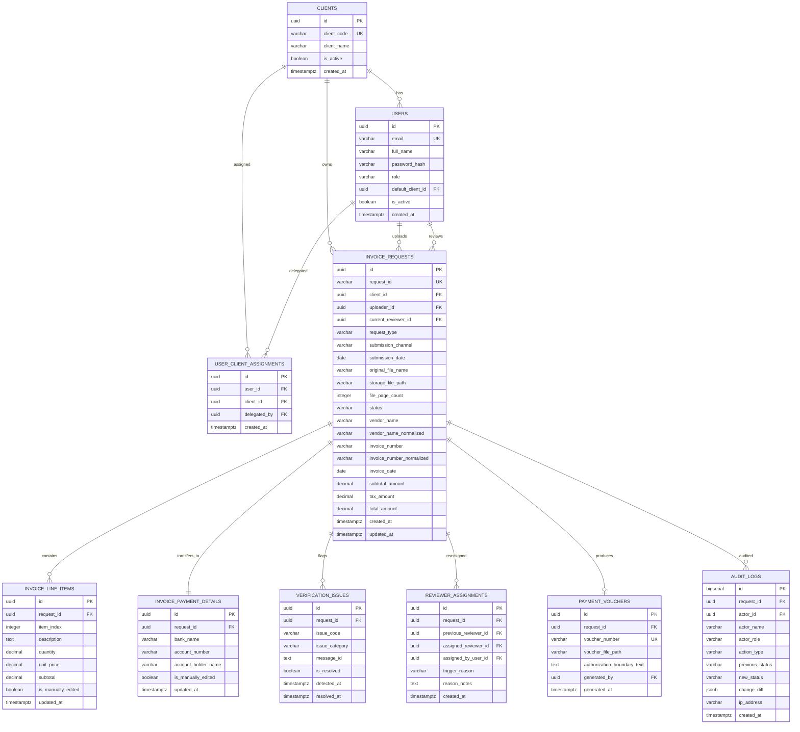
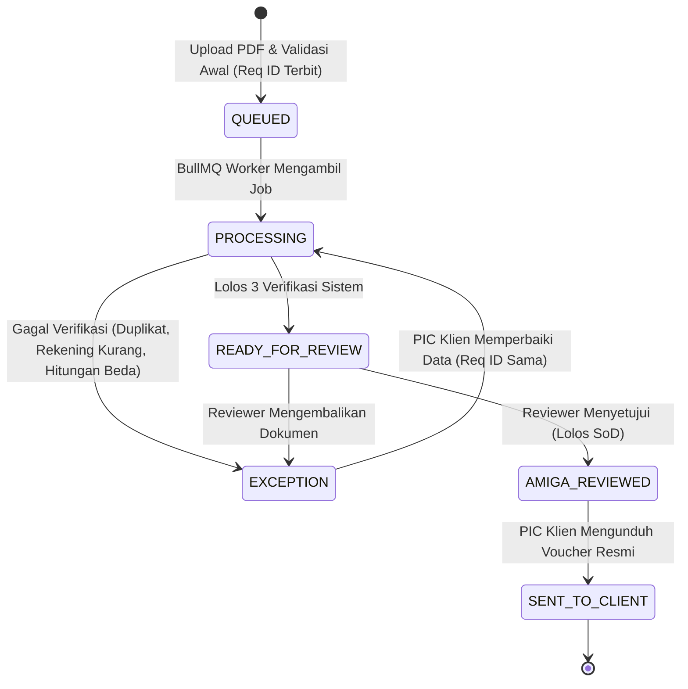

# Desain Sistem: AMIGA Robot Admin (Invoice-to-Voucher Processing)

**Status:** Phase 2 Baseline (Disahkan)  
**Target Rilis:** Proof of Concept (PoC) - MAIN Hackathon 2026  
**Arsitektur:** Unified Full-Stack TypeScript Monorepo (Next.js 16 LTS + Fastify 4.x/5.x + PostgreSQL 16)  
**ID Kebutuhan Terkait:** `BR-001`..`BR-015`, `PR-001`..`PR-025`, `SR-001`..`SR-017`, `DR-001`..`DR-013`, `PF-001`..`PF-021`

---

## 1. Ikhtisar Arsitektur & Diagram C4 [SR-001, SR-002, SR-005, SR-006]

AMIGA Robot Admin mengadopsi pola **Modular Monolith dengan Event-Driven Background Worker**. Frontend Next.js 16 (Active LTS) berkomunikasi dengan Backend Fastify melalui REST API Gateway stateless berbasis token JWT. Pemrosesan AI dan kompilasi PDF didelegasikan ke worker asinkron BullMQ agar HTTP event loop tetap responsif (SLA <= 2s).

### 1.1 C4 Context Diagram (Konteks Sistem)


### 1.2 C4 Container Diagram (Wadah Aplikasi)


---

## 2. Rincian Komponen & Batas Modul [SR-001, SR-006, SR-008, SR-009]

Struktur kode backend terisolasi dalam modul-modul kohesif (`backend/src/`):
- **`plugins/`**:
  - `prisma.plugin.ts`: Inisialisasi pool koneksi database PostgreSQL dengan isolasi query tenant.
  - `auth.plugin.ts`: Verifikasi stateless token JWT (8 jam) dan injeksi metadata pengguna ke request Fastify.
  - `rbac.plugin.ts`: Pre-handler hook pembatasan hak akses berbasis 5 peran internal.
  - `storage.plugin.ts`: Abstraksi pluggable Local Filesystem (`STORAGE_BACKEND=local`) dan AWS S3 (`s3`).
- **`routes/`**:
  - `auth.routes.ts`: Autentikasi pengguna (`login`, `me`).
  - `intake.routes.ts`: Upload berkas PDF, validasi magic bytes, penerbitan Request ID.
  - `review.routes.ts`: Split-screen data, koreksi line-items, penolakan EXCEPTION, persetujuan atomik SoD.
  - `voucher.routes.ts`: Pratinjau data voucher, stream unduhan voucher resmi (mutasi `SENT_TO_CLIENT`).
  - `audit.routes.ts`: Query append-only ledger audit trail terurut kronologis.
- **`services/`**:
  - `bedrock.service.ts`: Ekstraksi in-context AWS Bedrock Titan Text Express (`amazon.titan-text-express-v1`) dengan deterministic mock fallback.
  - `verification.service.ts`: Eksekusi 3 aturan verifikasi sistem (`MISSING_EVIDENCE`, `POSSIBLE_DUPLICATE`, `CALCULATION_DISCREPANCY`).
  - `review.service.ts`: Penegakan SoD di server dalam `prisma.$transaction` serializable.
  - `voucher.service.ts`: Generator voucher PDF resmi via `@react-pdf/renderer` dengan teks legal statis.
- **`workers/`**:
  - `ai-extraction.worker.ts`: Menjalankan ekstraksi PDF teks in-memory (`pdf-parse`) -> Titan Express -> verifikasi aturan -> mutasi `READY_FOR_REVIEW` atau `EXCEPTION`.
  - `pdf-voucher.worker.ts`: Mengompilasi berkas PDF voucher berpenomoran `VCH/YYYYMM/CLI/XXXXX`.

---

## 3. Model Data & ERD (10 Entitas 3NF) [SR-007, SR-011, DR-001..013]



### 3.1 Indeks & Batasan Khusus Database
- `idx_invoice_client_status`: (`client_id`, `status`) - Menjamin SLA pemuatan antrean <= 2 detik.
- `idx_invoice_duplicate_lookup`: (`client_id`, `vendor_name_normalized`, `invoice_number_normalized`) - Mempercepat deteksi duplikasi.
- `idx_audit_logs_request`: (`request_id`, `created_at` ASC) - Optimasi pembacaan runtut audit trail.
- `audit_logs` **Append-Only**: Role DB aplikasi hanya diberikan privilese `GRANT SELECT, INSERT ON audit_logs`.

---

## 4. Kontrak API Lengkap (14 Endpoints REST) [SR-012, SR-002, PF-001..021]

Format Respon Sukses: `{ "success": true, "statusCode": 200, "data": {}, "meta": { "requestId": "...", "timestamp": "..." } }`.  
Format Respon Error RFC 7807: `{ "success": false, "statusCode": 403, "error": { "code": "...", "message": "...", "details": {} }, "timestamp": "..." }`.

| No | Metode & Path | Peran Diizinkan | Schema Request (TypeBox) / Query | Respon Sukses (200/201) | Error Codes & RFC 7807 | Pemetaan BPMN |
| :--- | :--- | :--- | :--- | :--- | :--- | :--- |
| **01** | `POST /api/v1/auth/login` | Publik | `{ email: String, password: String }` | `{ accessToken, expiresIn: 28800, user: { id, email, role } }` | `AUTH_INVALID_CREDENTIALS` (401) | Inisiasi Sesi |
| **02** | `GET /api/v1/auth/me` | Terautentikasi | Header `Authorization: Bearer <token>` | `{ user: { id, email, role, defaultClientId, assignedClientIds: [] } }` | `AUTH_UNAUTHORIZED` (401) | Header Profil |
| **03** | `POST /api/v1/invoices/upload` | `PIC_KLIEN`, `INTAKE_SUPPORT` | Multipart: `file` (PDF <= 5 hal, <= 10MB), `clientId`, `requestType`, `submissionChannel`, `submissionDate` | 201: `{ requestId: "REQ-...", status: "QUEUED" }` | `INVALID_FILE_TYPE` (400), `PAGE_LIMIT_EXCEEDED` (400), `CLIENT_UNAUTHORIZED` (403) | `start_pic`, `act_sys_queue_job` |
| **04** | `GET /api/v1/invoices/queue` | Seluruh Internal | Query: `clientId?`, `status?`, `page`, `limit`, `search?` | `{ items: InvoiceSummary[], totalCount, statusCounts: {} }` | `INVALID_QUERY_PARAMS` (400) | `act_lead_rebalance`, Antrean Review |
| **05** | `GET /api/v1/invoices/:requestId` | Terotorisasi Tenant | Param: `requestId` | `{ invoice: InvoiceDetail, issues: Issue[], voucher: Voucher? }` | `INVOICE_NOT_FOUND` (404), `TENANT_FORBIDDEN` (403) | Pelacakan Status |
| **06** | `GET /api/v1/invoices/:requestId/review-data` | `FINANCE_REVIEWER` | Param: `requestId` | `{ pdfSignedUrl, extractedData, lineItems, paymentDetails, issues, canApprove }` | `INVOICE_NOT_FOUND` (404), `INVALID_LIFECYCLE_STATE` (409) | `act_fin_split_review` |
| **07** | `PUT /api/v1/invoices/:requestId/line-items` | `FINANCE_REVIEWER` | `{ items: [{ id?, description, quantity, unitPrice, subtotal }] }` | `{ updatedCount, subtotalAmount, taxAmount, totalAmount }` | `CALCULATION_DISCREPANCY` (400), `INVOICE_LOCKED` (409) | `act_fin_edit_lines` |
| **08** | `POST /api/v1/invoices/:requestId/approve` | `FINANCE_REVIEWER` | Param: `requestId` (Body kosong / catatan opsional) | `{ requestId, status: "AMIGA_REVIEWED", message: "Disetujui. Voucher sedang dikompilasi." }` | `SOD_VIOLATION` (403), `UNRESOLVED_ISSUES` (409) | `act_sys_sod_enforce`, `act_sys_gen_voucher` |
| **09** | `POST /api/v1/invoices/:requestId/return` | `FINANCE_REVIEWER` | `{ returnReason: String (min 10 chars) }` | `{ requestId, status: "EXCEPTION", issueCode: "REVIEWER_RETURNED" }` | `REASON_REQUIRED` (400), `INVALID_LIFECYCLE_STATE` (409) | `gw_fin_decision` (Kembalikan) |
| **10** | `PUT /api/v1/invoices/:requestId/correct` | `PIC_KLIEN`, `INTAKE_SUPPORT` | `{ paymentDetails?: {}, metadata?: {}, comments?: String }` | `{ requestId, status: "PROCESSING", message: "Data dikoreksi, proses verifikasi ulang." }` | `NOT_AN_EXCEPTION` (409), `TENANT_FORBIDDEN` (403) | `act_pic_correct`, BPMN F10 Re-extract |
| **11** | `POST /api/v1/invoices/:requestId/reassign` | `SERVICE_LEAD` | `{ newReviewerId: UUID, reason: String }` | `{ requestId, previousReviewerId, currentReviewerId }` | `USER_NOT_REVIEWER` (400), `CAPACITY_EXCEEDED` (400) | `act_lead_rebalance` |
| **12** | `GET /api/v1/invoices/:requestId/voucher/preview` | `FINANCE_REVIEWER`, `PIC_KLIEN` | Param: `requestId` | `{ voucherNumber, boundaryText, invoiceSummary, generatedAt }` | `VOUCHER_NOT_GENERATED` (404) | Pratinjau Layar 04 |
| **13** | `GET /api/v1/invoices/:requestId/voucher/download` | `PIC_KLIEN`, `INTAKE_SUPPORT`, `FINANCE_REVIEWER` | Param: `requestId` | Binary Stream `application/pdf` | `VOUCHER_NOT_READY` (404) | `act_pic_download` (Mutasi `SENT_TO_CLIENT`) |
| **14** | `GET /api/v1/invoices/:requestId/audit-trail` | Terotorisasi Tenant | Param: `requestId` | `[{ id, actorName, actorRole, actionType, previousStatus, newStatus, changeDiff, createdAt }]` | `INVOICE_NOT_FOUND` (404) | Layar 05 Jejak Audit |

---

## 5. Pemetaan BPMN & Mesin Status Dokumen [PR-006, PR-012, PR-019, PR-022, PF-004..016]

### 5.1 Siklus Hidup Dokumen (6 Status Pasti)


### 5.2 Matriks Pemetaan Elemen BPMN ver3 ke Komponen Teknis
1. `start_pic` (Unggah Invoice) -> `POST /api/v1/invoices/upload`
2. `act_sys_validate_upload` -> Guard Fastify (Magic byte `%PDF-1.`, page <= 5, size <= 10MB)
3. `act_sys_queue_job` -> Penerbitan `request_id`, status `QUEUED`, add job ke Redis `ai_extraction_queue`
4. `act_ai_extract` -> Worker `ai-extraction.worker.ts`, Bedrock Titan Text Express in-context
5. `act_sys_verify_rules` -> `verification.service.ts` mengeksekusi 3 aturan verifikasi
6. `gw_verification_clean` -> Percabangan status: `READY_FOR_REVIEW` vs `EXCEPTION`
7. `act_fin_split_review` -> Layar 03 Dual-Context Split-Screen (`GET /api/v1/invoices/:requestId/review-data`)
8. `act_fin_edit_lines` -> Koreksi data rincian (`PUT /api/v1/invoices/:requestId/line-items`)
9. `gw_fin_decision` -> Aksi Reviewer: Return (`POST .../return`) vs Approve (`POST .../approve`)
10. `act_sys_sod_enforce` -> Penolakan server-side SoD (`review.service.ts`) jika Reviewer == Uploader
11. `act_sys_sod_reassign` -> Alihkan otomatis ke least-loaded active reviewer + audit log
12. `act_sys_gen_voucher` -> Worker `pdf-voucher.worker.ts` kompilasi PDF resmi (SLA <= 3s)
13. `act_pic_download` -> Stream PDF voucher (`GET .../voucher/download`) & mutasi `SENT_TO_CLIENT`
14. `act_pic_correct` -> PIC submit data koreksi (`PUT .../correct`), status balik ke `PROCESSING` (Req ID sama)
15. `act_lead_rebalance` -> Service Lead mengubah penugasan (`POST .../reassign`)

---

## 6. Autentikasi, RBAC & Penegakan SoD Atomik [BR-002, SR-003, SR-004, SR-016]

### 6.1 Matriks Hak Akses Peran (RBAC Matrix)
| Peran (Role) | Upload Invoice | Lihat Antrean | Koreksi Line Items | Setujui Voucher | Rebalance Beban | Unduh Voucher |
| :--- | :---: | :---: | :---: | :---: | :---: | :---: |
| `PIC_KLIEN` | Ya (Klien Sendiri) | Ya (Klien Sendiri) | Tidak | DILARANG | Tidak | Ya |
| `INTAKE_SUPPORT` | Ya (Klien Ditugaskan) | Ya (Klien Ditugaskan)| Tidak | DILARANG | Tidak | Ya |
| `FINANCE_REVIEWER` | Tidak (Dilarang Intake)| Ya (Semua Antrean) | Ya | Ya (Kecuali Dok. Sendiri)| Tidak | Ya |
| `SERVICE_LEAD` | Tidak | Ya (Monitoring) | Tidak | DILARANG | Ya | Ya (Audit Only) |
| `SYSTEM_ADMIN` | Tidak | Konfigurasi Saja | Tidak | DILARANG | Tidak | Konfigurasi Saja|

### 6.2 Mekanisme Penegakan Segregation of Duties (SoD) Atomik
Validasi `uploader_id != reviewer_id` dieksekusi secara serializable di database dalam satu transaksi utuh:
```typescript
await prisma.$transaction(async (tx) => {
  const invoice = await tx.invoiceRequest.findUniqueOrThrow({ where: { requestId } });
  if (invoice.uploaderId === currentUser.id) {
    // 1. Batalkan transaksi persetujuan
    // 2. Cari reviewer aktif dengan antrean aktif paling sedikit
    const candidate = await getLeastLoadedReviewer(tx, currentUser.id);
    // 3. Alihkan penugasan dokumen
    await tx.invoiceRequest.update({ where: { id: invoice.id }, data: { currentReviewerId: candidate.id } });
    await tx.reviewerAssignment.create({
      data: { requestId: invoice.id, previousReviewerId: currentUser.id, assignedReviewerId: candidate.id, triggerReason: 'SOD_AUTO_REASSIGN' }
    });
    // 4. Catat pelanggaran ke audit log
    await tx.auditLog.create({
      data: { requestId: invoice.id, actorId: currentUser.id, actorName: currentUser.fullName, actorRole: currentUser.role, actionType: 'SOD_REASSIGN', previousStatus: invoice.status, newStatus: invoice.status }
    });
    throw new SodViolationException('Segregation of Duties: Anda tidak dapat menyetujui dokumen yang Anda unggah.');
  }
  // Jika valid: mutasi status dan jadwalkan pembuatan voucher
  await tx.invoiceRequest.update({ where: { id: invoice.id }, data: { status: 'AMIGA_REVIEWED' } });
});
```

---

## 7. Desain Non-Fungsional & Guardrails SLA [SR-001, SR-003, SR-004, SR-012, SR-015, SR-016]

1. **SLA Ekstraksi AI (<= 15 Detik)**:
   - File PDF dibaca in-memory via `pdf-parse`. Teks digital langsung diumpankan ke AWS Bedrock Titan Text Express (`amazon.titan-text-express-v1`) tanpa network hop multi-service.
   - BullMQ Worker dikonfigurasi dengan `timeout: 15000` dan `attempts: 2`. Jika gagal atau kuota habis, otomatis fallback ke deterministic mock extractor untuk menjamin kelancaran evaluasi.
2. **SLA Pemuatan Antrean & Layar Review (<= 2 Detik)**:
   - Pemanfaatan Server-Side Rendering (SSR) Next.js 16 dengan caching route tags.
   - Indeks gabungan PostgreSQL `(client_id, status)` dan query scope terbatas kolom yang ditampilkan pada ringkasan antrean.
3. **SLA Kompilasi Voucher Resmi (<= 3 Detik)**:
   - Generator `@react-pdf/renderer` merender voucher template langsung ke stream buffer in-memory Node.js, menulis ke storage, dan mencatat nomor urut `VCH/YYYYMM/CLI/XXXXX` secara atomic.
4. **Isolasi Mutlak Multi-Tenant**:
   - Seluruh endpoint query database wajib memuat klausa `WHERE client_id IN (:allowedClientIds)`. Percobaan IDOR menghasilkan respon RFC 7807 403 Forbidden.
5. **Keamanan Data Finansial (Masking PII)**:
   - Nomor rekening pada log console dan audit trail otomatis disamarkan: `88****23`.

---

## 8. Arsitektur Frontend & Sistem Desain [SR-005, DR-001..013]

### 8.1 Hirarki Komponen 5 Layar Utama (Next.js 16 App Router)
1. **Layar 01: Dashboard Antrean & Monitoring Beban (`/queue`)**:
   - `MetricCardsBar` (Summary count: Queued, Processing, Ready, Exception, Reviewed).
   - `ReviewerWorkloadPills` (Badge status beban per reviewer, penanda merah jika > `WORKLOAD_MAX_THRESHOLD`).
   - `QueueDataTable` (Tabel tabular angka dengan TanStack Query auto-refetch 5s).
   - `RebalanceModal` (Akses khusus Service Lead untuk mutasi penugasan).
2. **Layar 02: Formulir Pengunggahan & Intake (`/upload`)**:
   - `DragDropZone` (Validasi client-side: PDF digital, maks 5 hal, maks 10MB).
   - `MetadataForm` (Dropdown Klien, Request Type, Submission Channel, Submission Date).
   - `UploadProgressBar` & `FeedbackSuccessState` (Menampilkan Request ID unik).
3. **Layar 03: Split-Screen Koreksi & Peninjauan Dokumen (`/review/[id]`)**:
   - Layout CSS Grid 50:50 (`h-screen overflow-hidden`).
   - **Sisi Kiri (Viewer PDF Asli)**: `PdfViewerContainer` (PDF.js canvas, toolbar zoom 50%-200%, sinkronisasi nomor halaman).
   - **Sisi Kanan (Formulir Data Finansial)**: `VendorHeaderCard`, `LineItemsEditableTable` (perhitungan subtotal real-time), `PaymentDetailsCard`, `IssuesAlertBanner`, `ReviewActionBar` (Approve vs Return).
4. **Layar 04: Pratinjau & Unduh Voucher Resmi (`/voucher/[id]`)**:
   - `VoucherDocumentPreview` (Nomor voucher `VCH/...`, tabel rincian, teks batas legalitas otorisasi permanen).
   - `DownloadVoucherButton` (Memicu download file stream dan mutasi status `SENT_TO_CLIENT`).
5. **Layar 05: Penelusuran Jejak Audit (`/audit/[id]`)**:
   - `AuditTimeline` (Kronologi vertikal terurut waktu).
   - `AuditDiffViewer` (Memperlihatkan nilai lama vs nilai baru hasil koreksi).

### 8.2 Sistem Desain Visual ("Navy Ink on Cool Marble")
- **Warna Wajib**:
  - Ink Navy (Teks primer & header berwibawa): `#0B3558` (DILARANG menggunakan hitam pekat `#000000`).
  - Signal Blue (Aksi interaktif & tautan): `#006BFF` (Hover: `#0055CC`).
  - Cool Marble Canvas (Latar belakang utama): `#F8F9FB` / Surface Card: `#FFFFFF`.
  - Border Subtle: `#E2E8F0` / Shadow: `0 4px 12px rgba(11, 53, 88, 0.06)`.
- **Status Semantic Badges**:
  - `QUEUED`: Slate Navy (`bg-slate-100 text-slate-700`)
  - `PROCESSING`: Electric Blue (`bg-blue-50 text-blue-700 animate-pulse`)
  - `READY_FOR_REVIEW`: Emerald Green (`bg-emerald-50 text-emerald-700`)
  - `EXCEPTION`: Amber Crimson (`bg-amber-50 text-amber-800 border-amber-300`)
  - `AMIGA_REVIEWED`: Indigo Violet (`bg-indigo-50 text-indigo-700`)
  - `SENT_TO_CLIENT`: Soft Teal (`bg-teal-50 text-teal-700`)
- **Tipografi**: `Manrope` (angka tabular `font-mono tabular-nums` untuk nominal finansial) dan `JetBrains Mono` untuk ID referensi.

---

## 9. Log Keputusan Arsitektur Resmi (Architectural Decision Records)

- **ADR-001: Fastify sebagai Backend Core Node.js 20 LTS**:  
  *Konteks:* Kebutuhan ekosistem TypeScript terpadu dengan Next.js 16 dan kecepatan throughput tinggi.  
  *Keputusan:* Menggunakan Fastify 4.x/5.x dengan TypeBox schema. Menghasilkan throughput >60k req/s, serialisasi JSON instan, dan zero context-switching antar frontend dan backend.
- **ADR-002: In-Context Extraction pada AWS Bedrock Titan Text Express**:  
  *Konteks:* Invoice vendor memiliki struktur multi-kolom dan tabel baris yang rapuh jika di-chunking.  
  *Keputusan:* Membaca teks PDF (maks. 5 halaman) dan menyuapkannya langsung secara utuh ke LLM Titan Express (`amazon.titan-text-express-v1`) via SDK v3. RAG dilarang untuk ekstraksi invoice utama karena memotong integritas tabel. Bedrock KB hanya disiapkan untuk rekonsiliasi vendor master.
- **ADR-003: Pluggable Storage Backend (Local File & AWS S3)**:  
  *Konteks:* Fleksibilitas menjalankan demo hackathon offline vs staging S3.  
  *Keputusan:* Mendukung switch via env `STORAGE_BACKEND="local"` (folder `../storage`) atau `"s3"` tanpa mengubah kode layanan.
- **ADR-004: Next.js 16 (Active LTS) Frontend**:  
  *Konteks:* Kebutuhan stabilitas jangka panjang dan kecepatan kompilasi.  
  *Keputusan:* Mengadopsi Next.js 16 Active LTS dengan Turbopack stabil dan React 19 untuk menjamin SLA antrean <= 2 detik.

---

## 10. Matriks Risiko & Mitigasi (Risk & Mitigation Matrix)

| Risiko Arsitektur | Dampak | Probabilitas | Strategi Mitigasi Teknis |
| :--- | :---: | :---: | :--- |
| **Timeout AI Bedrock saat Demo** | Tinggi | Sedang | Worker BullMQ menerapkan timeout 15 detik dan otomatis fallback ke *High-Fidelity Deterministic Mock Extractor*. |
| **Pelanggaran SoD karena Bypass Frontend** | Kritis | Rendah | Penegakan SoD wajib di sisi server di dalam `prisma.$transaction`. Tombol frontend disabled hanya visual bantuan. |
| **Akses Lintas Data Klien (IDOR Tenant)** | Kritis | Sedang | Prisma extension / service guard selalu memfilter `WHERE client_id IN (...)` berbasis klaim JWT user. |
| **Duplikasi Tagihan Tidak Terdeteksi** | Tinggi | Sedang | Algoritma normalisasi teks (lowercase, alfanumerik murni) + query indeks database pada vendor dan nomor invoice. |
| **Kelebihan Beban Reviewer (>10 Dokumen)** | Sedang | Tinggi | Dashboard menampilkan indikator visual merah jika beban > `WORKLOAD_MAX_THRESHOLD` dan Service Lead memiliki fitur rebalance. |
| **Modifikasi Data Audit Log Tidak Sah** | Kritis | Sangat Rendah| Hak akses database pada tabel `audit_logs` dibatasi append-only (`GRANT SELECT, INSERT`). Dilarang ada method UPDATE/DELETE. |
