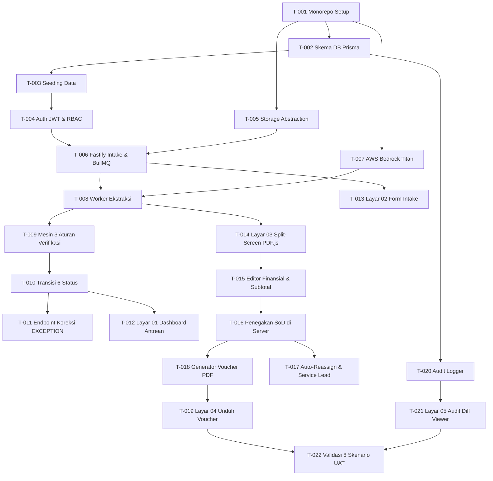

# Pelacak Tugas Implementasi: AMIGA Robot Admin (tasks.md)

**Status Proyek:** Phase 3 Baseline (Siap Eksekusi)  
**Target Rilis:** Proof of Concept (PoC) - MAIN Hackathon 2026  
**Arsitektur:** Unified Full-Stack TypeScript Monorepo (Next.js 16 LTS + Fastify 4.x/5.x + PostgreSQL 16)  
**Sumber Kebenaran:** `docs/specs/00-analysis.md`, `docs/specs/system-design.md`, `docs/requirements/`

---

## 1. Ringkasan Status & Matriks Kemajuan (Progress Overview)

| Milestone | Cakupan Fungsional | Total Tugas | Selesai | Status |
| :--- | :--- | :---: | :---: | :---: |
| **M1: Pondasi & Data** | Setup Monorepo, Skema 10 Tabel Prisma, Seeding, Auth JWT | 4 | 4 | `[x] Completed` |
| **M2: Intake & AI Worker** | Upload PDF, Storage Pluggable, BullMQ, AWS Bedrock Titan | 4 | 4 | `[x] Completed` |
| **M3: Verifikasi & Siklus** | 3 Aturan Verifikasi, Mesin 6 Status, Koreksi EXCEPTION | 3 | 3 | `[x] Completed` |
| **M4: Antarmuka Peninjauan**| Dashboard Antrean, Form Intake, Split-Screen PDF.js, Editor | 4 | 4 | `[x] Completed` |
| **M5: SoD & Voucher Resmi** | Penegakan Atomik SoD, Auto-Reassign, Voucher PDF, Unduh | 4 | 4 | `[x] Completed` |
| **M6: Audit & UAT E2E** | Immutable Audit Ledger, Layar Audit Diff, 8 Skenario UAT | 3 | 3 | `[x] Completed` |
| **TOTAL** | **Seluruh Cakupan PoC AMIGA Robot Admin** | **22** | **22** | **100%** |

---

## 2. Rincian Tugas per Milestone

### Milestone 1: Pondasi Monorepo & Skema Data Relasional

#### [x] `T-001` Inisialisasi Monorepo TypeScript & Konfigurasi Workspace
- **Prioritas / Estimasi**: P0 / 3 SP | **Dependensi**: Tidak ada
- **Kebutuhan Terkait**: `SR-001`, `SR-005`, `SR-006`, `PF-001`
- **File Target**: `package.json`, `pnpm-workspace.yaml`, `backend/package.json`, `frontend/package.json`, `turbo.json`
- **Cakupan**: Menyiapkan monorepo pnpm dengan workspace `backend` (Fastify, TypeScript 5.x) dan `frontend` (Next.js 16 LTS, Tailwind v4). Menyetel skrip linting, build Turbopack, dan TypeScript path aliases.
- **Acceptance Criteria**:
  - `Given` repositori bersih, `When` menjalankan `pnpm install`, `Then` seluruh dependensi terinstal tanpa bentrok versi.
  - `Given` backend dan frontend terkonfigurasi, `When` menjalankan `pnpm dev`, `Then` Fastify API menyala di port 4000 dan Next.js di port 3000.
- **DoD Checklist**: [x] `pnpm build` sukses [x] `pnpm lint` 0 error [x] Struktur folder selaras dengan `02-project-structure.md`.

#### [x] `T-002` Pemodelan Skema Database Prisma (10 Tabel 3NF)
- **Prioritas / Estimasi**: P0 / 5 SP | **Dependensi**: `T-001`
- **Kebutuhan Terkait**: `SR-007`, `SR-011`, `DR-001`..`DR-013`, `PF-002`
- **File Target**: `backend/prisma/schema.prisma`, `backend/prisma/migrations/`
- **Cakupan**: Menulis skema Prisma untuk 10 tabel: `clients`, `users`, `user_client_assignments`, `invoice_requests`, `invoice_line_items`, `invoice_payment_details`, `verification_issues`, `reviewer_assignments`, `payment_vouchers`, `audit_logs`. Mengonfigurasi indeks `idx_invoice_client_status` dan `idx_invoice_duplicate_lookup`.
- **Acceptance Criteria**:
  - `Given` koneksi PostgreSQL 16 aktif, `When` mengeksekusi `pnpm --filter backend prisma migrate dev`, `Then` seluruh 10 tabel dan indeks terbentuk dengan integritas referensial lengkap.
- **DoD Checklist**: [x] Migrasi SQL terbit tanpa error [x] Client Prisma ter-generate [x] Foreign key cascade/restrict sesuai spesifikasi DRD.

#### [x] `T-003` Skrip Seeding Database Multi-Peran & Akun Pengujian
- **Prioritas / Estimasi**: P0 / 3 SP | **Dependensi**: `T-002`
- **Kebutuhan Terkait**: `BR-002`, `SR-011`, `PR-004`, `PF-003`
- **File Target**: `backend/prisma/seed.ts`
- **Cakupan**: Membuat seeder akun standar dengan password `password123!`: minimal 2 Finance Reviewer (`reviewer1@amiga.co.id`, `reviewer2@amiga.co.id`), PIC Klien (`pic_client@amiga.co.id`), Intake Support (`intake_support@amiga.co.id`), Service Lead (`service_lead@amiga.co.id`), System Admin (`sysadmin@amiga.co.id`), serta 3 entitas klien (`CLI-MAIN`, `CLI-001`, `CLI-002`).
- **Acceptance Criteria**:
  - `Given` database kosong hasil migrasi, `When` menjalankan `pnpm --filter backend prisma db seed`, `Then` seluruh akun uji dan organisasi klien terisi siap pakai.
- **DoD Checklist**: [x] Hash password menggunakan bcrypt/argon2 [x] Seeding idempotent [x] Data terverifikasi via query manual.

#### [x] `T-004` Autentikasi Stateless JWT & Fastify RBAC Guard Plugin
- **Prioritas / Estimasi**: P0 / 4 SP | **Dependensi**: `T-003`
- **Kebutuhan Terkait**: `SR-002`, `SR-003`, `PR-004`, `PF-001`, `PF-002`
- **File Target**: `backend/src/plugins/auth.plugin.ts`, `backend/src/plugins/rbac.plugin.ts`, `backend/src/routes/auth.routes.ts`
- **Cakupan**: Endpoint `POST /api/v1/auth/login` (penerbitan JWT 8 jam), `GET /api/v1/auth/me`, dan pre-handler hook verifikasi token serta proteksi role (`PIC_KLIEN`, `FINANCE_REVIEWER`, dll.).
- **Acceptance Criteria**:
  - `Given` kredensial valid, `When` memanggil endpoint login, `Then` menerima JWT token dan profil pengguna dengan status HTTP 200.
  - `Given` token milik PIC Klien, `When` mengakses route yang diproteksi khusus Finance Reviewer, `Then` menerima respon RFC 7807 403 Forbidden.
- **DoD Checklist**: [x] Unit test login valid & invalid [x] Payload JWT memuat userId, role, dan allowedClientIds [x] TypeBox schema terdaftar.

---

### Milestone 2: Modul Intake & Ekstraksi AI Asinkron

#### [x] `T-005` Abstraksi File Storage & Validasi Magic Bytes PDF
- **Prioritas / Estimasi**: P0 / 3 SP | **Dependensi**: `T-001`
- **Kebutuhan Terkait**: `SR-008`, `PR-002`, `PR-003`, `PF-004`
- **File Target**: `backend/src/plugins/storage.plugin.ts`, `backend/src/services/storage.service.ts`
- **Cakupan**: Layanan penyimpan berkas pluggable yang mendukung `STORAGE_BACKEND=local` (`../storage`) dan `s3`. Memvalidasi magic bytes header file (`%PDF-1.`), membatasi ukuran maksimal 10MB, dan menghitung jumlah halaman (maks. 5 halaman).
- **Acceptance Criteria**:
  - `Given` berkas PDF non-digital atau ekstensi palsu (.exe diubah .pdf), `When` divalidasi, `Then` sistem menolak dengan kode `INVALID_FILE_TYPE`.
  - `Given` berkas PDF 6 halaman, `When` divalidasi, `Then` sistem menolak dengan kode `PAGE_LIMIT_EXCEEDED`.
- **DoD Checklist**: [x] Test upload lokal berhasil menyimpan berkas [x] File path tersimpan aman dengan ID acak unik [x] Memory buffer dibersihkan.

#### [x] `T-006` Fastify Intake Route & Antrean BullMQ
- **Prioritas / Estimasi**: P0 / 4 SP | **Dependensi**: `T-004`, `T-005`
- **Kebutuhan Terkait**: `SR-001`, `PR-005`, `PR-006`, `PF-005`
- **File Target**: `backend/src/routes/intake.routes.ts`, `backend/src/services/intake.service.ts`
- **Cakupan**: Endpoint `POST /api/v1/invoices/upload` (multipart/form-data). Menerbitkan `request_id` unik (`REQ-YYYYMMDD-XXXXX`), menyimpan record status `QUEUED`, dan memasukkan job ke antrean Redis `ai_extraction_queue`.
- **Acceptance Criteria**:
  - `Given` PIC mengunggah PDF valid beserta metadata, `When` request diproses, `Then` respon HTTP 201 mengembalikan Request ID unik dan status `QUEUED` dalam tempo <= 500ms.
- **DoD Checklist**: [x] Job BullMQ terverifikasi masuk ke antrean [x] Record tersimpan di tabel `invoice_requests` [x] RFC 7807 jika tenant tidak valid.

#### [x] `T-007` Layanan Ekstraksi Teks AWS Bedrock Titan Express
- **Prioritas / Estimasi**: P0 / 5 SP | **Dependensi**: `T-001`
- **Kebutuhan Terkait**: `SR-009`, `PR-007`, `PR-008`, `PF-006`
- **File Target**: `backend/src/services/bedrock.service.ts`
- **Cakupan**: Mengintegrasikan `@aws-sdk/client-bedrock-runtime` untuk memanggil model `amazon.titan-text-express-v1`. Ekstraksi in-context teks PDF ke struktur JSON (header, line items, payment details). Menyediakan deterministic high-fidelity mock fallback jika API gagal/timeout.
- **Acceptance Criteria**:
  - `Given` teks invoice digital 2 halaman, `When` diekstraksi Titan Express, `Then` menghasilkan JSON valid berisi vendor, nomor invoice, tanggal, tabel line items, dan data rekening bank.
  - `Given` sambungan AWS terputus, `When` fallback aktif, `Then` data uji standar tetap terekstraksi presisi tanpa error unhandled.
- **DoD Checklist**: [x] Skema respon JSON tervalidasi ajv [x] Zero Data Retention flag terpasang [x] Unit test ekstraksi live & mock lulus.

#### [x] `T-008` Worker BullMQ Ekstraksi Asinkron & Parsing PDF
- **Prioritas / Estimasi**: P0 / 4 SP | **Dependensi**: `T-006`, `T-007`
- **Kebutuhan Terkait**: `SR-001`, `SR-009`, `PR-009`, `PF-007`
- **File Target**: `backend/src/workers/ai-extraction.worker.ts`
- **Cakupan**: Worker BullMQ membaca file PDF in-memory (`pdf-parse`), memanggil `bedrock.service.ts`, menyimpan entitas rincian ke `invoice_line_items` dan `invoice_payment_details`, serta mengukur waktu pemrosesan (SLA <= 15s).
- **Acceptance Criteria**:
  - `Given` job ekstraksi pada status `QUEUED`, `When` worker mengambil job, `Then` status berubah menjadi `PROCESSING`, dan data ekstraksi tersimpan di database.
- **DoD Checklist**: [x] Konfigurasi retry 2x dengan timeout 15000ms [x] Pengukuran durasi job dicatat ke log terstruktur [x] Bebas memory leak.

---

### Milestone 3: Mesin Verifikasi Aturan Sistem & Lifecycle State Machine

#### [x] `T-009` Mesin Verifikasi 3 Aturan Sistem Otomatis
- **Prioritas / Estimasi**: P0 / 4 SP | **Dependensi**: `T-008`
- **Kebutuhan Terkait**: `BR-008`, `PR-010`, `PR-011`, `SR-013`, `PF-008`
- **File Target**: `backend/src/services/verification.service.ts`
- **Cakupan**: Implementasi 3 aturan verifikasi: 1) `MISSING_EVIDENCE` (nomor rekening atau bank kosong); 2) `POSSIBLE_DUPLICATE` (nomor invoice dan vendor identik pada klien yang sama via teks ternormalisasi); 3) `CALCULATION_DISCREPANCY` (total != sum(subtotal line items) + tax).
- **Acceptance Criteria**:
  - `Given` total invoice Rp 1.500.000 namun jumlah baris item Rp 1.400.000, `When` diverifikasi, `Then` sistem menghasilkan issue `CALCULATION_DISCREPANCY`.
  - `Given` invoice tanpa nomor rekening, `When` diverifikasi, `Then` menghasilkan issue `MISSING_EVIDENCE`.
- **DoD Checklist**: [x] Fungsi normalisasi teks alfanumerik huruf kecil [x] Unit test mencakup 3 skenario kendala + 1 skenario bersih.

#### [x] `T-010` Transisi State Siklus Hidup Dokumen (6 Status Pasti)
- **Prioritas / Estimasi**: P0 / 3 SP | **Dependensi**: `T-009`
- **Kebutuhan Terkait**: `PR-012`, `PR-013`, `SR-004`, `PF-009`
- **File Target**: `backend/src/services/verification.service.ts`, `backend/src/workers/ai-extraction.worker.ts`
- **Cakupan**: Jika hasil verifikasi memiliki isu aktif -> transisi status ke `EXCEPTION` dan simpan ke `verification_issues`. Jika bersih tanpa isu -> transisi status ke `READY_FOR_REVIEW`.
- **Acceptance Criteria**:
  - `Given` invoice lolos seluruh verifikasi, `When` proses selesai, `Then` status menjadi `READY_FOR_REVIEW`.
  - `Given` ditemukan kejanggalan duplikasi, `When` proses selesai, `Then` status menjadi `EXCEPTION`.
- **DoD Checklist**: [x] Status hanya boleh bernilai salah satu dari 6 enum resmi [x] Mutasi status dicatat ke `audit_logs`.

#### [x] `T-011` Endpoint Koreksi Dokumen EXCEPTION oleh PIC Klien
- **Prioritas / Estimasi**: P0 / 4 SP | **Dependensi**: `T-010`
- **Kebutuhan Terkait**: `PR-014`, `PR-015`, `SR-011`, `PF-010`
- **File Target**: `backend/src/routes/intake.routes.ts`, `backend/src/services/intake.service.ts`
- **Cakupan**: Endpoint `PUT /api/v1/invoices/:requestId/correct`. PIC melengkapi bukti rekening atau revisi nilai. Mempertahankan **Request ID TETAP SAMA**, memicu re-ekstraksi & verifikasi ulang, dan mengembalikan status ke `PROCESSING`.
- **Acceptance Criteria**:
  - `Given` dokumen berstatus `EXCEPTION`, `When` PIC mengirim data koreksi rekening, `Then` Request ID tidak berubah, status kembali ke `PROCESSING`, dan job verifikasi ulang dijalankan.
- **DoD Checklist**: [x] Penolakan jika status bukan `EXCEPTION` [x] Pencatatan riwayat koreksi ke `audit_logs` [x] Request ID identik.

---

### Milestone 4: Antarmuka & Layar Peninjauan Split-Screen

#### [x] `T-012` Layar 01: Dashboard Antrean & Monitoring Beban Kerja
- **Prioritas / Estimasi**: P0 / 4 SP | **Dependensi**: `T-004`, `T-010`
- **Kebutuhan Terkait**: `PR-016`, `PR-017`, `SR-005`, `DR-001`, `PF-011`
- **File Target**: `frontend/src/app/(dashboard)/queue/page.tsx`, `frontend/src/components/dashboard/`
- **Cakupan**: Tampilan antrean dokumen multi-status, summary metrics cards, filtering per klien/status, dan badge beban reviewer per pengguna dengan indikator visual merah jika beban > `WORKLOAD_MAX_THRESHOLD`. Auto-refetch TanStack Query interval 5 detik.
- **Acceptance Criteria**:
  - `Given` pengguna membuka dashboard, `When` data termuat, `Then` antrean muncul dalam tempo <= 2 detik dengan palet *"Navy Ink on Cool Marble"*.
- **DoD Checklist**: [x] Tabular numbers pada angka [x] Filter client-side & server-side sinkron [x] Status semantic badges akurat.

#### [x] `T-013` Layar 02: Formulir Pengunggahan & Intake Dokumen
- **Prioritas / Estimasi**: P0 / 3 SP | **Dependensi**: `T-006`
- **Kebutuhan Terkait**: `PR-002`..`PR-006`, `DR-002`, `PF-012`
- **File Target**: `frontend/src/app/(intake)/upload/page.tsx`, `frontend/src/components/intake/`
- **Cakupan**: Drag-and-drop zone upload file PDF digital, validasi batas 5 halaman dan ukuran 10MB di sisi client, formulir metadata klien & tanggal, progress bar responsif, dan modal sukses berisi Request ID.
- **Acceptance Criteria**:
  - `Given` pengguna menarik file PDF > 10MB, `When` file di-drop, `Then` muncul pesan peringatan dan tombol submit dinonaktifkan.
- **DoD Checklist**: [x] Aksesibilitas keyboard dan form labels WCAG 2.1 [x] Reset form pasca submit sukses [x] Redirect ke tracker status.

#### [x] `T-014` Layar 03: Dual-Context Split-Screen PDF Viewer Canvas
- **Prioritas / Estimasi**: P0 / 5 SP | **Dependensi**: `T-008`, `T-012`
- **Kebutuhan Terkait**: `PR-018`, `SR-005`, `DR-003`, `PF-013`
- **File Target**: `frontend/src/app/(review)/review/[id]/page.tsx`, `frontend/src/components/pdf/`
- **Cakupan**: Layout CSS Grid 50:50. Sisi kiri menampilkan dokumen PDF asli via PDF.js canvas viewer, kontrol zoom (50%-200%), fit-to-width, dan navigasi halaman sinkron. SLA muat layar <= 2 detik.
- **Acceptance Criteria**:
  - `Given` reviewer membuka URL review, `When` halaman dirender, `Then` canvas PDF kiri dan form kanan termuat berdampingan tanpa layout shift.
- **DoD Checklist**: [x] Presigned URL berbatas waktu 15 menit [x] Kontrol zoom responsif dan bebas blur [x] Scroll terisolasi di masing-masing panel.

#### [x] `T-015` Editor Finansial Interaktif & Live Subtotal Math
- **Prioritas / Estimasi**: P0 / 4 SP | **Dependensi**: `T-014`
- **Kebutuhan Terkait**: `PR-018`, `PR-019`, `SR-011`, `DR-003`, `PF-014`
- **File Target**: `frontend/src/components/review/line-items-editor.tsx`, `backend/src/routes/review.routes.ts`
- **Cakupan**: Tabel rincian barang/jasa di sisi kanan layar split-screen. Reviewer dapat mengedit kuantitas, harga satuan, dan deskripsi; kalkulasi subtotal dan grand total berjalan otomatis secara real-time di client dan disinkronkan ke `PUT /api/v1/invoices/:requestId/line-items`.
- **Acceptance Criteria**:
  - `Given` reviewer mengubah harga satuan item dari Rp 10.000 menjadi Rp 12.000 dengan kuantitas 5, `When` field blur, `Then` subtotal otomatis berubah menjadi Rp 60.000 dan grand total terbarui seketika.
- **DoD Checklist**: [x] Penanda `is_manually_edited: true` tersimpan [x] Audit diff nilai lama vs baru tercatat [x] Validasi angka non-negatif.

---

### Milestone 5: Penegakan Segregation of Duties (SoD) & Generator Voucher

#### [x] `T-016` Penegakan SoD di Server & Transaksi Persetujuan Atomik
- **Prioritas / Estimasi**: P0 / 5 SP | **Dependensi**: `T-004`, `T-015`
- **Kebutuhan Terkait**: `BR-002`, `PR-018`, `SR-004`, `PF-015`
- **File Target**: `backend/src/routes/review.routes.ts`, `backend/src/services/review.service.ts`
- **Cakupan**: Endpoint `POST /api/v1/invoices/:requestId/approve`. Pengecekan `uploader_id != reviewer_id` di dalam transaksi database atomik serializable. Jika melanggar: tolak persetujuan, batalkan mutasi, dan picu auto-reassignment.
- **Acceptance Criteria**:
  - `Given` uploader dokumen login sebagai reviewer dan menekan persetujuan, `When` request sampai di server, `Then` transaksi persetujuan gagal, respon mengembalikan RFC 7807 403 Forbidden `SOD_VIOLATION`.
- **DoD Checklist**: [x] Validasi mutlak di server bukan sekadar disabled button di frontend [x] Rollback transaksi atomik Prisma teruji.

#### [x] `T-017` Algoritma Auto-Reassignment & Rebalancing Service Lead
- **Prioritas / Estimasi**: P0 / 4 SP | **Dependensi**: `T-016`
- **Kebutuhan Terkait**: `BR-002`, `PR-018`, `PR-024`, `SR-014`, `PF-016`
- **File Target**: `backend/src/services/review.service.ts`, `backend/src/routes/review.routes.ts`
- **Cakupan**: Saat SoD dilanggar, sistem otomatis mencari reviewer aktif dengan beban dokumen terkecil (*least-loaded active reviewer*), mengalihkan penugasan, dan mencatat riwayat ke `reviewer_assignments`. Menyediakan endpoint `POST /api/v1/invoices/:requestId/reassign` untuk Service Lead.
- **Acceptance Criteria**:
  - `Given` Reviewer A melanggar SoD, `When` transaksi ditolak, `Then` dokumen otomatis berpindah ke antrean Reviewer B (beban terendah) dan tercatat di `reviewer_assignments`.
- **DoD Checklist**: [x] Trigger reason `SOD_AUTO_REASSIGN` tercatat [x] Endpoint manual reassign Service Lead tervalidasi peran.

#### [x] `T-018` Generator Voucher PDF Resmi (@react-pdf/renderer)
- **Prioritas / Estimasi**: P0 / 4 SP | **Dependensi**: `T-016`
- **Kebutuhan Terkait**: `PR-020`, `PR-021`, `SR-010`, `PF-017`
- **File Target**: `backend/src/services/voucher.service.ts`, `backend/src/workers/pdf-voucher.worker.ts`
- **Cakupan**: Kompilasi voucher pembayaran resmi dari template React-PDF menjadi berkas PDF (SLA <= 3s). Menerbitkan nomor voucher unik format `VCH/YYYYMM/CLI/XXXXX` dan mencantumkan teks batas legalitas otorisasi permanen. Status dokumen bermutasi ke `AMIGA_REVIEWED`.
- **Acceptance Criteria**:
  - `Given` dokumen disetujui, `When` worker kompilasi voucher selesai, `Then` berkas PDF voucher tersimpan di storage dan status invoice menjadi `AMIGA_REVIEWED`.
- **DoD Checklist**: [x] Teks batas otorisasi legal tertera verbatim [x] Format penomoran urut 5 digit akurat [x] Waktu kompilasi <= 3 detik.

#### [x] `T-019` Layar 04: Pratinjau & Alur Unduh Berkas Voucher
- **Prioritas / Estimasi**: P0 / 3 SP | **Dependensi**: `T-018`
- **Kebutuhan Terkait**: `PR-022`, `PR-023`, `DR-004`, `PF-018`
- **File Target**: `frontend/src/app/(voucher)/voucher/[id]/page.tsx`, `backend/src/routes/voucher.routes.ts`
- **Cakupan**: Layar pratinjau voucher pembayaran resmi, endpoint stream unduh berkas `GET /api/v1/invoices/:requestId/voucher/download`. Jika diunduh oleh PIC Klien, status otomatis bermutasi menjadi `SENT_TO_CLIENT`.
- **Acceptance Criteria**:
  - `Given` invoice berstatus `AMIGA_REVIEWED`, `When` PIC Klien menekan tombol unduh voucher, `Then` browser menerima stream file PDF dan status di database berubah menjadi `SENT_TO_CLIENT`.
- **DoD Checklist**: [x] Header `Content-Disposition: attachment; filename="VCH-..."` [x] Status berubah menjadi `SENT_TO_CLIENT` [x] Audit log mencatat download.

---

### Milestone 6: Jejak Audit Permanen & Verifikasi UAT

#### [x] `T-020` Layanan Append-Only Immutable Audit Trail Logger
- **Prioritas / Estimasi**: P0 / 3 SP | **Dependensi**: `T-002`
- **Kebutuhan Terkait**: `BR-015`, `PR-025`, `SR-016`, `PF-019`
- **File Target**: `backend/src/services/audit.service.ts`, `backend/src/routes/audit.routes.ts`
- **Cakupan**: Service pencatatan audit log setiap kali terjadi mutasi status, perubahan nilai data (JSON diff), atau aksi pengguna. Endpoint `GET /api/v1/invoices/:requestId/audit-trail`. Menjamin tidak ada API/method untuk UPDATE atau DELETE pada tabel `audit_logs`.
- **Acceptance Criteria**:
  - `Given` aktivitas koreksi atau approval, `When` dieksekusi, `Then` record baru masuk ke `audit_logs` dengan informasi aktor, peran, timestamp, dan diff nilai.
- **DoD Checklist**: [x] Izin database SELECT, INSERT saja [x] Indeks urutan timestamp ASC [x] Masking nomor rekening sensitif.

#### [x] `T-021` Layar 05: Visualisasi Garis Waktu Jejak Audit & Diff Viewer
- **Prioritas / Estimasi**: P0 / 3 SP | **Dependensi**: `T-020`
- **Kebutuhan Terkait**: `PR-025`, `DR-005`, `PF-020`
- **File Target**: `frontend/src/app/(audit)/audit/[id]/page.tsx`, `frontend/src/components/audit/`
- **Cakupan**: Tampilan garis waktu kronologis vertikal aktivitas dokumen. Menampilkan badge aktor, jenis aksi, status sebelumnya vs baru, dan panel perbandingan diff nilai lama (merah) vs nilai baru (hijau).
- **Acceptance Criteria**:
  - `Given` dokumen yang telah melewati koreksi dan approval, `When` layar audit dibuka, `Then` seluruh riwayat perubahan tampil runtut dengan badge visual yang jelas.
- **DoD Checklist**: [x] Format tanggal dan jam ramah pengguna [x] PII nomor rekening tersensor [x] Desain selaras tema Cool Marble.

#### [x] `T-022` Pengujian Otomasi E2E & Validasi 8 Skenario UAT
- **Prioritas / Estimasi**: P0 / 5 SP | **Dependensi**: `T-001` s/d `T-021`
- **Kebutuhan Terkait**: `SR-017`, `PF-021`, UAT-01 s/d UAT-08
- **File Target**: `backend/test/e2e/`, `frontend/test/e2e/`
- **Cakupan**: Suite pengujian integrasi otomatis menyeluruh yang memverifikasi 8 skenario UAT resmi:
  1. `UAT-01`: Happy path digital PDF upload -> extract -> review -> voucher terbit.
  2. `UAT-02`: Deteksi dan flag `MISSING_EVIDENCE` jika rekening tidak terdeteksi.
  3. `UAT-03`: Deteksi dan flag `POSSIBLE_DUPLICATE` tagihan ganda.
  4. `UAT-04`: Deteksi dan flag `CALCULATION_DISCREPANCY` selisih hitungan total.
  5. `UAT-05`: Penolakan server-side SoD saat Uploader mencoba menyetujui dokumen sendiri.
  6. `UAT-06`: Auto-reassignment dokumen pasca pelanggaran SoD ke least-loaded reviewer.
  7. `UAT-07`: Alur perbaikan EXCEPTION oleh PIC dengan Request ID sama hingga selesai.
  8. `UAT-08`: Unduh voucher resmi memicu mutasi status menjadi `SENT_TO_CLIENT`.
- **Acceptance Criteria**:
  - `Given` seluruh modul terintegrasi, `When` mengeksekusi suite tes E2E, `Then` 100% dari 8 skenario UAT lulus tanpa kegagalan.
- **DoD Checklist**: [x] `pnpm test:e2e` lulus 100% [x] Coverage modul kritis > 80% [x] 0 regresi arsitektur.

---

## 3. Matriks Ketergantungan Tugas (Task Dependency Graph)

---

## 4. Aturan Eksekusi Tugas bagi Agen AI (/implement-task)

1. **Satu Tugas per Iterasi**: Agen AI HANYA boleh mengambil 1 tugas target (`T-xxx`) dalam satu siklus pengerjaan.
2. **Kepatuhan Terhadap ID & Traceability**: Setiap commit Git, file baru, dan test case wajib mencantumkan tag ID kebutuhan yang dipenuhinya.
3. **Validasi Definition of Done (DoD)**: Tugas TIDAK BOLEH ditandai selesai `[x]` sebelum lulus:
   - Kompilasi tipe tanpa error (`pnpm typecheck` / `tsc --noEmit`).
   - Lulus seluruh unit test dan regression test (`pnpm test`).
   - Dokumen `tasks.md` dan `CHANGELOG.md` diperbarui.
