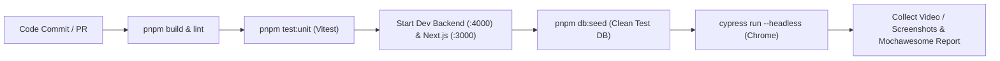

# Rencana Pelaksanaan Automated Testing (Cypress E2E Testing)
**Sistem:** AMIGA Robot Admin (Intelligent Vendor Invoice-to-Voucher Processing)  
**Dokumen:** `docs/testing/cypress-automation-plan.md`  
**Disusun Oleh:** Tech Lead & QA Engineer  
**Tanggal:** 14 Oktober 2026  
**Status:** Siap Ditinjau & Dieksekusi  
**Referensi Terkait:** `docs/specs/tasks.md` (T-022), `.agents/rules/05-testing-quality.md`, `GEMINI.md`

---

## 1. Eksekutif Ringkasan (Executive Summary)

AMIGA Robot Admin merupakan sistem pemrosesan finansial berisiko tinggi (*high-stakes financial processing*) yang mentransformasi invoice vendor PDF digital menjadi voucher pembayaran resmi. Integritas sistem bergantung pada 10 non-negotiable behaviors, termasuk penegakan Segregation of Duties (SoD), isolasi multi-tenant, 3 aturan verifikasi sistem otomatis, serta SLA waktu muat dan kompilasi dokumen.

Untuk melengkapi pengujian manual pada lembar kerja Excel [AMIGA_Robot_Admin_Test_Summary_Report.xlsx](file:///d:/Naufal/Personal/Own%20Project/belajar/main-alkademi/hackathon-main/apps-2/docs/testing/AMIGA_Robot_Admin_Test_Summary_Report.xlsx) dan unit/integration test Vitest di backend, kami menyusun rencana implementasi **Automated End-to-End (E2E) Testing menggunakan Cypress**.

Cypress dipilih karena:
1. Kemampuan direct DOM & Canvas inspection untuk memvalidasi *Dual-Context Split-Screen* 50:50 (PDF.js canvas + reactive financial editor).
2. Native network interception (`cy.intercept`) untuk mensimulasikan kegagalan AI Bedrock, timeout SLA, dan validasi response RFC 7807.
3. Kemudahan pengujian manipulasi file upload digital (`cy.selectFile`) dan stream download voucher PDF.
4. Dukungan visual debugging, time-travel, serta headless execution di pipeline CI/CD.

---

## 2. Arsitektur & Struktur Direktori Cypress

Cypress akan dikonfigurasi pada direktori `frontend/cypress` (atau root `cypress/` sesuai kesepakatan) dengan struktur modular:

```
frontend/
├── cypress/
│   ├── fixtures/                       # Data uji statis & berkas PDF uji
│   │   ├── invoices/
│   │   │   ├── invoice-clean-sample.pdf       # 1 hal, lolos verifikasi
│   │   │   ├── invoice-multiline-3items.pdf   # 3 hal, multi-line items
│   │   │   ├── invoice-missing-evidence.pdf   # Tanpa rekening bank
│   │   │   ├── invoice-duplicate-sample.pdf   # Nomor & vendor identik
│   │   │   ├── invoice-6-pages-invalid.pdf    # Melebihi batas 5 halaman
│   │   │   └── fake-invoice-exe.pdf           # Binary palsu (.exe diubah .pdf)
│   │   └── users.json                         # Kredensial akun multi-peran
│   ├── e2e/                            # Test Suites E2E
│   │   ├── 01-auth-and-rbac.cy.ts             # Login, sesi, proteksi rute, role guard
│   │   ├── 02-intake-upload.cy.ts             # Upload PDF, drag-drop, validasi 5 hal & 10MB
│   │   ├── 03-queue-dashboard.cy.ts           # Antrean, filter multi-klien, workload bar
│   │   ├── 04-split-screen-review.cy.ts       # PDF canvas zoom/page, live subtotal math
│   │   ├── 05-sod-enforcement.cy.ts           # Penolakan uploader approval & auto-reassign
│   │   ├── 06-voucher-preview-download.cy.ts  # Teks legalitas & download -> SENT_TO_CLIENT
│   │   ├── 07-exception-correction.cy.ts      # Perbaikan rekening & Request ID identik
│   │   ├── 08-multi-tenant-isolation.cy.ts    # Direct IDOR injection & tenant protection
│   │   └── 09-audit-trail-timeline.cy.ts      # Diff viewer nilai lama vs baru (old/new)
│   └── support/                        # Helper & Custom Commands
│       ├── commands.ts                        # Custom cy commands (login, upload, assert)
│       └── e2e.ts                             # Global setup, unhandled exception suppression
├── cypress.config.ts                   # Konfigurasi Cypress (baseUrl, timeouts, viewports)
└── package.json
```

---

## 3. Konfigurasi Cypress (`cypress.config.ts`)

```typescript
import { defineConfig } from 'cypress';

export default defineConfig({
  e2e: {
    baseUrl: 'http://localhost:3000',
    viewportWidth: 1440,
    viewportHeight: 900,
    defaultCommandTimeout: 10000,
    requestTimeout: 15000,
    responseTimeout: 15000,
    video: false,
    screenshotOnRunFailure: true,
    chromeWebSecurity: false,
    env: {
      apiUrl: 'http://localhost:4000/api/v1',
      mockBedrock: true,
    },
    setupNodeEvents(on, config) {
      // Node events untuk seeding database dan cleanup file download
      on('task', {
        log(message) {
          console.log(message);
          return null;
        },
      });
    },
  },
});
```

---

## 4. Pustaka Custom Commands (`cypress/support/commands.ts`)

Untuk menjaga efisiensi kode dan mematuhi prinsip DRY (*Don't Repeat Yourself*), kami mendesain custom commands berikut:

```typescript
// 1. Login Command via UI atau Direct JWT Storage
Cypress.Commands.add('loginAs', (role: 'PIC' | 'REVIEWER_1' | 'REVIEWER_2' | 'SERVICE_LEAD' | 'SYSADMIN') => {
  const credentials = {
    PIC: { email: 'pic_client@amiga.co.id', password: 'password123!' },
    REVIEWER_1: { email: 'reviewer1@amiga.co.id', password: 'password123!' },
    REVIEWER_2: { email: 'reviewer2@amiga.co.id', password: 'password123!' },
    SERVICE_LEAD: { email: 'service_lead@amiga.co.id', password: 'password123!' },
    SYSADMIN: { email: 'sysadmin@amiga.co.id', password: 'password123!' },
  };

  const cred = credentials[role];
  cy.visit('/login');
  cy.get('input[name="email"]').clear().type(cred.email);
  cy.get('input[name="password"]').clear().type(cred.password);
  cy.get('button[type="submit"]').click();
  cy.url().should('include', '/queue');
  cy.get('[data-testid="navbar-user-email"]').should('contain', cred.email);
});

// 2. Upload Invoice PDF
Cypress.Commands.add('uploadInvoice', (fixtureFile: string, clientCode = 'CLI-MAIN', channel = 'EMAIL') => {
  cy.visit('/upload');
  cy.get('select[name="clientId"]').select(clientCode);
  cy.get('select[name="channel"]').select(channel);
  cy.get('input[type="file"]').selectFile(`cypress/fixtures/invoices/${fixtureFile}`, { force: true });
  cy.get('button[data-testid="btn-submit-upload"]').click();
  cy.get('[data-testid="modal-upload-success"]').should('be.visible');
  cy.get('[data-testid="request-id-display"]').invoke('text').as('createdRequestId');
});

// 3. Validasi Segregation of Duties (SoD) Rejection
Cypress.Commands.add('assertSodViolationModal', () => {
  cy.get('[data-testid="sod-violation-alert"]').should('be.visible');
  cy.get('[data-testid="sod-violation-alert"]').should('contain', 'Segregation of Duties');
  cy.get('[data-testid="sod-reassigned-badge"]').should('be.visible');
});
```

---

## 5. Matriks Pemetaan 8 Skenario UAT ke Test Suite Cypress

| Skenario UAT | File Test Cypress | Fokus Pengujian Otomatis |
| :--- | :--- | :--- |
| **UAT-1 (Happy Path)** | `01-happy-path-lifecycle.cy.ts` | Upload PDF -> Status `QUEUED` -> `PROCESSING` -> Lolos verifikasi -> `READY_FOR_REVIEW` -> Reviewer Setujui -> `AMIGA_REVIEWED` -> Unduh Voucher -> `SENT_TO_CLIENT`. |
| **UAT-2 (Multi-line Items)** | `02-multiline-items.cy.ts` | Upload invoice 3 items -> Cek tabel financial editor panel kanan -> Pastikan 3 baris item terisi lengkap dan subtotal terhitung akurat. |
| **UAT-3 (Missing Evidence)** | `03-missing-evidence.cy.ts` | Upload PDF tanpa bank transfer -> Verifikasi sistem menandai `MISSING_EVIDENCE` -> Status `EXCEPTION` -> Tombol koreksi aktif pada PIC. |
| **UAT-4 (Duplicate Invoice)** | `04-duplicate-invoice.cy.ts` | Upload invoice dengan vendor dan nomor yang telah terdaftar di `CLI-MAIN` -> Sistem menandai `POSSIBLE_DUPLICATE` -> Masuk status `EXCEPTION`. |
| **UAT-5 (SoD Enforcement)** | `05-sod-enforcement.cy.ts` | Reviewer 1 mengunggah dokumen -> Reviewer 1 membuka split-screen -> Klik Setujui -> Server tolak HTTP 403 `SOD_VIOLATION` -> Reassign otomatis ke Reviewer 2. |
| **UAT-6 (Multi-Tenant Isolation)**| `06-multi-tenant.cy.ts` | User Klien CLI-MAIN mencoba mengakses `/review/[id]` atau memanggil API dokumen milik CLI-002 -> Respon ditolak 403/404 -> UI redirect. |
| **UAT-7 (Audit Trail Diff)** | `07-audit-diff.cy.ts` | Reviewer ubah harga satuan item di editor -> Simpan -> Buka `/audit/[id]` -> Pastikan panel diff menampilkan nilai lama (merah) vs nilai baru (hijau). |
| **UAT-8 (Exception Correction)** | `08-exception-correction.cy.ts` | PIC buka dokumen EXCEPTION -> Buka modal koreksi -> Input nomor rekening BCA -> Submit -> Request ID **TETAP SAMA** -> Re-verifikasi lolos. |

---

## 6. Contoh Implementasi Test Suite Kunci: SoD & Split-Screen (`05-sod-enforcement.cy.ts`)

```typescript
describe('UAT-5: Penegakan Segregation of Duties (SoD) & Auto-Reassignment', () => {
  let uploadedRequestId: string;

  before(() => {
    // 1. Reviewer 1 login dan mengunggah dokumen
    cy.loginAs('REVIEWER_1');
    cy.uploadInvoice('invoice-clean-sample.pdf', 'CLI-MAIN');
    cy.get('@createdRequestId').then((id) => {
      uploadedRequestId = id as unknown as string;
    });
  });

  it('harus menolak persetujuan dokumen ketika Reviewer adalah Pengunggah (SoD Guard)', () => {
    // 2. Reviewer 1 membuka dokumen yang diunggahnya sendiri
    cy.visit(`/review/${uploadedRequestId}`);

    // Pastikan layar split-screen 50:50 termuat
    cy.get('[data-testid="pdf-canvas-pane"]').should('be.visible');
    cy.get('[data-testid="financial-editor-pane"]').should('be.visible');

    // 3. Reviewer 1 mencoba menekan tombol Setujui Dokumen
    cy.get('button[data-testid="btn-approve-invoice"]').click();

    // 4. Verifikasi server Fastify menolak transaksi atomik
    cy.assertSodViolationModal();

    // 5. Verifikasi dokumen dialihkan dari Reviewer 1
    cy.visit('/queue');
    cy.get(`[data-testid="row-${uploadedRequestId}"]`).within(() => {
      cy.get('[data-testid="badge-reviewer"]').should('not.contain', 'reviewer1@amiga.co.id');
      cy.get('[data-testid="badge-reviewer"]').should('contain', 'reviewer2@amiga.co.id');
    });
  });

  it('harus mengizinkan Reviewer 2 menyetujui dokumen hasil auto-reassign', () => {
    // 6. Reviewer 2 login dan menyetujui dokumen
    cy.loginAs('REVIEWER_2');
    cy.visit(`/review/${uploadedRequestId}`);
    cy.get('button[data-testid="btn-approve-invoice"]').click();

    // Verifikasi voucher resmi terbit
    cy.url().should('include', `/voucher/${uploadedRequestId}`);
    cy.get('[data-testid="voucher-status-badge"]').should('contain', 'AMIGA_REVIEWED');
  });
});
```

---

## 7. Rencana Eksekusi & Pipeline CI/CD



### Perintah Eksekusi:
- **Interactive Mode (Local Dev):**
  ```bash
  pnpm --filter frontend cypress open
  ```
- **Headless Mode (CI Verification):**
  ```bash
  pnpm --filter frontend cypress run --browser chrome --headless
  ```
- **Automated Monorepo Script di `package.json`:**
  ```json
  "test:e2e:cypress": "start-server-and-test dev http://localhost:3000 \"pnpm --filter frontend cypress run\""
  ```

---

## 8. Definition of Done untuk Cypress Testing
Suite Cypress dinyatakan siap produksi jika:
1. 100% dari 8 Skenario UAT lolos uji (*Zero Test Failures*).
2. Waktu eksekusi seluruh suite tidak melebihi 3 menit (memanfaatkan background worker mock).
3. Tidak ada *flaky tests* (diverifikasi melalui 3 kali eksekusi berturut-turut tanpa kegagalan).
4. Hasil pengujian terekam otomatis pada laporan pengujian sistem.
